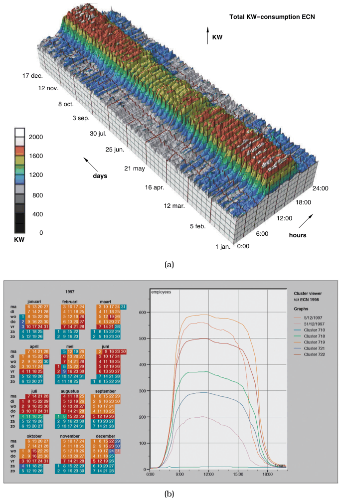
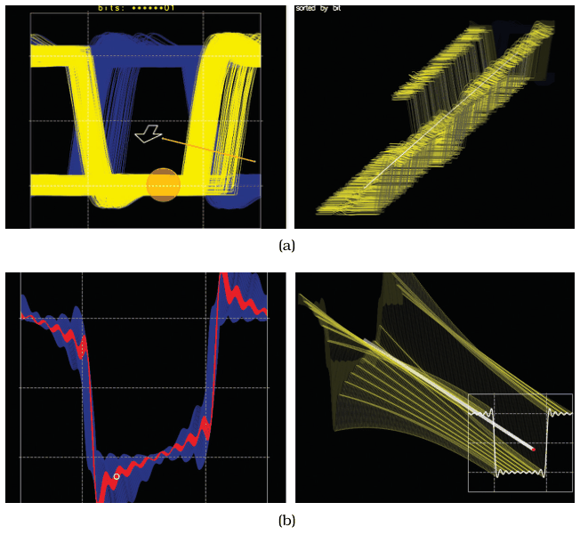

# 6.3.8 Justification and Alternatives

## The state of the question

Whether to use two or three channels for spatial position has been extensively studied. Computer-based vis began in the late 1980s with much enthusiasm for 3D; as the field matured, researchers better appreciated the costs of 3D for abstract datasets [p.150].

<!-- verbatim p.150 -->
> By now, the use of 3D for abstract data requires careful justification. In many cases, a different choice at the abstraction or visual encoding levels would be more appropriate.
<!-- /verbatim -->

## Example: Cluster–Calendar Time-Series Vis (a 2D alternative)

- **Data.** Two related sets of measurements in an office building, the number of people inside and the power used, measured over each day for one full year [pp.150-152].
- **The 3D version.** Each cross-section is one day's 2D time-series curve, extruded along a third axis with one curve per day (Figure 6.7(a)); only very large-scale patterns are visible, such as higher consumption during working hours and the seasonal difference between winter and summer [p.152].
- **The 2D redesign.** A different data abstraction, a hierarchical clustering of the daily curves in which the most similar curves are merged and each cluster is shown by its average curve, drawn as superimposed aggregate curves linked by shared colour to a calendar view (Figure 6.7(b)) [p.152].
- **What it gains.** No perspective distortion or occlusion, so curve heights compare directly at every time of day; the same seasonal patterns stay visible and smaller-scale ones appear, such as weekends and holidays, Fridays, days between holidays, and the Dutch Santa Claus day [p.152].
- **A caveat.** The cluster–calendar vis shows the number of people in the building, not the power consumption of the 3D extruded vis, so the two panels do not show the same attribute [p.152].

<!-- verbatim p.152 -->
> While unbridled enthusiasm for 3D is no longer common, there are indeed situations where its use is justifiable even for abstract data.
<!-- /verbatim -->

## Example: Layer-Oriented Time-Series Vis (careful 3D)

- **Data and start point.** Oscilloscope time-series data, first viewed as the traditional eye diagram, with the signal wrapped around in time as many overlapping traces [p.153].
- **The 3D move.** Users spread the traces apart with the metaphor of opening a drawer (Figure 6.8(a)) [p.153].
- **The constraints that justify it.** Layers are orthographically projected and always face the viewer, and navigation complexity is controlled by automatically zooming and framing as the user adjusts the drawer's orientation (Figure 6.8(b)) [p.153].

## Figures

-  **Figure 6.7** [p.151]. 3D versus 2D. (a) A 3D representation of this time-series dataset introduces the problems of occlusion and perspective distortion. (b) The linked 2D views of derived aggregate curves and the calendar allow direct comparison and show more fine-grained patterns. From [van Wijk and van Selow 99, Figures 1 and 4].
-  **Figure 6.8** [p.153]. Careful use of 3D. (a) The user can evolve the view from the traditional overlapping eye diagram with the metaphor of opening a drawer. (b) The interaction is carefully designed to avoid the difficulties of unconstrained 3D navigation. From [Lopez-Hernandez et al. 10, Figures 3 and 7].

## Related

- [Cluster–Calendar Time-Series Vis](../../idioms/cluster-calendar-time-series-vis.md): the first example as an idiom card [p.150]
- [Layer-Oriented Time-Series Vis](../../idioms/layer-oriented-time-series-vis.md): the second example as an idiom card [p.153]
- [12 Facet into Multiple Views](../../ch12-facet-into-multiple-views/node.md): linked views, discussed there [p.152]
- [6.3.9 Empirical Evidence](s06-03-09-empirical-evidence.md): the studies behind the shift away from 3D for abstract data [p.150]
- [13.4.1 Item Aggregation](../../ch13-reduce-items-attributes/s13-04-aggregate/s13-04-01-item-aggregation.md): aggregation, as in the cluster averages that replace individual curves [p.152]
