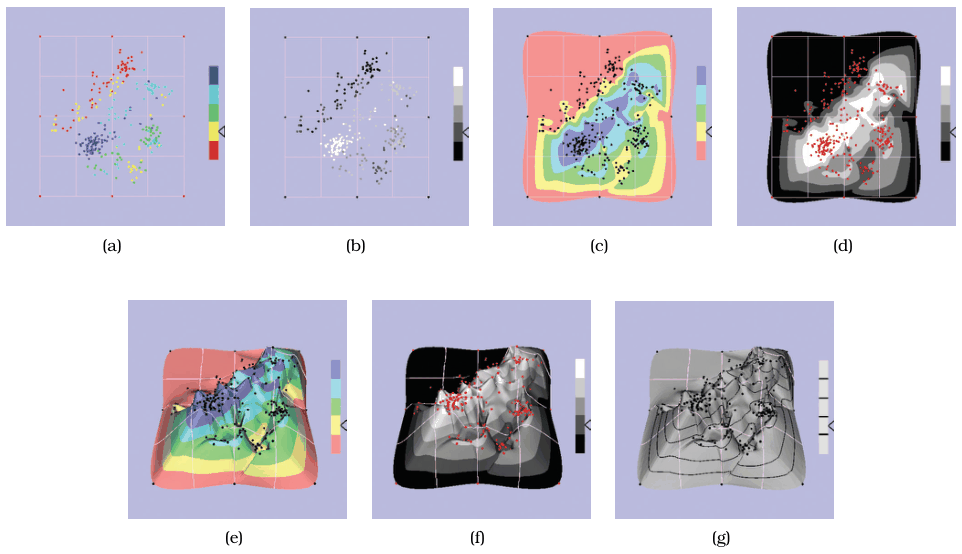

# 6.3.9 Empirical Evidence

## Preference is not performance

<!-- verbatim p.154 -->
> Empirical experiments are critical in understanding user performance, especially because of the well-documented dissociation between stated preference for 3D and actual task performance [Andre and Wickens 95].
<!-- /verbatim -->

## What the studies show

<!-- verbatim p.154 -->
> Experimental evidence suggests that 3D interfaces are better for shape understanding, whereas 2D are best for relative position tasks: those that require judging the precise distances and angles between objects [St. John et al. 01]. Most tasks involving abstract data do not benefit from 3D
<!-- /verbatim -->

An experiment comparing 3D cone trees with an equivalent 2D tree browser found that the 3D interaction had a significant time cost [p.154].

## Beware confounded comparisons

- **The trap.** When an experiment compares two interfaces that differ in many ways, it is dangerous to conclude that 3D made the difference just because the 3D one won; several earlier results read as 3D benefits were superseded by more careful designs that removed uncontrolled factors [p.154].
- **Data Mountain.** The 3D Data Mountain interface for organising web page thumbnails outperformed Internet Explorer's standard 2D Favorites display, but that left open whether the gain came from 3D or from the data mountain encoding, a spatial layout giving immediate access to every item in each pile. A later study of 3D and 2D versions of Data Mountain found no performance benefit for 3D [p.154].

## 3D landscapes versus points

- **The idiom.** A 3D information landscape computes the density of points on the plane as a derived attribute and builds a surface whose height follows it, like geographic terrain; other names are height field and terrain [p.154].
- **Contour plots.** A third alternative uses coloured bands for the outlines of specific heights, either alone as a 2D landscape or combined with 3D as a coloured landscape [p.154].
- **The appeal.** Proponents argue landscapes are familiar and engaging, and several systems have used them for high-dimensional data reduced to two synthetic dimensions [pp.154-155].
- **The finding.** A study found no benefit for 3D landscapes over simply showing the 2D point cloud. Of the seven encodings tested (Figure 6.9), points were far superior to landscapes for search and point estimation, and 2D landscapes beat 3D ones; a follow-up on a visual memory task gave similar results [pp.154-155].

## Figures

-  **Figure 6.9** [p.155]. Point-based displays were found to outperform information landscapes in an empirical study of visual encodings for dimensionally reduced data. (a) Colored points. (b) Grayscale points. (c) Colored 2D landscape. (d) Grayscale 2D landscape. (e) Colored 3D landscape. (f) Grayscale 3D landscape. (g) Height only. From [Tory et al. 07, Figure 1].

## Related

- [8.4.1 Isocontours](../../ch08-arrange-spatial-data/s08-04-scalar-fields-one-value/s08-04-01-isocontours.md): contour plots, discussed there [p.154]
- [13.4.3 Attribute Aggregation: Dimensionality Reduction](../../ch13-reduce-items-attributes/s13-04-aggregate/s13-04-03-attribute-aggregation-dimensionality-reduction.md): dimensionality reduction, discussed there [p.155]
- [6.3.7 Benefits of 3D: Shape Perception](s06-03-07-benefits-3d-shape-perception.md): the shape-understanding case where 3D does win [p.154]
- [4 Analysis: Four Levels for Validation](../../ch04-analysis-four-levels-validation/node.md): validation methods, including controlled experiments [p.154]
