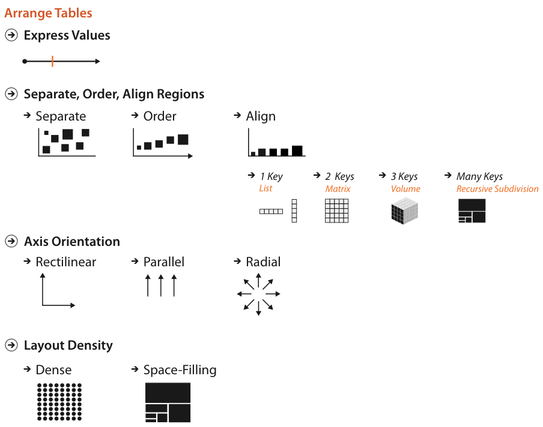

# 7.1 The Big Picture

## Scope

<!-- verbatim p.170 -->
> Figure 7.1 shows the four visual encoding design choices for how to arrange tabular data spatially. One is to express values. The other three are to separate, order, and align regions. The spatial orientation of axes can be rectilinear, parallel, or radial. Spatial layouts may be dense, and they may be space-filling.
<!-- /verbatim -->

A fifth arrangement choice, to use a given spatial layout, is not an option for nonspatial information; Chapter 8 covers it [p.170].

## The four design choices

Figure 7.1 lays the choices out as four groups [p.169]:

- **Express Values.** Quantitative values placed along an axis; Section 7.4 covers it [pp.169-170].
- **Separate, Order, Align Regions.** Separate, Order and Align, with alignment split by key count: 1 key as a list, 2 keys as a matrix, 3 keys as a volume, many keys as recursive subdivision; Section 7.5 covers it [p.169].
- **Axis Orientation.** Rectilinear, parallel or radial; Section 7.6 covers it [pp.169-170].
- **Layout Density.** Dense or space-filling; Section 7.7 covers it [pp.169-170].

## Figures

-  **Figure 7.1** [p.169]. Design choices for arranging tables.

## Related

- [7.3 Arrange by Keys and Values](s07-03-arrange-keys-values.md): how the key and value distinction bears on these choices [p.170]
- [7.4 Express: Quantitative Values](s07-04-express-quantitative-values.md): the express-values choice [p.170]
- [7.5 Separate, Order, and Align: Categorical Regions](s07-05-separate-order-align-categorical/node.md): the regions choice and its list, matrix, volume and subdivision alignments [p.170]
- [7.6 Spatial Axis Orientation](s07-06-spatial-axis-orientation/node.md): rectilinear, parallel and radial axes [p.170]
- [7.7 Spatial Layout Density](s07-07-spatial-layout-density.md): dense and space-filling layouts [p.170]
- [8 Arrange Spatial Data](../ch08-arrange-spatial-data/node.md): the fifth arrangement choice, using a given spatial layout [p.170]
