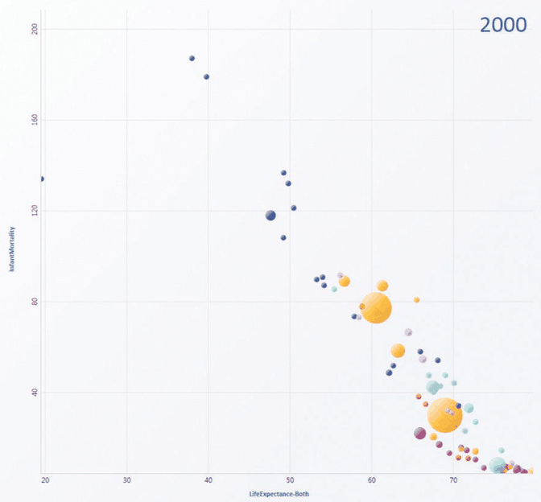
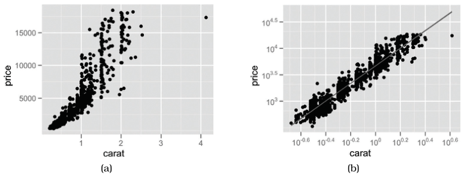

# 7.4 Express: Quantitative Values

## Expressing values with spatial position

<!-- verbatim p.171 -->
> Using space to express quantitative attributes is a straightforward use of the spatial position channel to visually encode data. The attribute is mapped to spatial position along an axis.
<!-- /verbatim -->

- **Simple case.** For a single value attribute, each item is a mark at some position along the axis; further attributes can go on the same mark through nonspatial channels such as colour and size [p.171].
- **Complex case.** A composite glyph is drawn, with internal structure from multiple marks; each mark sits in a subregion of the glyph that is encoded differently, so the glyph shows several attributes at once. Glyphs and views are discussed further in Section 12.4 [p.171].

## Scatterplots

<!-- verbatim p.171 -->
> The idiom of scatterplots encodes two quantitative value variables using both the vertical and horizontal spatial position channels, and the mark type is necessarily a point.
<!-- /verbatim -->

- **Tasks.** Effective for providing overviews and characterising distributions, and specifically for finding outliers and extreme values; highly effective for judging the correlation between two attributes [p.171].
- **Reading correlation.** Correlation becomes the easy perceptual judgement of whether the points form a line along the diagonal: the stronger the correlation, the closer the points fall to a perfect diagonal; an upward slope is positive, downward negative. Figure 7.2 is strongly negatively correlated [pp.171-172].
- **Transformations.** Derived attributes can shed more light: log-scaling diamond price and weight (Figure 7.3) yields strongly positively correlated attributes [p.172].
- **Regression line.** When judging correlation is the primary task, a calculated regression line is often superimposed on the raw points, as in Figures 7.3(b) and 1.3 [p.173].
- **Extra attributes.** Scatterplots are often augmented with colour coding for another attribute; size coding can add yet another, and size-coded scatterplots are sometimes called bubble plots. Figure 7.2 plots infant mortality against life expectancy, with colour for country and size for population [pp.172-173].
- **Scalability.** Limited by the need to distinguish points, so suited to dozens or hundreds of items [p.173].

The book's what–why–how summary is on the Scatterplots card; every later example in the book ends with a similar summary table [p.173].

## Figures

-  **Figure 7.2** [p.172]. Scatterplot. Each point mark represents a country, with horizontal and vertical spatial position encoding the primary quantitative attributes of life expectancy and infant mortality. The color channel is used for the categorical country attribute and the size channel for quantitative population attribute. From [Robertson et al. 08, Figure 1c].
-  **Figure 7.3** [p.173]. Scatterplots. (a) Original diamond price/carat data. (b) Derived log-scale attributes are highly positively correlated. From [Wickham 10, Figure 10].

## Related

- [Scatterplots](../idioms/scatterplots.md): the idiom box, use conditions and plotting code [p.173]
- [12.4 Partition into Views](../ch12-facet-into-multiple-views/s12-04-partition-into-views/node.md): further discussion of glyphs and views [p.171]
- [7.5.2 Matrix Alignment: Two Keys](s07-05-separate-order-align-categorical/s07-05-02-matrix-alignment-two-keys.md): scatterplot matrices, for more than two value attributes [p.171]
