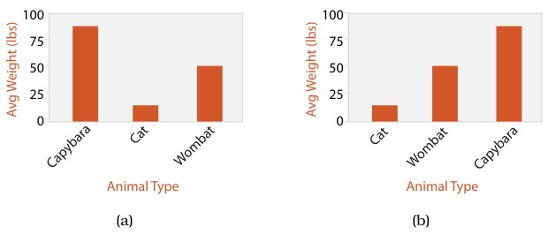
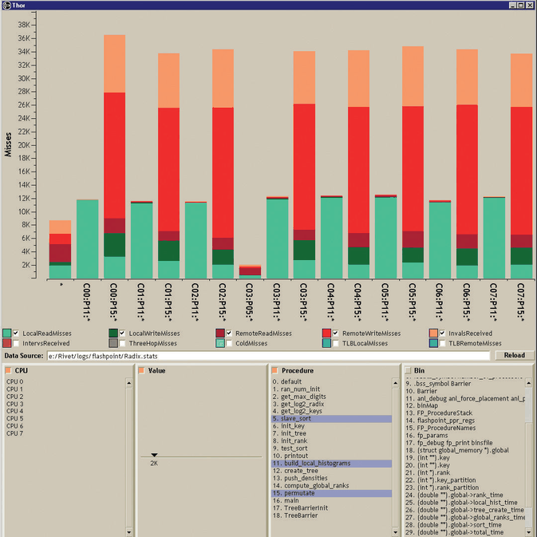
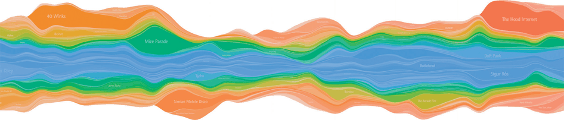
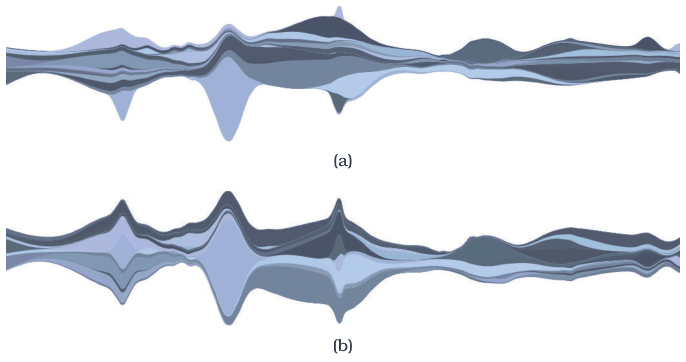
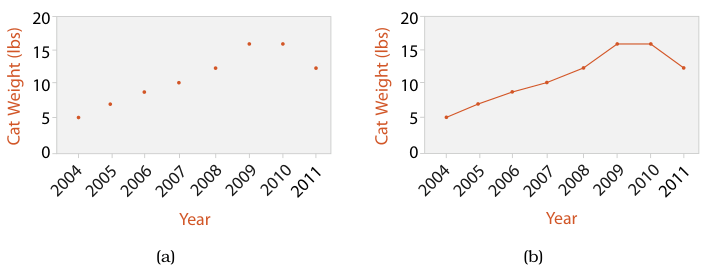
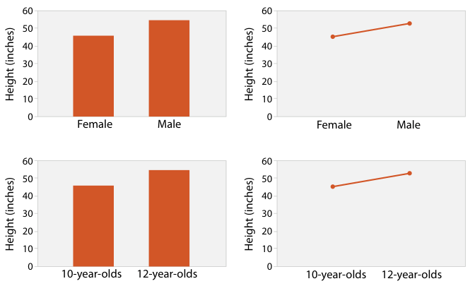
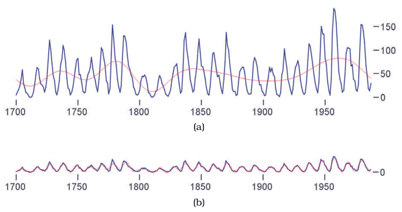

# 7.5.1 List Alignment: One Key

## One region per item

<!-- verbatim p.174 -->
> With a single key, separating into regions using that key yields one region per item. The regions are frequently arranged in a one-dimensional list alignment, either horizontal or vertical.
<!-- /verbatim -->

The view still covers a 2D area: the aligned list stretches across one spatial dimension, and the region showing the values stretches across the other [p.174].

## Bar charts

- **Encoding.** A line mark per level of a categorical key attribute, with a quantitative value attribute on one spatial position channel; each mark sits in its own region, and all are aligned within a common frame so the highest-accuracy aligned position channel is used rather than the lower-accuracy unaligned one [p.175].
- **Ordering.** Alphabetical order (Figure 7.4(a)) is formally a derived attribute; this frequent default makes lookup by name easy but often hides meaningful patterns. Ordering by the value attribute itself (Figure 7.4(b)) makes dataset trends easier to see [p.175].
- **Tasks.** Well suited to looking up individual values [p.175].
- **Scalability.** White space must separate the bars so they stay distinguishable. Several to dozens of bars is common; a full-screen 1000-pixel chart could handle up to hundreds of bars, but not thousands [p.175].

## Stacked bar charts

- **Encoding.** Each bar is a composite glyph of sub-bars stacked vertically; the full glyph length still encodes a value and each subcomponent encodes a length-encoded value. Glyphs are listed by a primary key; a secondary key builds the glyph's vertical structure. This is list alignment with more than one key, and it supports lookup by either key [p.176].
- **Colour.** Subcomponents are typically coloured by the stacking key; they abut end to end at the same width, so without different colouring they would not be distinguishable, and black outlines with white fill would make comparing subcomponents across bars considerably harder [p.176].
- **Example.** Figure 7.5, the Thor memory profiler: bars by processor–procedure combination, stacked and coloured by cache-miss type, full bar height for all cache misses [p.176].
- **Alignment matters.** The lowest component and the full bar can be read against the flat baseline (position against a common scale); the other components are harder to compare across bars because their starting points are not aligned. So the stacking order, as well as the bar order, shapes which patterns are visible [pp.176-177].
- **Scalability.** Similar to bar charts along the main axis, but the stacking key works with several categories, up to around one dozen [p.177].
- **Absolute versus relative.** Stacked bars are typically used for absolute data; a normalized stacked bar chart shows relative proportions of parts to a whole, each bar carrying the same information as an entire pie chart (Section 7.6.3) [p.177].

## Streamgraphs

- **Encoding.** A more complex generalised stacked graph: derived geometry that emphasises the continuity of horizontal layers (one per artist in a music-listening history), rather than vertical glyphs that would emphasise behaviour at one point in time [p.178].
- **Global layout.** The derived geometry comes from a global computation, whereas individual glyphs need only calculations about their own region [p.178]. The silhouette is deliberately organic rather than using the horizontal axis as baseline, and the shape trades off the external silhouette, each layer's deviation from the baseline and the wiggle in the baseline [pp.178-179].
- **Layer order.** Computed by an algorithm that emphasises a derived value: Figure 7.7 contrasts ordering by volatility of popularity with onset time [p.179].
- **Scalability.** Streamgraphs scale to more categories than stacked bar charts, because most layers do not span the whole timeline [p.179].
- **Orientation.** Both streamgraphs and stacked bar charts can run vertically or horizontally [p.178].

## Dot charts and line charts

- **Dot charts.** One quantitative attribute by spatial position against one categorical attribute, using point marks rather than a bar chart's line marks; Figure 7.8(a) plots a cat's weight by year [p.180]. A dot chart is like a scatterplot with one categorical axis, or like a bar chart with point marks; the second view matches its standard use more closely [p.180].
- **Terminology.** "Dot chart" and "dot plot" are sometimes synonyms and are overloaded. The book's dot chart is Cleveland's idiom; Wilkinson's dot plot shows distributions much like histograms (Section 13.4.1) [p.180].
- **Line charts.** Dot charts plus connection marks between the points; in Figure 7.8(b) the connecting lines emphasise a rising weight trend and the loss after a 2010 diet [p.180].

### What separates bar, dot and line charts

All three show one value attribute and one key attribute in a rectilinear layout, are often augmented with a second categorical attribute via colour or shape, and use one spatial direction for the quantitative value and the other for the key [p.181].

<!-- verbatim p.181 -->
> The difference is that line charts also use connection marks to emphasize the ordering of the items along the key axis by explicitly showing the relationship between one item and the next. Thus, they have a stronger implication of trend relationships, making them more suitable for the abstract task of spotting trends.
<!-- /verbatim -->

<!-- verbatim p.181 -->
> Line charts should be used for ordered keys but not categorical keys. A line chart used for categorical data violates the expressiveness principle, since it visually implies a trend where one cannot exist.
<!-- /verbatim -->

The implication can override common knowledge. In Zacks and Tversky's study (Figure 7.9), line charts of quantitative age data drew appropriate trend answers, bar charts drew equally appropriate discrete comparisons, but line charts of categorical gender data drew inappropriate trend answers such as "The more male a person is, the taller he/she is" [p.181].

### Aspect ratio and banking to 45°

- **The question.** A line chart's aspect ratio (width to height of the whole plot) matters; standard packages often default to a square or other fixed size, which in many cases hides dataset structure [p.181].
- **The principle.** Angle judgement is more accurate at exact diagonals than at arbitrary directions: 43° is visibly off 45°, but 20° cannot be told from 22° [p.181].
- **Banking to 45°.** Computes the aspect ratio that maximises the number of line segments falling close to the diagonal [p.182].
- **Multiscale banking to 45°.** Finds a set of informative aspect ratios by analysing the line graph in the frequency domain, with the derived power spectrum. In the sunspot data (Figure 7.10) a ratio near 4 shows low-frequency oscillation in cycle maxima, and one near 22 shows steep onsets with gradual decay; a red locally weighted regression line shows the trend [p.182].

## Figures

-  **Figure 7.4** [p.175]. Bar chart. The key attribute, species, separates the marks along the horizontal spatial axis. The value attribute, weight, expresses the value with aligned vertical spatial position and line marks. (a) Marks ordered alphabetically according to species name. (b) Marks ordered by the weight attribute used for bar heights.
-  **Figure 7.5** [p.177]. Stacked bar chart. The Thor memory profiler shows cache misses stacked and colored by miss type. From [Bosch 01, Figure 4.1].
-  **Figure 7.6** [p.178]. Streamgraph of music listening history. From [Byron and Wattenberg 08, Figure 0].
-  **Figure 7.7** [p.179]. Streamgraphs with layers ordered by different derived attributes. (a) Volatility of artist’s popularity. (b) Onset time when artist’s music of first gained attention. From [Byron and Wattenberg 08, Figure 15].
-  **Figure 7.8** [p.180]. Line charts versus dot charts. (a) Dot charts use a point mark to show the value for each item. (b) Line charts use point marks connected by lines between them.
-  **Figure 7.9** [p.182]. Bar charts and line charts both encode a single attribute. Bar charts encourage discrete comparisons, while line graphs encourage trend assessments. Line charts should not be used for categorical data, as in the upper right, because their implications are misleading. After [Zacks and Tversky 99, Figure 2].
-  **Figure 7.10** [p.183]. Sunspot cycles. The multiscale banking to 45◦idiom exploits our orientation resolution accuracy at the diagonal. (a) An aspect ratio close to 4 emphasizes low-frequency structure. (b) An aspect ratio close to 22 shows higher-frequency structure: cycle onset is mostly steeper than the decay. From [Heer and Agrawala 06, Figure 5].

## Related

- [Bar Charts](../../idioms/bar-charts.md): idiom box, use conditions and plotting code [p.176]
- [Stacked Bar Charts](../../idioms/stacked-bar-charts.md): idiom box, use conditions and plotting code [p.178]
- [Streamgraphs](../../idioms/streamgraphs.md): idiom box, use conditions and plotting code [p.179]
- [Dot Charts](../../idioms/dot-charts.md): idiom box, use conditions and plotting code [p.180]
- [Line Charts](../../idioms/line-charts.md): idiom box, use conditions and plotting code [p.181]
- [7.6.3 Radial Layouts](../s07-06-spatial-axis-orientation/s07-06-03-radial-layouts.md): normalized stacked bar charts and their comparison with pie charts [p.177]
- [13.4.1 Item Aggregation](../../ch13-reduce-items-attributes/s13-04-aggregate/s13-04-01-item-aggregation.md): histograms, the distribution idiom that Wilkinson's dot plot resembles [p.180]
