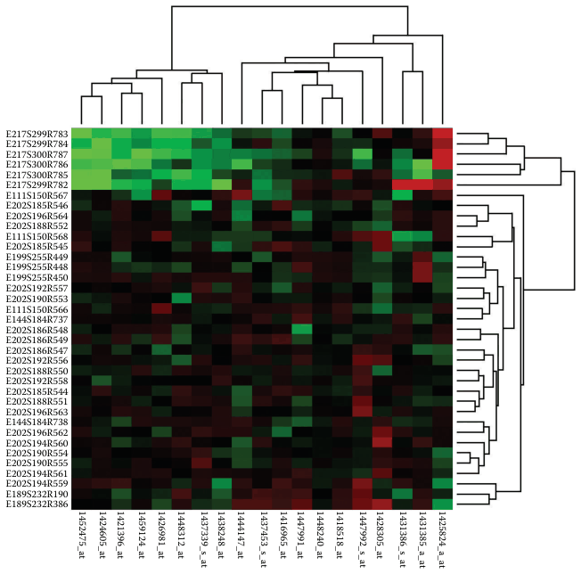

# 7.5.2 Matrix Alignment: Two Keys

## One cell per pair of key levels

<!-- verbatim p.182 -->
> Datasets with two keys are often arranged in a two-dimensional matrix alignment where one key is distributed along the rows and
<!-- /verbatim -->

<!-- verbatim p.183 -->
> the other along the columns, so a rectangular cell in the matrix is the region for showing the item values.
<!-- /verbatim -->

## Heatmaps

<!-- verbatim p.183 -->
> The idiom of heatmaps is one of the simplest uses of the matrix alignment: each cell is fully occupied by an area mark encoding a single quantitative value attribute with color.
<!-- /verbatim -->

- **Example.** Common with bioinformatics data. In Figure 7.11 the keys are genes and experimental conditions and the value is a gene's activity level in a condition, measured by microarray. Genes are categorical; conditions may be categorical or ordered, for example successive times [p.183].
- **Colour.** The heatmap uses a diverging red–green colormap, conventional in genomics because of how optical microarray sensors record fluorescence; this choice causes problems for colourblind users [p.183].
- **Benefit.** Encoding quantitative data with colour on small area marks is very compact, so heatmaps give overviews with high information density [pp.183-184].
- **Scalability.** Marks several pixels on a side make a 200 × 200 matrix of 40,000 items easy; the limit is one-pixel marks, one million items. So each key can have hundreds of levels, but only 3 to 11 levels of the quantitative attribute are distinguishable, because colour perception is limited in small noncontiguous regions [p.184]. The book's screen-space scalability figures all assume a 1000 × 1000 display [p.184].

## Cluster heatmaps and matrix reordering

- **Matrix reordering.** The cluster heatmap combines the heatmap with matrix reordering, where two attributes are reordered in combination. The goal is to group similar cells to check for large-scale patterns between both attributes, just as reordering one attribute shows trends across it [p.185]. Synonyms include matrix permutation, seriation, ordination, biclustering, co-clustering and two-mode clustering [p.185].
- **Composition.** A heatmap juxtaposed with two dendrograms showing the derived cluster hierarchies used in the reordering [p.185].
- **Cluster hierarchy.** It records the whole history of an iterative clustering: each leaf is a single-item cluster, interior nodes record the order in which clusters merge by similarity, and the root is the cluster of all items [p.185].
- **Dendrogram.** A visual encoding of tree data with the leaves aligned, so interior branch heights are easy to compare. Traversing the leaves gives the final row and column order [p.185].

## Scatterplot matrix (SPLOM)

<!-- verbatim p.185 -->
> A scatterplot matrix (SPLOM) is a matrix where each cell contains an entire scatterplot chart. A SPLOM shows all possible pairwise combinations of attributes, with the original attributes as the rows and columns.
<!-- /verbatim -->

- **Complex cells.** Unlike a heatmap, whose cells each show one value, each SPLOM cell shows a complete chart [p.185].
- **Derived key.** The key is the same for rows and columns: an index listing all the original attributes. The matrix could be reordered by any ordered attribute [p.185].
- **Layout.** Usually only the lower or upper triangle is shown rather than the redundant full square; the diagonal cells, which would plot an attribute against itself, are typically omitted and often hold axis labels instead [p.186].
- **Tasks.** Heavily used for finding correlations, trends and outliers, as with their constituent scatterplots [p.186].
- **Scalability.** Each cell needs about 100 × 100 pixels at least to plot every item discernibly, so around one dozen attributes and hundreds of items [p.186].
- **Extensions.** Many have been proposed, including scagnostics (Section 15.3) and the compact heatmap-style overview of Section 15.5 [p.186]. SPLOMs are an example of small-multiple views (Section 12.3.2) [p.185].

## Figures

-  **Figure 7.11** [p.184]. Cluster heatmap. A heatmap provides a compact summary of a quantitative value attribute with 2D matrix alignment by two key attributes and small area marks colored with a diverging colormap. The cluster heatmap includes trees drawn on the periphery showing how the matrix is ordered according to the derived data of hierarchical clusterings on its rows and columns.

## Related

- [Heatmaps](../../idioms/heatmaps.md): idiom box, use conditions and plotting code [p.185]
- [Cluster Heatmaps](../../idioms/cluster-heatmaps.md): idiom box, use conditions and plotting code [p.185]
- [Scatterplot Matrix (SPLOM)](../../idioms/scatterplot-matrix-splom.md): idiom box, use conditions and plotting code [p.186]
- [10.3 Colormaps](../../ch10-map-color-other-channels/s10-03-colormaps/node.md): colormap design for heatmap cells [p.183]
- [10.3.4 Colorblind-Safe Colormap Design](../../ch10-map-color-other-channels/s10-03-colormaps/s10-03-04-colorblind-safe-colormap-design.md): the problem with the red–green genomics convention [p.183]
- [13.4.1 Item Aggregation](../../ch13-reduce-items-attributes/s13-04-aggregate/s13-04-01-item-aggregation.md): hierarchical clustering in more depth [p.185]
- [12.3.2 Share Data: All, Subset, None](../../ch12-facet-into-multiple-views/s12-03-juxtapose-coordinate-views/s12-03-02-share-data-all-subset.md): small multiples, of which SPLOMs are an example [p.185]
- [15.3 Graph-Theoretic Scagnostics](../../ch15-analysis-case-studies/s15-03-graph-theoretic-scagnostics.md): a SPLOM extension using derived attributes [p.186]
- [15.5 Hierarchical Clustering Explorer](../../ch15-analysis-case-studies/s15-05-hierarchical-clustering-explorer.md): a compact heatmap-style SPLOM overview [p.186]
- [9.3 Matrix Views](../../ch09-arrange-networks-trees/s09-03-matrix-views.md): adjacency matrices, which use the same 2D alignment for networks [p.183]
