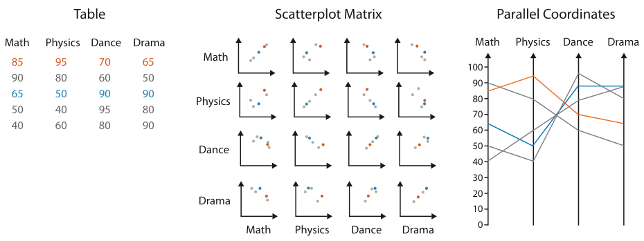
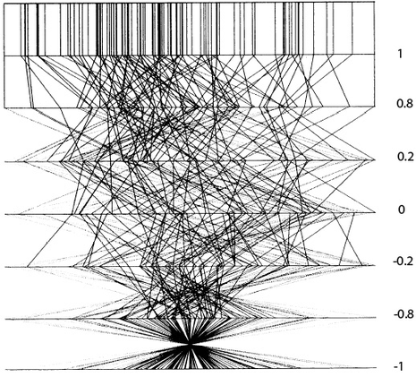
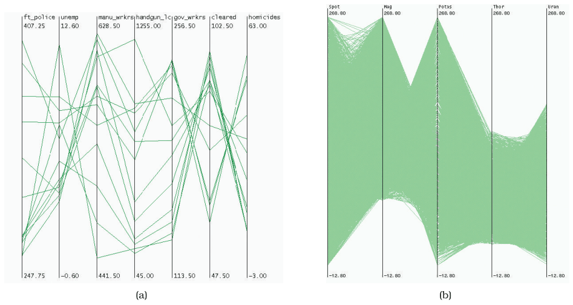

# 7.6.2 Parallel Layouts

## The limit of perpendicular axes

- A scatterplot's perpendicular axes can show only two attributes with high-precision planar position; even the low-precision third spatial dimension raises that only to three [p.187].
- Nonspatial channels can add more, but channel inseparability limits how many can be combined effectively in one view, and many tables have far more than three quantitative attributes [p.187].

## Parallel coordinates

<!-- verbatim p.187 -->
> The idiom of parallel coordinates is an approach for visualizing many quantitative attributes at once using spatial position.
<!-- /verbatim -->

- **Encoding.** The axes are parallel rather than perpendicular. An item is a jagged line (a polyline) that zigzags through the axes, crossing each exactly once at the item's value for that attribute. Figure 7.12 shows one small table as both a SPLOM and parallel coordinates [p.187].
- **Correlation.** An original motivation was checking correlation. Between neighbouring axes, mostly parallel segments mean high positive correlation, segments crossing at a single spot mean high negative correlation, and a mix of crossing angles means uncorrelated (Figure 7.13) [pp.187-188].

<!-- verbatim p.188 -->
> However, in practice, SPLOMs are typically easier to use for the task of finding correlation.
<!-- /verbatim -->

- **Other tasks.** More often used for overview over all attributes, finding the range of individual attributes, selecting a range of items and outlier detection; Figure 7.14(a) shows a broad range on one axis, a narrow one on another and an outlier on a third [p.188].
- **Value precision.** Two spatial dimensions are used, one per axis and one to lay out the axes. Many quantitative values can be discriminated because planar position is high-precision, roughly in proportion to the axes' pixel extent [p.188].
- **Attribute count.** Moderate: dozens is common. Width grows with each axis, so many-attribute displays are wide flat rectangles, and there must be room between axes to see crossing or parallel patterns [pp.188-189].
- **Item count.** Hundreds of items, not thousands: overplotting causes occlusion that yields very little information. Figure 7.14 contrasts 13 items and 7 attributes (effective) with over 16,000 items and 5 attributes (only axis minima and maxima readable) [p.189]. Section 13.4.1 covers hierarchical parallel coordinates for larger datasets [p.189].
- **Axis order.** The visible patterns are pairwise between neighbouring axes, so the crucial limitation is choosing axis order. Most implementations allow interactive reordering, but systematically trying all orders is prohibitive as the axis count grows [pp.189-190].
- **Training.** First-time users lack intuitions for the patterns, which must be taught explicitly [p.190].
- **Multiple views.** Often one of several views of the same dataset rather than the only encoding. Pairing it with familiar views such as scatterplots accelerates learning, especially with linked highlighting between dots and lines [p.190].

## Figures

-  **Figure 7.12** [p.188]. Comparison of scatterplot matrix and parallel coordinate idioms for a small data table. After [McGuffin 14].
-  **Figure 7.13** [p.189]. Parallel coordinates were designed to show correlation between neighboring axes. At the top, parallel lines show perfect positive correlation. At the bottom, all of the lines cross over each other at a single spot in between the two axes, showing perfect negative correlation. In the middle, the mix of crossings shows uncorrelated data. From [Wegman 90, Figure 3].
-  **Figure 7.14** [p.190]. Parallel coordinates scale to dozens of attributes and hundreds of items, but not to thousands of items. (a) Effective use with 13 items and 7 attributes. (b) Ineffective use with over 16,000 items and 5 attributes. From [Fua et al. 99, Figures 1 and 2].

## Related

- [Parallel Coordinates](../../idioms/parallel-coordinates.md): idiom box, use conditions and plotting code [p.191]
- [Scatterplot Matrix (SPLOM)](../../idioms/scatterplot-matrix-splom.md): the easier idiom for finding correlation [p.188]
- [6.3 No Unjustified 3D](../../ch06-rules-thumb/s06-03-no-unjustified-3d/node.md): drawbacks of a third spatial dimension for abstract data [p.187]
- [5.5.3 Separability](../../ch05-marks-channels/s05-05-channel-effectiveness/s05-05-03-separability.md): separable versus integral channels, which limit nonspatial additions [p.187]
- [Hierarchical Parallel Coordinates](../../idioms/hierarchical-parallel-coordinates.md): scaling parallel coordinates to larger datasets [p.189]
- [13.4.1 Item Aggregation](../../ch13-reduce-items-attributes/s13-04-aggregate/s13-04-01-item-aggregation.md): the section on hierarchical parallel coordinates [p.189]
- [12.3 Juxtapose and Coordinate Views](../../ch12-facet-into-multiple-views/s12-03-juxtapose-coordinate-views/node.md): multiple views with linked highlighting [p.190]
- [12.4 Partition into Views](../../ch12-facet-into-multiple-views/s12-04-partition-into-views/node.md): further multiple-view design choices [p.190]
