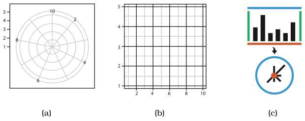
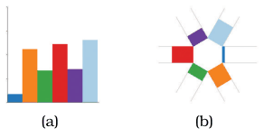
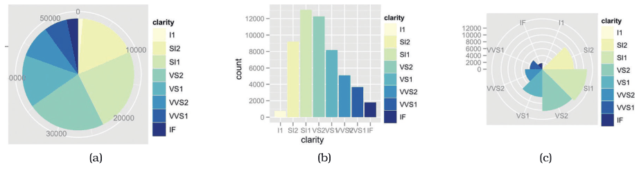
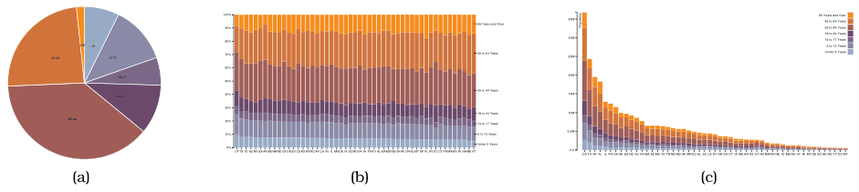
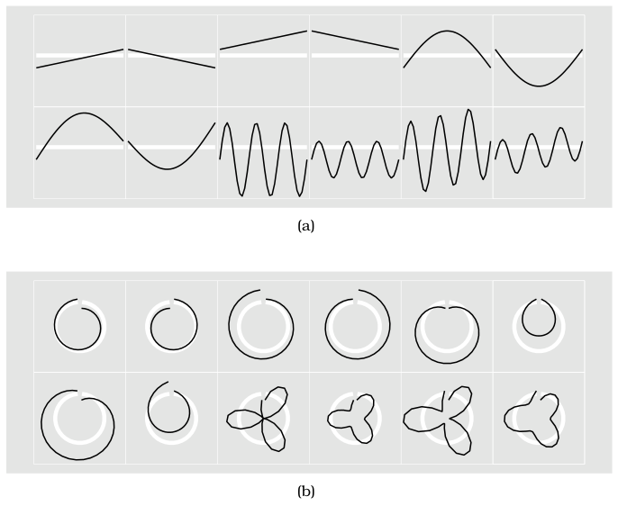

# 7.6.3 Radial Layouts

## Polar coordinates

<!-- verbatim p.191 -->
> In a radial spatial layout, items are distributed around a circle using the angle channel in addition to one or more linear spatial channels, in contrast to the rectilinear layouts that use only two spatial channels.
<!-- /verbatim -->

- The natural coordinate system is polar: one dimension is an angle from a starting line, the other a distance from a centre point (Figure 7.15) [p.191].
- Mathematically, rectilinear and radial layouts are equivalent under a transformation that collapses one bounding line to the centre point and wraps the other into a circle [p.191].

## Why radial is not perceptually equivalent

The change of channel has two consequences: the angle channel is perceived less accurately than rectilinear spatial position, and it is inherently cyclic (nonmonotonic), because start and end coincide [p.191].

<!-- verbatim p.191 -->
> Radial layouts may be more effective than rectilinear ones in showing the periodicity of patterns, but encoding nonperiodic data with the periodic channel of angle
<!-- /verbatim -->

<!-- verbatim p.192 -->
> may be misleading. Radial layouts imply an asymmetry of importance between the two attributes and would be inappropriate when the two attributes have equal importance.
<!-- /verbatim -->

## Radial bar charts

The same five-attribute dataset appears as a rectilinear bar chart and as a radial bar chart (Figure 7.16); both encode a quantitative attribute with line marks and the length channel, and differ only in axis orientation [p.192].

## Pie charts and polar area charts

- **Pie charts.** The most commonly used radial statistical graphic; a single attribute encoded with area marks and the angle channel [p.193].
- **The problem.** Pie charts are clearly problematic by the channel properties of Section 5.5: angle judgements on area marks are less accurate than length judgements on line marks, and wedges widen from centre to edge, making area judgement particularly difficult. A bar chart of the same data needs only high-accuracy position along a common scale (Figure 7.17) [p.193].
- **Polar area charts.** A more direct equivalent of a bar chart in polar coordinates: one quantitative attribute, with wedge length varied like bar length rather than angle varied as in a pie. Synonyms are rose plot and coxcomb plot, popularised by Florence Nightingale [p.193].
- **Colour.** The Figure 7.17 instances redundantly colour each mark for legibility, but the idioms work without colour [p.193].

## Part-to-whole: pie versus normalized stacked bar

- **Pie's useful property.** Showing the relative contribution of parts to a whole: wedge angles sum to 360°, matching normalised data such as percentages summing to 100% [p.194].
- **Not unique to pies.** A single bar of a normalized stacked bar chart shows the same with the more accurate length channel. A normalized stacked bar chart stretches each stacked bar to the maximum length, showing percentages rather than absolute counts [p.194].
- **Channel accuracy.** Only the lowest sub-bar is aligned across bars, so it gets position against a common frame; the others use unaligned position, less accurate than aligned position but still more accurate than angle [p.194].
- **Figure 7.18.** One pie of US population by age compared with a normalized stacked bar chart and a stacked bar chart for all 50 states; a whole pie equals one bar, so the equivalent display would be a list or matrix of pies [p.194].
- **Space and scale.** Pies need somewhat more area because angle is lower precision than length, and a square rather than a long narrow rectangle. Both pies and normalized stacked bar charts are limited to about a dozen categories [p.194].

## Rectilinear versus radial: evidence

- **Glyphmaps.** Over 12 iconic time-series datasets, rectilinear layouts better show the differences between linear and nonlinear trends, and radial layouts better show cyclic patterns (Figure 7.19) [pp.195-196].
- **Diehl et al.** A first empirical study, on memorising object positions for a few seconds, compared rectilinear grids of rows and columns with radial grids of sectors and rows, without investigating periodicity. Rectilinear layouts generally outperformed radial ones in speed and tended to in accuracy [pp.195-196].

<!-- verbatim p.196 -->
> However, their results also suggest the use of radial layouts can be justified when one attribute is more important than the other. In this case, the more important attribute should be encoded in the sectors and the less important attribute in the rings.
<!-- /verbatim -->

## Figures

-  **Figure 7.15** [p.192]. Layout coordinate systems. (a) Radial layouts use polar coordinates, with one spatial position and one angle channel. (b) Rectlinear layouts use two perpendicular spatial position channels. After [Wickham 10, Figure 8]. (c) Transforming rectilinear to radial layouts maps two parallel bounding lines to a point at the center and a circle at the perimeter.
-  **Figure 7.16** [p.192]. Radial versus rectilinear layouts. (a) Rectilinear bar chart. (b) Radial bar chart. After [Booshehrian et al. 11, Figure 4].
-  **Figure 7.17** [p.193]. Pie chart versus bar chart accuracy. (a) Pie charts require angle and area judgements. (b) Bar charts require only high-accuracy length judgements for individual items. (c) Polar area charts are a more direct equivalent of bar charts, where the length of each wedge varies like the length of each bar. From [Wickham 10, Figures 15 and 16].
-  **Figure 7.18** [p.194]. Relative contributions of parts to a whole. (a) A single pie chart shows the relative contributions of parts to a whole, such as percentages, using area judgements. (b) Each bar in a normalized stacked bar chart also shows the relative contributions of parts to a whole, with a higher-accuracy length encoding. (c) A stacked bar chart shows the absolute counts in each bar, in contrast to the percentages when each bar is normalized to the same vertical length. From <http://bl.ocks.org/mbostock/3887235>, <http://bl.ocks.org/mbostock/3886208>, <http://bl.ocks>. org/mbostock/3886394.
-  **Figure 7.19** [p.196]. Glyphmaps. (a) Rectilinear layouts are more effective at showing the differences between linear and nonlinear trends. (b) Radial layouts are more effective at showing cyclic patterns. From [Wickham et al. 12, Figure 3].

## Related

- [Radial Bar Charts](../../idioms/radial-bar-charts.md): idiom box, use conditions and plotting code [p.193]
- [Pie Charts](../../idioms/pie-charts.md): idiom box, use conditions and plotting code [p.195]
- [Polar Area Charts](../../idioms/polar-area-charts.md): idiom box, use conditions and plotting code [p.195]
- [Normalized Stacked Bar Charts](../../idioms/normalized-stacked-bar-charts.md): idiom box, use conditions and plotting code [p.195]
- [5.5 Channel Effectiveness](../../ch05-marks-channels/s05-05-channel-effectiveness/node.md): the channel properties that make pie charts problematic [p.193]
- [7.5.1 List Alignment: One Key](../s07-05-separate-order-align-categorical/s07-05-01-list-alignment-one-key.md): stacked glyphs and stacked bar charts [p.194]
- [Angle Channel](../../idioms/angle-channel.md): the angle channel that radial layouts add [p.191]
