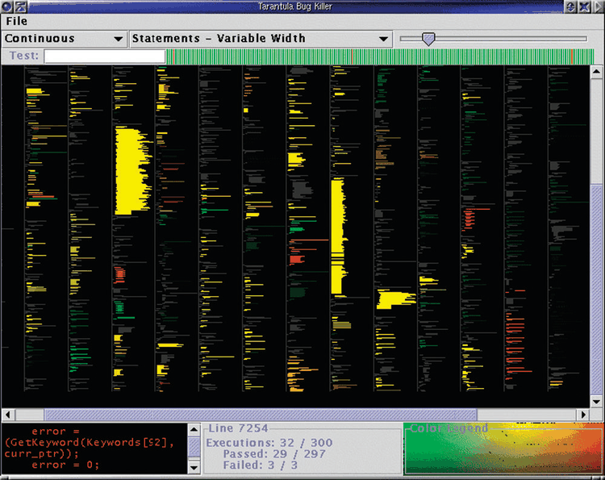

# 7.7 Spatial Layout Density

## Dense or sparse, space-filling or not

Another spatial design choice is whether a layout is dense or sparse; a related but not identical choice is whether it is space-filling [p.196].

### 7.7.1 Dense

<!-- verbatim p.197 -->
> A dense layout uses small and densely packed marks to provide an overview of as many items as possible with very high information density.
<!-- /verbatim -->

- **Synonym.** Pixel-oriented [p.197].
- **Channels.** A maximally dense layout has one-pixel point marks and one-pixel-wide line marks, so only planar position and colour are usable; size, shape, tilt, curvature and other channels needing more room are not available [p.197].
- **VisDB.** Section 15.4 is a case study of VisDB, a dense display for multidimensional tables using point marks [p.197].

#### Dense software overviews (Tarantula)

- **The display.** Tarantula visualises software test coverage (Figure 7.20). Dense line-mark displays have become popular for source-code overviews: mark arrangement follows the order and length of the code lines, and colour encodes an attribute of interest [p.197].
- **Overview.** Most of the screen is a dense overview of one-pixel-tall lines coloured by whether they passed, failed or had mixed results in a test suite. The code is illegible, but preserved indentation and line length give landmarks that help orientation. The long list wraps into multiple columns [p.197].
- **Detail.** A small lower-left view shows a few lines at legible size with the same colour coding and spatial position [p.197].
- **Scale.** Around ten thousand lines of code, with about one thousand vertical pixels and ten columns [p.197].
- **Data.** Source code is highly structured text, divided into numbered lines with a multiscale hierarchy of packages, files and methods. Many tasks require reading snippets line by line in the original order, so reordering lines within a method would be inappropriate; but usually only a few units need reading at once, which makes a dense overview plus a legible detail view reasonable [pp.197-198].
- **Derived attributes.** Each test has a categorical pass or fail result (the book prints "test or fail") and is tied to specific lines. Tarantula derives two quantitative attributes: brightness encodes the percentage of coverage (dark is low), and hue the relative percentage of passed versus failed tests [p.198].
- **A system, not one idiom.** Tarantula uses multiple idioms, so its what–why–how analysis includes faceting and reduction choices from later chapters [p.198].

### 7.7.2 Space-Filling

<!-- verbatim p.199 -->
> A space-filling layout has the property that it fills all available space in the view, as the name implies.
<!-- /verbatim -->

- **Forms.** Any of the three geometric possibilities above can be space-filling. They typically use area marks for items or containment marks for relationships, rather than line, connection or point marks [p.199].
- **Examples.** With containment marks: the treemaps in Figures 9.8 and 9.9(f) and the nested circle tree in Figure 9.9(e). With area marks and spatial position: the concentric circle tree in Figure 9.9(d) and the icicle tree in Figure 9.9(b) [p.199].
- **Advantages.** They maximise room for colour coding, so coloured regions are more likely to be perceptually salient, and an item's space is often large enough to embed a label [p.199].
- **Disadvantage.** The designer cannot use white space, which graphic design guidelines use for readability, emphasis, relative importance and visual balance [p.199].
- **Not the same as efficient.** Space-filling layouts typically aim for high information density, but filling space does not guarantee using it efficiently. Technically, space-filling means the layout's total area equals the view's available area; other space-efficiency metrics exist, such as, for trees, the size of the smallest nodes and the area of node labels [p.200].

## Figures

-  **Figure 7.20** [p.198]. Tarantula shows a dense overview of source code with lines color coded by execution status of a software test suite. From [Jones et al. 02, Figure 4].

## Related

- [Dense Software Overviews](../idioms/dense-software-overviews.md): Tarantula's idiom box with its encode, facet and reduce fields [p.199]
- [15.4 VisDB](../ch15-analysis-case-studies/s15-04-visdb.md): a dense display of multidimensional tables using point marks [p.197]
- [12.3 Juxtapose and Coordinate Views](../ch12-facet-into-multiple-views/s12-03-juxtapose-coordinate-views/node.md): the overview and detail choice Tarantula uses [p.198]
- [9.5 Containment: Hierarchy Marks](../ch09-arrange-networks-trees/s09-05-containment-hierarchy-marks.md): the space-filling tree layouts of Figures 9.8 and 9.9 [p.199]
- [Treemaps](../idioms/treemaps.md): the main space-filling containment idiom [p.199]
