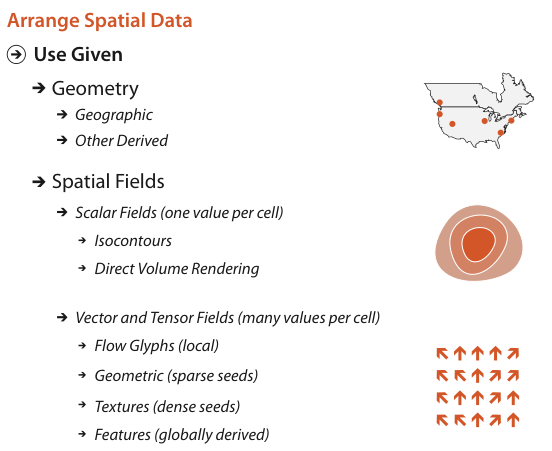

# 8.1 The Big Picture

## Use the given spatial layout

<!-- verbatim p.204 -->
> For datasets with spatial semantics, the usual choice for arrange is to use the given spatial information to guide the layout. In this case, the choices of express, separate, order, and align do not apply because the position channel is not available for directly encoding attributes.
<!-- /verbatim -->

## Two spatial data types

<!-- verbatim p.204 -->
> The two main spatial data types are geometry, where shape information is directly conveyed by spatial elements that do not necessarily have associated attributes, and spatial fields, where attributes are associated with each cell in the field.
<!-- /verbatim -->

In a vis context, geometry data is typically either geographic or explicitly derived from some other data type as a design choice [p.204].

## Idiom families for spatial fields

- **Scalar fields**, one attribute per cell: two main idiom families, isocontours and direct volume rendering [p.204].
- **Vector and tensor fields**, several attributes per cell: four families. Flow glyphs show local information; geometric approaches derive geometry from a sparse set of seed points; texture approaches use a dense set of seeds; feature approaches derive data with global computations over the entire field [p.204].

Figure 8.1 summarises these choices as a tree: use given, split into geometry (geographic, other derived) and spatial fields (scalar fields with isocontours and direct volume rendering; vector and tensor fields with flow glyphs (local), geometric (sparse seeds), textures (dense seeds) and features (globally derived)) [p.203].

## Figures

-  **Figure 8.1** [p.203]. Design choices for using given spatial data: geometry or spatial fields.

## Related

- [8.2 Why Use Given?](s08-02-why-use-given.md): why spatial position is spent on the given layout rather than on other attributes [p.204]
- [2.4.3 Fields](../ch02-what-data-abstraction/s02-04-dataset-types/s02-04-03-fields.md): the spatial field dataset type, with cells and attributes, that this chapter arranges [p.204]
- [2.4.4 Geometry](../ch02-what-data-abstraction/s02-04-dataset-types/s02-04-04-geometry.md): the geometry dataset type [p.204]
- [7 Arrange Tables](../ch07-arrange-tables/node.md): where express, separate, order and align do apply, because position is free to encode attributes [p.204]
