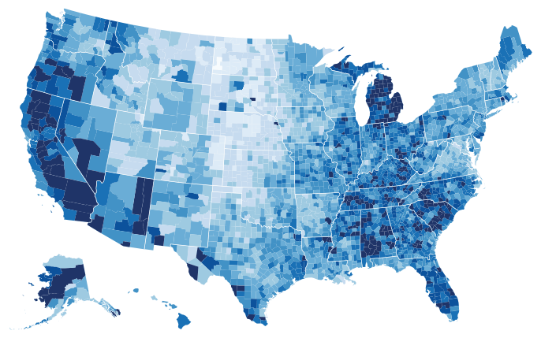

# 8.3 Geometry

<!-- verbatim p.205 -->
> Geometric data does not necessarily have attributes associated with it: it conveys shape information directly through the spatial position of its elements.
<!-- /verbatim -->

Computer graphics addresses simply drawing geometric data. Geometry becomes interesting in a vis context when it is derived from raw source data as the result of a design decision at the abstraction level [p.205]. Two common sources are geographic information about the Earth and computations on spatial fields [p.205].

## 8.3.1 Geographic Data

Cartographers have grappled with design choices for representing geographic spatial data for many hundreds of years [p.205].

<!-- verbatim p.205 -->
> The term cartographic generalization is closely related to the term abstraction as used in this book: it refers to the set of choices about how to derive an appropriate geometry dataset from raw data so that it is suitable for the intended task of the map users.
<!-- /verbatim -->

- **Level of detail.** Cartographic generalization includes filtering, aggregation and level of detail. A city might be a point mark on a map of a whole country, but an area mark showing the shape of its boundaries on a map of the city and its suburbs [p.205].
- **Nonspatial data on maps.** Cartographic data includes what the book classifies as nonspatial information: a population table could size-code the point marks for cities. The cartography literature calls integrating nonspatial data with base spatial data thematic cartography [p.205].

### Choropleth maps

A choropleth map encodes a quantitative attribute as colour over regions delimited as area marks, with region shapes from given geometry; the shapes are either provided directly as the base dataset or derived from base data by cartographic generalization choices [p.206]. The major design choices are how to construct the colormap and which region boundaries to use [p.206].

Figure 8.2 shows US unemployment rates for 2008 by county within states, using a segmented sequential colormap of nine white-to-blue levels with monotonically decreasing luminance [p.206]. The idiom box and its alternatives are on the [Choropleth Map](../idioms/choropleth-map.md) card [p.206].

## 8.3.2 Other Derived Geometry

Geometry data used in vis can also arise from spatial data that is not geographic. It is frequently derived through computations on spatial fields, as the rest of the chapter discusses [p.207].

## Figures

-  **Figure 8.2** [p.206]. Choropleth map showing regions as area marks using given geometry, where a quantitative attribute is encoded with color. From <http://bl.ocks.org/> mbostock/4060606.

## Related

- [Choropleth Map](../idioms/choropleth-map.md): the idiom box for colour over given region geometry [p.206]
- [10.3.2 Ordered Colormaps](../ch10-map-color-other-channels/s10-03-colormaps/s10-03-02-ordered-colormaps.md): sequential colormaps, the colour choice in a choropleth [p.206]
- [13.4.2 Spatial Aggregation](../ch13-reduce-items-attributes/s13-04-aggregate/s13-04-02-spatial-aggregation.md): how region boundaries affect spatial aggregation [p.206]
- [13 Reduce Items and Attributes](../ch13-reduce-items-attributes/node.md): filtering, aggregation and level of detail, which cartographic generalization includes [p.205]
- [8.4 Scalar Fields: One Value](s08-04-scalar-fields-one-value/node.md): geometry derived from fields as isolines and isosurfaces [p.207]
