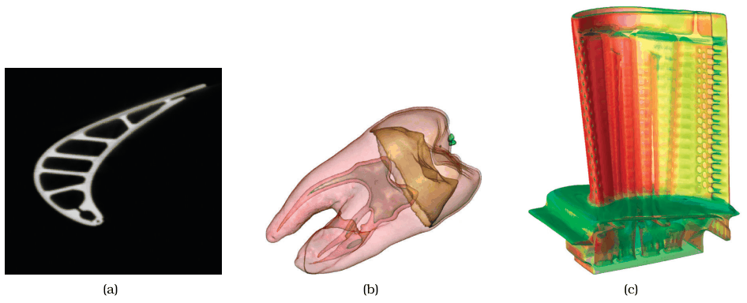
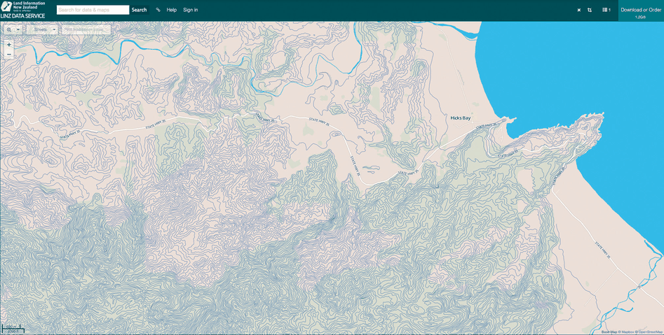
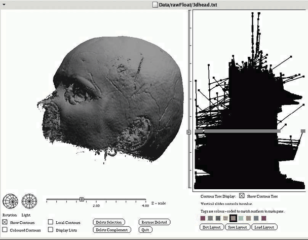
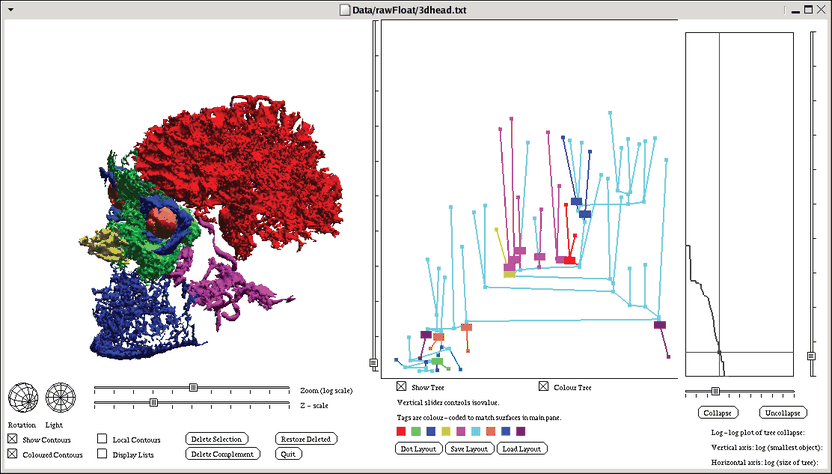

# 8.4.1 Isocontours

## Scalar fields and their three idiom families

<!-- verbatim p.207 -->
> A scalar spatial field has a single value associated with each spatially defined cell.
<!-- /verbatim -->

Scalar fields often come from medical imaging: radio-opacity in computed tomography (CT) scans and proton density in magnetic resonance imaging (MRI) scans [p.207].

The book names three major families of idioms for scalar fields, shown in Figure 8.3 [pp.207-208]:

- **Slicing** shows information about only two dimensions at once as an image; the slice may be aligned with the field's original axes or have an arbitrary orientation in 3D space [p.208].
- **Isocontours** compute derived lower-dimensional surface geometry and show it with standard computer graphics techniques: typically 2D isosurfaces for a 3D field, or 1D isolines for a 2D field [p.207].
- **Direct volume rendering** uses all of the information in the full 3D field to generate an image from a particular 3D viewpoint (Section 8.4.2) [p.208].

In all of these cases geometric navigation is the usual interaction approach. The idioms can be combined, for example with an interactively controllable widget for choosing the position and orientation of a slice embedded within a direct volume rendering view [p.208].

## Isolines

<!-- verbatim p.208 -->
> A set of isolines, namely, lines that represent the contours of a particular level of the scalar value, can be derived from a scalar spatial field.
<!-- /verbatim -->

Synonyms are contour lines and isopleths [p.208]. Isolines are far apart where the field changes slowly and close together where it changes fast, but never overlap, so contours for many values can be shown at once without excessive visual clutter [p.208]. Colour-coding the regions between contours with a sequential colormap yields a contour plot, as in Figure 6.9(c) [p.208].

### Topographic terrain maps

Topographic terrain maps are a familiar, widely used example of isolines: contours of equal elevation above sea level layered over the spatial substrate of a geographic map [p.208]. Figure 8.4 has contours every 10 metres, nearly 80 levels in total; small closed contours mark mountain peaks, and flat regions near sea level have no lines at all [pp.208-209]. See the [Topographic Terrain Map](../../idioms/topographic-terrain-map.md) card for the idiom box [p.208].

## Isosurfaces

<!-- verbatim p.209 -->
> The idiom of isosurfaces transforms a 3D scalar spatial field into one or more derived 2D surfaces that represent the contours of a particular level of the scalar value.
<!-- /verbatim -->

- **Navigation.** The surface is usually shown with interactive 3D navigation controls for rotation, zooming and translation [p.209].
- **Occlusion.** In 3D, showing all contour surfaces for dozens of values at once is not feasible, because the outer surfaces would occlude the inner ones. A crucial question is therefore which level gives the most useful result [p.209].
- **Choosing the level.** Exploration is frequently supported by dynamic controls for changing the level on the fly, such as a slider from the dataset's minimum to maximum value [p.209].
- **Several at once.** With careful use of colour and transparency, several isosurfaces can be shown together; the book cites a human tooth with five distinguishable isosurfaces as Figure 8.3(c) [p.209]. The Figure 8.3 caption, however, labels the tooth isosurfaces as panel (b) and panel (c) as direct volume rendering of a turbine; the book does not resolve the mismatch [pp.207-209].

### Flexible isosurfaces

There may be several disconnected isosurfaces for one value, and as the value changes, components can appear, join, split or disappear [p.210]. The flexible isosurfaces idiom adds one more level of derived data, the simplified contour tree, which tracks this evolution explicitly and shows how the connected components change their nesting structure [p.210]. The full tree for the head dataset has over 1.5 million edges (Figure 8.5); careful simplification gives under 100 edges (Figure 8.6) [p.210]. Using the simplified tree for filtering and colouring through multiple coordinated views supports interactive exploration, and seeing the identified structures in one 3D view shows both their shape and their relative positions [p.210]. See the [Flexible Isosurfaces](../../idioms/flexible-isosurfaces.md) card [p.210].

## Figures

-  **Figure 8.3** [p.207]. Spatial scalar fields shown with three different idioms. (a) A single 2D slice of a turbine blade dataset. (b) Multiple semitransparent isosurfaces of a 3D tooth dataset. (c) Direct volume rendering of the entire 3D turbine dataset. From [Kniss 02, Figures 1.2 and 2.1b].
-  **Figure 8.4** [p.209]. Topographic terrain map, with isolines in blue. From <https://data.linz.govt.nz/layer/768-nz-mainland> -contours-topo-150k.
-  **Figure 8.5** [p.210]. A full contour tree with over 1.5 million edges does not help the user explore isosurfaces. From [Carr et al. 04, Figure 1].
-  **Figure 8.6** [p.211]. The flexible isosurfaces idiom uses the simplified contour tree of under 100 edges to help users identify meaningful structure. From [Carr et al. 04, Figure 1].

## Related

- [Topographic Terrain Map](../../idioms/topographic-terrain-map.md): the isoline idiom box [p.208]
- [Flexible Isosurfaces](../../idioms/flexible-isosurfaces.md): the contour-tree idiom box [p.211]
- [8.4.2 Direct Volume Rendering](s08-04-02-direct-volume-rendering.md): the alternative that renders the field without deriving surfaces [p.208]
- [11.6.1 Slice](../../ch11-manipulate-view/s11-06-navigate-reducing-attributes.md#s11.06.01): slicing among other attribute-reduction idioms [p.208]
- [11.5 Navigate: Changing Viewpoint](../../ch11-manipulate-view/s11-05-navigate-changing-viewpoint.md): geometric and spatial navigation for isosurfaces [pp.208-209]
- [13.3.2 Attribute Filtering](../../ch13-reduce-items-attributes/s13-03-filter/s13-03-02-attribute-filtering.md): the filtering flexible isosurfaces use [p.210]
- [12.3 Juxtapose and Coordinate Views](../../ch12-facet-into-multiple-views/s12-03-juxtapose-coordinate-views/node.md): the coordinated views that link the contour tree and the 3D view [p.210]
- [6.3.9 Empirical Evidence](../../ch06-rules-thumb/s06-03-no-unjustified-3d/s06-03-09-empirical-evidence.md): Figure 6.9, whose panel (c) the book cites as a contour plot [p.208]
