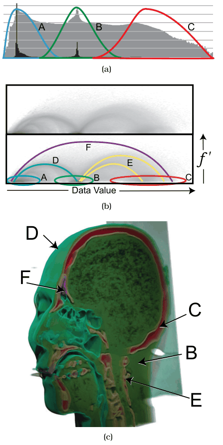

# 8.4.2 Direct Volume Rendering

## The idiom

<!-- verbatim p.211 -->
> The direct volume rendering idiom creates an image directly from the information contained within the scalar spatial field, without deriving an intermediate geometric representation of a surface.
<!-- /verbatim -->

The algorithmic issues are complex, and a great deal of work has gone into computing it efficiently and correctly [p.211].

## Transfer functions

<!-- verbatim p.212 -->
> A crucial visual encoding design choice with direct volume rendering is picking the transfer function that maps changes in the scalar value to opacity and color.
<!-- /verbatim -->

Finding the right transfer function by hand often takes considerable trial and error, because features of interest can be hard to isolate: uninteresting regions of space may hold the same range of data values as interesting ones [p.212].

## Multidimensional transfer functions (Simian)

The Simian system [Kniss 02, Kniss et al. 05] helps users build multidimensional transfer functions with a derived space and interactive widgets for specifying regions within it [p.212].

- **Axes.** The horizontal axis is the scalar data value; the vertical axis is the gradient magnitude, the direction of fastest change, so that regions of high change can be told apart from homogeneous ones. Mathematically, the gradient is the first derivative [p.212].
- **1D histogram (panel a).** The information of a standard 1D transfer function: a histogram of data values, with linear-scale values in black and log-scale values in grey. Only the three basic materials are distinguishable: (A) air, (B) soft tissue and (C) bone [p.212].
- **2D joint histogram (panel b).** The full derived space shows more. It is like a heatmap of one-pixel area marks, each cell showing a count of values in it with a grayscale colormap, and the boundaries between the basic surfaces form distinguishable structures [p.212].
- **Result (panel c).** A volume rendering of a head dataset with the resulting 2D transfer function shows the base materials and three boundaries: (D) air–tissue, (E) tissue–bone and (F) air–bone. A cutting plane exposes the head's internal structure [p.212].

The text calls these panels Figure 8.7(a), (b) and (c), but they are printed as the second Figure 8.6 on p.213 [pp.212-213]. The idiom box is on the [Multidimensional Transfer Functions](../../idioms/multidimensional-transfer-functions.md) card [p.212].

## Figures

-  **Figure 8.6** [p.213]. Simian allows users to construct multidimensional transfer functions for direct volume rendering using a derived space. (a) The standard 1D histogram can show the three basic materials: (A) air, (B) soft tissue, and (C) bone. (b) The full 2D derived space allows material boundaries to be distinguished as well. (c) Volume rendering of head dataset using the resulting 2D transfer function, showing material boundaries of (D) air–tissue, (E) tissue– bone, and (F) air–bone. From [Kniss et al. 05, Figure 9.1].

## Related

- [Multidimensional Transfer Functions](../../idioms/multidimensional-transfer-functions.md): the Simian idiom box [p.212]
- [8.4.1 Isocontours](s08-04-01-isocontours.md): the alternative that derives surfaces first, and the slicing idiom DVR can be combined with [p.211]
- [13.4.1 Item Aggregation](../../ch13-reduce-items-attributes/s13-04-aggregate/s13-04-01-item-aggregation.md): the histogram idiom behind the 1D and joint histogram views [p.212]
- [11.6.2 Cut](../../ch11-manipulate-view/s11-06-navigate-reducing-attributes.md#s11.06.02): cutting planes, used in the Simian head rendering [p.212]
- [Heatmaps](../../idioms/heatmaps.md): the joint histogram view is like a heatmap of one-pixel cells [p.212]
- [8.5.1 Flow Glyphs](../s08-05-vector-fields-multiple-values/s08-05-01-flow-glyphs.md): where the critical points of Figure 8.7 are discussed [p.214]
