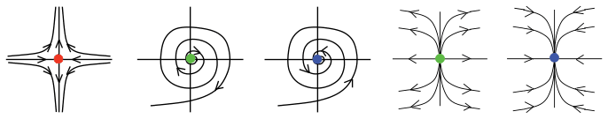
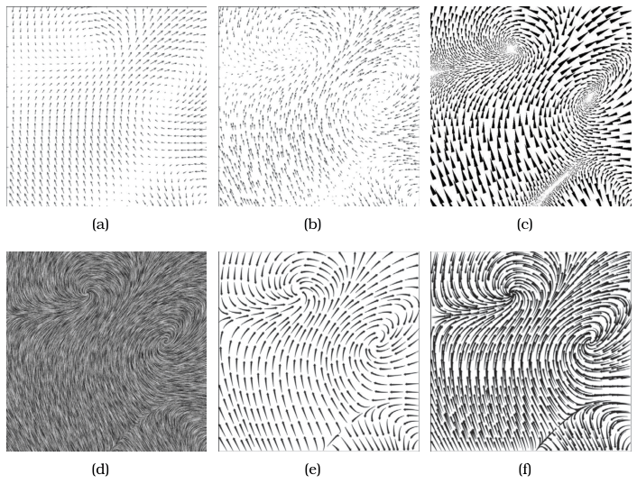

# 8.5.1 Flow Glyphs

## Vector fields and flow vis

Vector field datasets are often associated with computational fluid dynamics (CFD), as the outcome of flow simulations or measurements [p.214]. Flow vis deals with one kind of vector field, a velocity field, which holds both direction and magnitude at each cell [p.214]. The three common cases are purely 2D fields, purely 3D fields, and flow on a 2D surface embedded in 3D space. Time-varying flows are called unsteady; flows whose behaviour does not change over time are steady [p.214].

## Critical points

Critical points are points in a flow field where the velocity vanishes, and are features of interest [p.214].

- **Types.** They are classified by the behaviour of the flow in their neighbourhood: the three main types are attracting sources, repelling sinks, and saddle points that attract from one direction and repel from another [p.214].
- **Circulation.** Sources and sinks may or may not have circulation around them, giving the five types of Figure 8.7. A fourth type, a centre where the flow is perfectly circular, is less important in practice [p.214].
- **Terminology.** Flow vis calls a source or sink without circulation a node and one with circulation a focus; the book avoids these overloaded terms, reserving node and link for networks and focus+context for its family of embedding idioms [p.214].

[NOT FROM BOOK] The phrase "attracting sources, repelling sinks" is reproduced as printed. In standard flow terminology a source repels and a sink attracts, so treat the adjectives with care.

## Four idiom families, plus reduction to scalars

- **Flow glyphs** show local information at each cell [p.214].
- **Geometric flow** traces particle trajectories from a sparse set of seed points (Section 8.5.2) [p.214].
- **Texture flow** traces particle trajectories from a dense set of seeds (Section 8.5.3) [p.214].
- **Feature flow** uses global computation across the whole field to detect features explicitly, which are then usually encoded with glyphs or geometry (Section 8.5.4) [p.214].
- **Reduction to a scalar field.** A vector field can also be reduced to a scalar field, so that scalar idioms such as direct volume rendering or isocontouring apply [pp.214-215].

## Empirical comparison of 2D flow idioms

Laidlaw et al. compared six idioms for 2D vector fields: three local glyph idioms (Figure 8.8a-c), a dense texture idiom (8.8d) and two geometric idioms (8.8e-f) [p.215]. The tasks were finding all critical points and identifying their types, identifying the type of critical point at a given location, and predicting where a particle starting at a given point will be transported (advection) [p.215].

<!-- verbatim p.215 -->
> While none of the idioms outperformed all of the others for all tasks, the two local glyph idioms using arrows fared worst.
<!-- /verbatim -->

## Flow glyphs

<!-- verbatim p.216 -->
> The flow glyph idioms show local information about a cell in the field using an object with internal substructure; one of the most basic choices is an arrow, as shown in Figure 8.8(a).
<!-- /verbatim -->

- **Arrow encoding.** Stem length encodes magnitude, arrow orientation encodes direction, and the arrowhead on one side of the stem disambiguates directionality [p.216].
- **Density.** Besides the glyph encoding, a key design choice is how many glyphs to show: one per cell, or only a small subset [p.216].
- **Limitation.** Glyph-based approaches suffer from occlusion in 3D fields [p.216].

## Figures

-  **Figure 8.7** [p.214]. The main types of critical points in a flow field: saddle, circulating sinks, circulating sources, noncirculating sinks, and noncirculating sources. From [Tricoche et al. 02, Figure 1].
-  **Figure 8.8** [p.215]. An empirical study compared human response to six different 2D flow vis idioms. (a) arrow glyphs on a regular grid. (b) arrow glyphs on a jittered grid. (c) triangular wedge glyphs inspired by oil painting strokes. (d) dense texture-based Line Integral Convolution (LIC). (e) curved arrow glyphs with image-guided streamline seeding. (f) curved arrow glyphs with regular grid streamline seeding. From [Laidlaw et al. 05, Figure 1].

## Related

- [8.5.2 Geometric Flow](s08-05-02-geometric-flow.md): the family that traces trajectories from a sparse set of seeds [p.214]
- [8.5.3 Texture Flow](s08-05-03-texture-flow.md): the dense idiom in the Laidlaw study [p.215]
- [8.6 Tensor Fields: Many Values](../s08-06-tensor-fields-many-values.md): tensor glyphs, which share the all-cells-or-subset choice [p.216]
- [8.4 Scalar Fields: One Value](../s08-04-scalar-fields-one-value/node.md): the scalar idioms available once a vector field is reduced to a scalar field [p.215]
- [6.3.3 Occlusion Hides Information](../../ch06-rules-thumb/s06-03-no-unjustified-3d/s06-03-03-occlusion-hides-information.md): the occlusion problem that limits glyphs in 3D [p.216]
