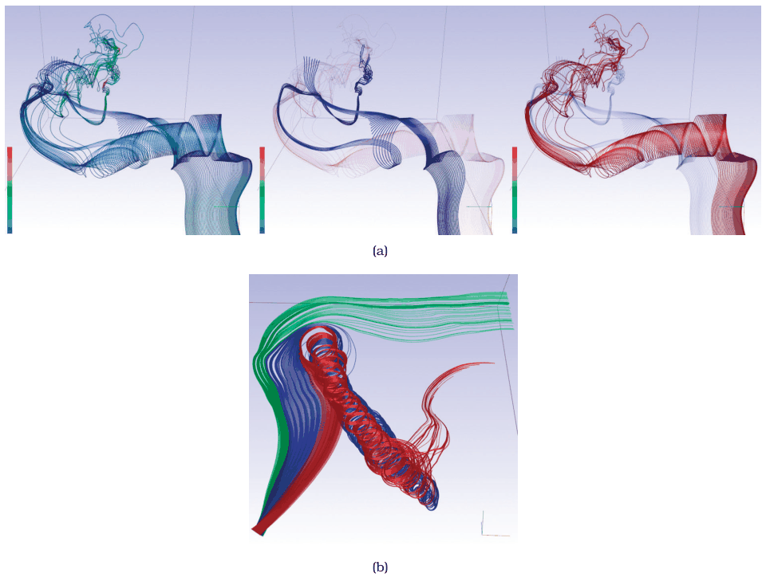

# 8.5.2 Geometric Flow

## The idiom family

<!-- verbatim p.216 -->
> The geometric flow idioms compute derived geometric data from the original field using trajectories computed from a sparse set of seed points and then directly show the derived geometry.
<!-- /verbatim -->

- **Computing trajectories.** One major algorithmic issue is how to compute the trajectories. Geometric approaches typically approximate them with numerical integration, so the idiom is sometimes called integration-based flow [p.216].
- **Seeding strategy.** A crucial design choice: poor choices cause visual clutter and occlusion, but a well-chosen strategy supports inspecting both 2D and 3D fields [p.216].
- **Navigation.** In 3D, geometric navigation is a useful interaction idiom for shape and structure understanding tasks [p.216].

## Streamlines, pathlines, streaklines and timelines

The idioms rest on intuitions from physical experiments such as wind tunnels, and the simpler cases have direct physical analogues [p.216].

| Structure | Definition | Physical analogy |
| --- | --- | --- |
| Streamline | The trajectory a specific particle follows in a steady field [p.216] | The path a single ball follows as time passes [p.216] |
| Pathline | The same trajectory in an unsteady (time-varying) field [p.216] | The path a single ball follows as time passes [p.216] |
| Streakline | Traces all particles that pass through a specific point in space [p.216] | A trail of smoke released at different times from one spot [p.216] |
| Timeline | Connects a front of pathlines over time [p.216] | Balls placed at once along a curve, with the path between them traced at a later time step [p.216] |

All of these have counterparts one dimension higher, seeded from a curve rather than a point: stream surfaces, path surfaces and streak surfaces. Time surfaces generalise further by connecting particles released from a surface rather than a curve [p.216].

## Similarity-clustered streamlines

McLoughlin et al. seed streamlines and pathlines by a derived similarity measure (Figure 8.9) [p.217]. Each line from the 3D vector field gets three derived attributes, curvature, torsion and tortuosity, which a complex algorithm combines into a fourth, the line's signature; signatures build a similarity matrix and then a cluster hierarchy [pp.217-218]. Users filter which lines are seeded by cluster membership, colour lines by cluster, control how many clusters show, and can emphasise one cluster as an opaque foreground layer over a translucent background; 3D navigation lets them rotate to any viewpoint [p.218]. See the [Similarity-Clustered Streamlines](../../idioms/similarity-clustered-streamlines.md) card for the box and details [p.218].

## Figures

-  **Figure 8.9** [p.217]. Geometric flow vis idioms showing a sparse set of particle trajectories, with seeding and coloring according to similarity. (a) Streamlines: all clusters equally opaque; purple cluster emphasized; red cluster emphasized. (b) Pathlines, colored by three clusters. From [McLoughlin et al. 13, Figures 7 and 11c].

## Related

- [Similarity-Clustered Streamlines](../../idioms/similarity-clustered-streamlines.md): a seeding strategy built on derived clusters [p.217]
- [8.5.3 Texture Flow](s08-05-03-texture-flow.md): the dense-seed counterpart [p.218]
- [11.5 Navigate: Changing Viewpoint](../../ch11-manipulate-view/s11-05-navigate-changing-viewpoint.md): the geometric navigation used for 3D flow [p.216]
- [13.3 Filter](../../ch13-reduce-items-attributes/s13-03-filter/node.md): filtering lines by cluster membership [p.218]
- [12.5 Superimpose Layers](../../ch12-facet-into-multiple-views/s12-05-superimpose-layers/node.md): the foreground and background layers for an emphasised cluster [p.218]
