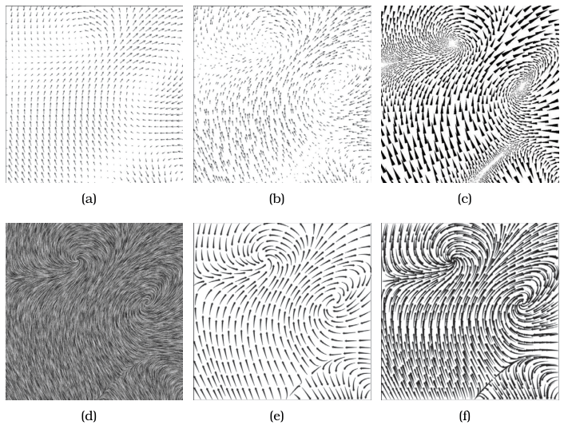

# 8.5.3 Texture Flow

## Dense particle tracing

<!-- verbatim p.218 -->
> The texture flow idioms also rely on particle tracing, but with dense coverage across the entire field rather than from a carefully selected set of seed points.
<!-- /verbatim -->

- **Where used.** Most commonly for 2D fields or fields on 2D surfaces [p.218].
- **Line Integral Convolution (LIC).** Figure 8.8(d) shows LIC, where white noise is smeared according to particle flow [Cabral and Leedom 93] [p.218].
- **The name.** "Texture" comes from computer graphics data structures and algorithms that efficiently manipulate high-resolution images without intermediate geometric representations, operations supported in hardware on modern machines [p.218].

In the Laidlaw et al. study of six 2D flow idioms, LIC was the one dense texture idiom; no idiom beat all others on every task, and the two arrow-glyph idioms fared worst [p.215].

## Figures

-  **Figure 8.8** [p.215]. An empirical study compared human response to six different 2D flow vis idioms. (a) arrow glyphs on a regular grid. (b) arrow glyphs on a jittered grid. (c) triangular wedge glyphs inspired by oil painting strokes. (d) dense texture-based Line Integral Convolution (LIC). (e) curved arrow glyphs with image-guided streamline seeding. (f) curved arrow glyphs with regular grid streamline seeding. From [Laidlaw et al. 05, Figure 1].

## Related

- [8.5.2 Geometric Flow](s08-05-02-geometric-flow.md): the sparse-seed alternative that also traces particles [p.218]
- [8.5.1 Flow Glyphs](s08-05-01-flow-glyphs.md): the Laidlaw study comparing texture, glyph and geometric idioms [p.215]
- [8.7 Further Reading](../s08-07-further-reading.md): LIC as the foundational texture-flow algorithm, and a texture-flow survey [p.218]
