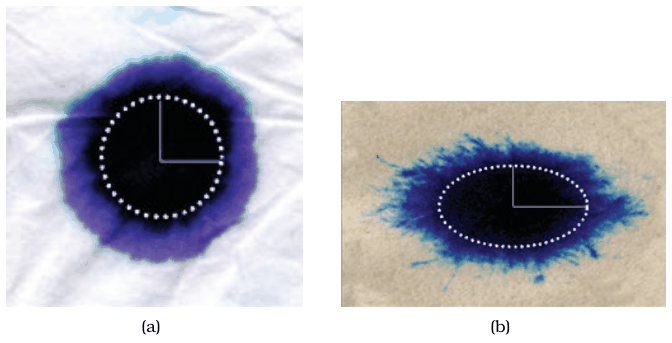
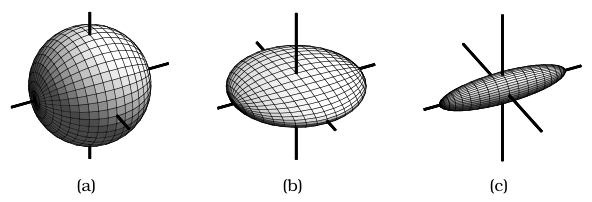
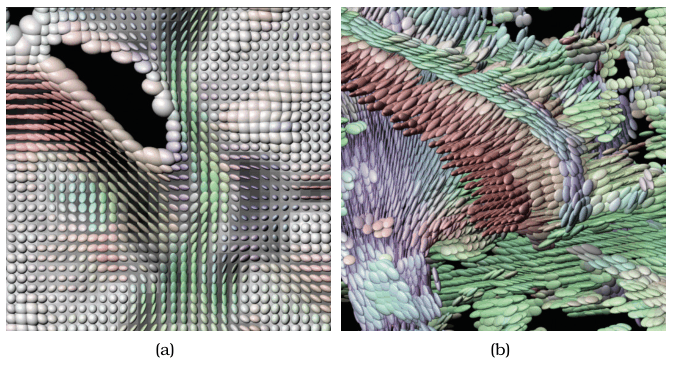

# 8.6 Tensor Fields: Many Values

## Tensor fields

<!-- verbatim p.219 -->
> Tensor fields typically contain a matrix at each cell in the field, capturing more complex structure than what can be expressed in a vector field.
<!-- /verbatim -->

- **Mathematics.** In the 3D case, second-order tensors are 3 × 3 matrices that may be symmetric or nonsymmetric [p.219].
- **What they measure.** Properties such as stress, conductivity, curvature and diffusivity [p.219].
- **Example.** Diffusion tensor data, measured with magnetic resonance imaging, records how the rate of water diffusion varies with direction; it is often used to study the architecture of the human brain and find abnormalities [p.219].

Flow vis is concerned with both vector and tensor data, and all the vector-field idiom families are also used for tensor fields: local glyphs, sparse geometry, dense textures and explicitly derived features [p.219].

## Tensor glyphs

One major family encodes local information at cells by controlling the shape, orientation and appearance of a base geometric shape [p.219]. As with vector glyphs, a design choice is whether to show a glyph in all cells or only a carefully chosen subset [p.219]. The glyph idiom is the same fundamental design choice for tensors and vectors, but tensor glyphs need a more complex geometric structure because they encode more information [p.219].

### Ellipsoid tensor glyphs

- **Decomposition.** Tensor quantities decompose naturally into orientation and shape, which a 3D glyph can encode. Mathematically, shape comes from the eigenvalues and orientation from the eigenvectors [p.219].
- **Isotropy.** A shape is isotropic when every direction is the same, and anisotropic when there is directional asymmetry; in biological tissue, anisotropy means water moves faster in some directions than others [p.220]. Figure 8.10 shows the 2D case with ink on paper: it spreads evenly through Kleenex and faster in a preferred direction through newspaper [p.220].
- **Three basic 3D shapes.** Fully isotropic is a sphere; partially anisotropic is planar, a sphere flattened in one direction; completely anisotropic is linear, a cigar-shaped ellipsoid (Figure 8.11) [pp.220-221].
- **Encoding.** An ellipsoid encodes the shape, and the direction it points is an intuitive encoding of orientation [p.221]. Figure 8.12(a) shows a 2D slice with orientation also used for colour; in 3D (Figure 8.12b) isotropic glyphs are filtered out so anisotropic regions are visible [p.221].
- **Weakness.** Different ellipsoid glyphs cannot be disambiguated from a single viewpoint; superquadric tensor glyphs are a more sophisticated approach that resolves this [Kindlmann 04] [p.221].

## Geometric, texture and feature tensor flow

Geometric tensor flow idioms rest on intuitions similar to the vector case, computing sparse derived geometry such as hyperstreamlines or tensorlines; the same holds for texture tensor flow [pp.221-222]. Feature tensor flow idioms detect features explicitly, generalising the simpler cases found in vector fields to the more complex possibilities of tensor fields [p.222].

## Figures

-  **Figure 8.10** [p.220]. 2D diffusion illustrated with ink and paper. (a) Isotropic Kleenex. (b) Anisotropic newspaper.
-  **Figure 8.11** [p.220]. Ellipsoid glyphs can show three basic shapes. (a) Isotropic: sphere. (b) Partially anisotropic: planar. (c) Fully anisotropic: linear. From [Kindlmann 04, Figure 1].
-  **Figure 8.12** [p.221]. Ellipsoid glyphs show shape and orientation of tensors at each cell in a field. (a) 2D slice. (b) 3D field, with isotropic glyphs filtered out. From [Kindlmann 04, Figures 10a and 11a].

## Related

- [Ellipsoid Tensor Glyphs](../idioms/ellipsoid-tensor-glyphs.md): the idiom box [p.221]
- [8.5 Vector Fields: Multiple Values](s08-05-vector-fields-multiple-values/node.md): the four idiom families tensor fields reuse [p.219]
- [8.5.1 Flow Glyphs](s08-05-vector-fields-multiple-values/s08-05-01-flow-glyphs.md): vector glyphs, which share the all-cells-or-subset choice [p.219]
- [8.5.2 Geometric Flow](s08-05-vector-fields-multiple-values/s08-05-02-geometric-flow.md): the streamline intuitions behind hyperstreamlines and tensorlines [p.221]
