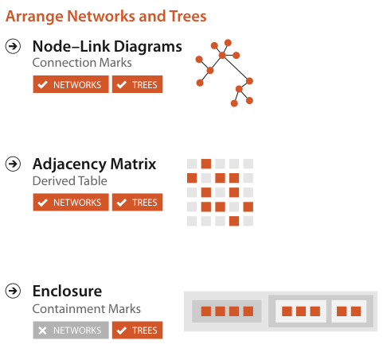

# 9.1 The Big Picture

## Scope

The chapter covers design choices for arranging network data in space, summarised in Figure 9.1 [p.226].

<!-- verbatim p.226 -->
> The node–link diagram family of visual encoding idioms uses the connection channel, where marks represent links rather than nodes. The second major family of network encoding idioms are matrix views that directly show adjacency relationships. Tree structure can be shown with the containment channel, where enclosing link marks show hierarchical relationships through nesting.
<!-- /verbatim -->

## The three design choices

Figure 9.1 lays the choices out as three rows, each tagged with the data types it applies to [p.225]:

- **Node–link diagrams** use connection marks and apply to networks and trees; Section 9.2 covers them [pp.225-226].
- **Adjacency matrix** uses a derived table and applies to networks and trees; Section 9.3 covers it [pp.225-226].
- **Enclosure** uses containment marks and applies to trees, with networks crossed out; Section 9.5 covers it [pp.225-226].

## Figures

-  **Figure 9.1** [p.225]. Design choices for arranging networks.

## Related

- [9.2 Connection: Link Marks](s09-02-connection-link-marks.md): the node–link family that uses the connection channel [p.226]
- [9.3 Matrix Views](s09-03-matrix-views.md): the matrix family that shows adjacency directly [p.226]
- [9.5 Containment: Hierarchy Marks](s09-05-containment-hierarchy-marks.md): containment through nesting for tree structure [p.226]
- [2.4.2 Networks and Trees](../ch02-what-data-abstraction/s02-04-dataset-types/s02-04-02-networks-trees.md): defines the network and tree data that this chapter arranges in space [p.226]
