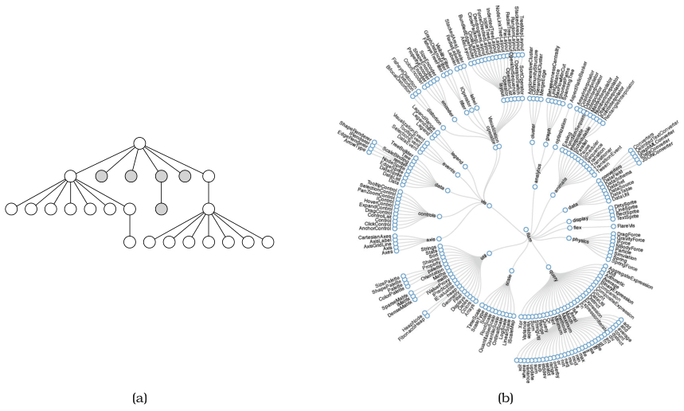
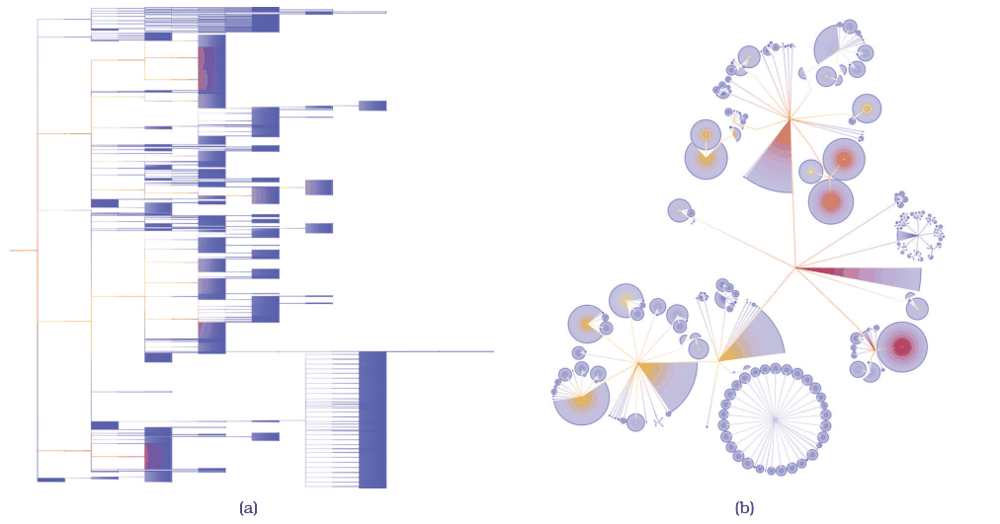
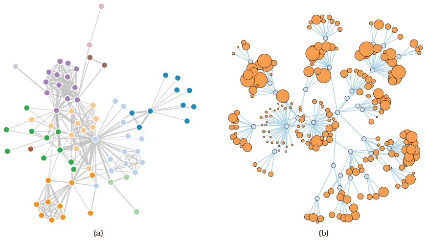
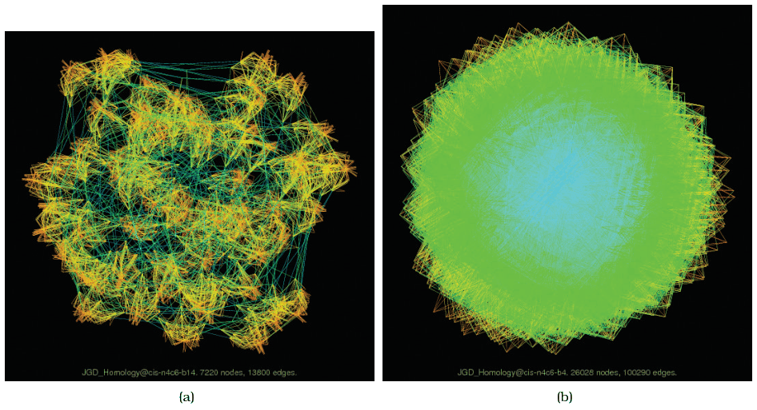

# 9.2 Connection: Link Marks

## Node–link diagrams

<!-- verbatim p.226 -->
> The most common visual encoding idiom for tree and network data is with node–link diagrams, where nodes are drawn as point marks and the links connecting them are drawn as line marks. This idiom uses connection marks to indicate the relationships between items.
<!-- /verbatim -->

## Trees as node–link diagrams

- **Triangular vertical layout** (Figure 9.2a). A tiny tree of 24 nodes, root at the top and leaves at the bottom. Besides connection marks, vertical spatial position shows depth in the tree. Horizontal position encodes no attribute; it is an artifact of a layout algorithm that maximises information density while guaranteeing no edge crossings or node overlaps [p.226].
- **Spline radial layout** (Figure 9.2b). A tree of a few hundred nodes, with essentially the same density-without-overlap algorithm, but radial rather than rectilinear: depth is distance from the centre of the circle, and links are smoothly curving splines rather than straight lines [pp.226-227].
- **Rectangular horizontal layout** (Figure 9.3a). A 5161-node tree with the root on the left and leaves to the right; edges are coloured with a purple-to-orange continuous colormap by the Strahler centrality metric of Section 3.7.2. The layout is fundamentally the triangular one, but zoomed out, the edges within a subtree form a single perceptual block whose internal spacing cannot be seen [p.227].
- **BubbleTree** (Figure 9.3b). A radial approach in which subtrees are laid out in full circles rather than partial arcs. Spatial position still encodes depth, but as relative distance to the centre of the parent rather than absolute distance in screen space [p.227].

## Networks as node–link diagrams and topology tasks

Directly connected nodes are perceived as the tightest grouping, and nodes separated by long multi-hop paths as less closely grouped [p.228].

<!-- verbatim p.228 -->
> The number of hops within a path—the number of individual links that must be traversed to get from one node to another—is a network-oriented way to measure distances.
<!-- /verbatim -->

Hops are a discrete distance, unlike continuous distance in the 2D plane, and connection marks support path tracing via these discrete hops [p.228].

<!-- verbatim p.228 -->
> Node–link diagrams in general are well suited for tasks that involve understanding the network topology: the direct and indirect connections between nodes in terms of the number of hops between them through the set of links.
<!-- /verbatim -->

Example topology tasks are: finding all possible paths between two nodes, finding the shortest path between two nodes, finding all adjacent nodes one hop from a target node, and finding nodes that bridge two components that would otherwise be disconnected [pp.228-229].

Node–link diagrams are most often laid out in a 2D planar region [p.229].

<!-- verbatim p.229 -->
> While it is algorithmically straightforward to design 3D layout algorithms, it is rarely an effective choice because of the many perceptual problems discussed in Section 6.3, and thus should be carefully justified.
<!-- /verbatim -->

## Force-directed placement

Force-directed placement is one of the most widely used idioms for node–link network layout using connection marks, and a family with many variants [p.229].

- **Mechanism.** In one variant of this family, nodes push away from each other while links act like springs pulling their endpoints closer. Many algorithms place nodes randomly, then iteratively refine positions under these simulated forces. The book notes it is also known as spring embedding, energy minimisation, or nonlinear optimisation [p.229].
- **Strengths.** A simple version is very easy to implement, and the physical-spring analogy makes it easy to understand and explain [p.229].
- **Encoding.** Spatial position does not directly encode attributes; it is a side effect of minimising distracting artifacts such as edge crossings and node overlaps. Size and colour coding of nodes and edges is common: Figure 9.4(a) codes link attributes as line width, 9.4(b) codes node attributes as point size [p.229].
- **Proximity is ambiguous.** Tightly interconnected groups often form visual clumps, so proximity is a strong grouping cue, but some clumps may simply be artifacts of nodes being repelled from elsewhere rather than closely connected [p.229].

<!-- verbatim p.229 -->
> Thus, proximity is sometimes meaningful but sometimes arbitrary; this ambiguity can mislead the user.
<!-- /verbatim -->

- **Nondeterminism.** Layouts often look different on each run, unlike a scatterplot or bar chart, so spatial memory cannot carry across runs, region-based identifications such as "the stuff in the upper left corner" fail, and proximity may reflect random initial positions rather than structure. A footnote says reusing the pseudorandom seed gives repeatability for most random layouts [p.230].
- **Dynamic layout.** With a network that streams in, disturbing spatial stability as little as possible while reflecting the changed structure requires sophisticated algorithmic strategies [pp.230-231].
- **Scalability is the major weakness**, in both visual complexity and computation time. Layouts of dozens of nodes are readable quickly; with a few hundred nodes the layout degenerates into a hairball, and with thousands or more, path following and understanding overall structure become essentially impossible [p.231].
- **Brittleness and local minima.** Many algorithms have parameters tuned per dataset that do not transfer, and can get stuck in a local minimum energy configuration [p.231].
- **Bouncing.** In the simplest algorithms nodes never settle unless the user halts them; continual bouncing should be avoided in a multiple-view context, and more sophisticated algorithms stop automatically once the forces balance [p.231].

The book's density threshold is stated two ways. The idiom box gives "Node/link density: L < 4N", but the running text reads [p.231]:

<!-- verbatim p.231 -->
> Straightforward force-directed placement is unlikely to yield good results when the number of nodes is more than roughly four times the number of links.
<!-- /verbatim -->

Read literally, the sentence inverts the box's L < 4N (links fewer than four times the nodes); the book does not reconcile the two [p.231].

## Multilevel layout and sfdp

<!-- verbatim p.231 -->
> Many recent approaches to scalable network drawing are multilevel network idioms, where the original network is augmented with a derived cluster hierarchy to form a compound network.
<!-- /verbatim -->

The hierarchy comes from coarsening the network into successively simpler networks that try to keep the essential structure. Laying out the simplest version first and refining through more complex versions improves speed and quality and better avoids the local-minimum problem. Compound networks are discussed further in Section 9.5, and cluster hierarchies in Section 13.4.1 [pp.231-232].

The sfdp (multilevel scalable force-directed placement) example, Figure 9.5(a), shows 7220 nodes and 13,800 edges coloured by length: dense clusters of short orange and yellow edges stand apart from long blue and green edges between them. Figure 9.5(b), with 26,028 nodes and 100,290 edges, shows little structure; overlapping lines cause overwhelming clutter through occlusion, so even these idioms hit the hairball problem [p.232].

## Figures

-  **Figure 9.2** [p.227]. Node–link layouts of small trees. (a) Triangular vertical for tiny tree. From [Buchheim et al. 02, Figure 2d]. (b) Spline radial layout for small tree. From <http://mbostock.github.com/d3/ex/tree.html>.
-  **Figure 9.3** [p.228]. Two layouts of a 5161-node tree. (a) Rectangular horizontal node–link layout. (b) BubbleTree node–link layout.
-  **Figure 9.4** [p.230]. Node–link layouts of small networks. (a) Force-directed placement of small network of 75 nodes, with size coding for link attributes. (b) Larger network, with size coding for node attributes. From <http://bl.ocks.org/> mbostock/4062045 and <http://bl.ocks.org/1062288>.
-  **Figure 9.5** [p.232]. Multilevel graph drawing with sfdp [Hu 05]. (a) Cluster structure is visible for a large network of 7220 nodes and 13,800 edges. (b) A huge graph of 26,028 nodes and 100,290 edges is a “hairball” without much visible structure. From [Hu 14].

## Related

- [Force-Directed Placement](../idioms/force-directed-placement.md): the idiom box, uses and limits of the main node–link network layout [p.231]
- [Multilevel Force-Directed Placement (sfdp)](../idioms/multilevel-force-directed-placement-sfdp.md): the idiom box for the multilevel layout that scales further [p.233]
- [9.4 Costs and Benefits: Connection versus Matrix](s09-04-costs-benefits-connection-matrix.md): when node–link diagrams beat matrix views and where they break down [p.231]
- [9.5 Containment: Hierarchy Marks](s09-05-containment-hierarchy-marks.md): the book points there for compound networks [p.231]
- [3.7.2 Deriving One Attribute](../ch03-why-task-abstraction/s03-07-analyzing-deriving-examples/s03-07-02-deriving-one-attribute.md): the Strahler centrality metric that colours the edges of Figure 9.3 [p.227]
- [6.3 No Unjustified 3D](../ch06-rules-thumb/s06-03-no-unjustified-3d/node.md): the perceptual problems that make 3D network layouts rarely effective [p.229]
- [13.4.1 Item Aggregation](../ch13-reduce-items-attributes/s13-04-aggregate/s13-04-01-item-aggregation.md): cluster hierarchies, which multilevel layouts derive [p.231]
