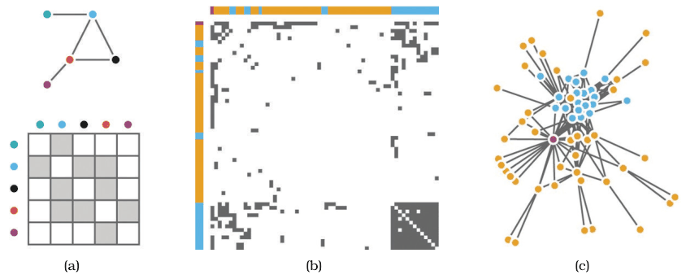

# 9.3 Matrix Views

## Deriving a table from a network

<!-- verbatim p.233 -->
> Network data can also be encoded with a matrix view by deriving a table from the original network data.
<!-- /verbatim -->

## Adjacency matrix view

<!-- verbatim p.233 -->
> A network can be visually encoded as an adjacency matrix view, where all of the nodes in the network are laid out along the vertical and horizontal edges of a square region and links between two nodes are indicated by coloring an area mark in the cell in the matrix that is the intersection between their row and column.
<!-- /verbatim -->

- **Derived data.** The network becomes a table with two key attributes, each a full list of every node, and one value attribute per cell recording whether a link exists between the two nodes that index it [p.233].
- **Alignment.** Adjacency matrix views use 2D alignment, just like the tabular matrix views of Section 7.5.2 [p.233].
- **Extra attributes.** Colouring cells can encode another attribute. Size coding of cells is limited by pixels per cell, so typically only a few levels are distinguishable. Weighted networks, with a quantitative value per link, can be shown with an ordered channel such as luminance or size [p.233].
- **Direction.** For undirected networks only half the matrix, above or below the diagonal, needs showing, because a link from A to B implies one from B to A. For directed networks the full square matrix has meaning, because links can be asymmetric [p.233].
- **Scale.** Matrix views of networks can reach very high information density, up to a limit of one thousand nodes and one million edges, like cluster heatmaps and all other matrix views that use small area marks [p.234].

Figure 9.6(a) shows node–link and matrix views of the same small network; Figures 9.6(b) and 9.6(c) repeat the comparison for a larger network [p.233].

## Figures

-  **Figure 9.6** [p.234]. Comparing node–link matrix and matrix views of a network. (a) Node–link and matrix views of small network. (b) Matrix view of larger network. (c) Node–link view of larger network. From [Gehlenborg and Wong 12, Figures 1 and 2].

## Related

- [Adjacency Matrix View](../idioms/adjacency-matrix-view.md): the idiom box and the choice between this and node–link layouts [p.234]
- [9.4 Costs and Benefits: Connection versus Matrix](s09-04-costs-benefits-connection-matrix.md): the strengths and weaknesses of matrix views against node–link diagrams [p.234]
- [7.5.2 Matrix Alignment: Two Keys](../ch07-arrange-tables/s07-05-separate-order-align-categorical/s07-05-02-matrix-alignment-two-keys.md): the 2D alignment that adjacency matrices share with tabular matrix views [p.233]
- [Cluster Heatmaps](../idioms/cluster-heatmaps.md): another matrix view of small area marks with the same density limit [p.234]
