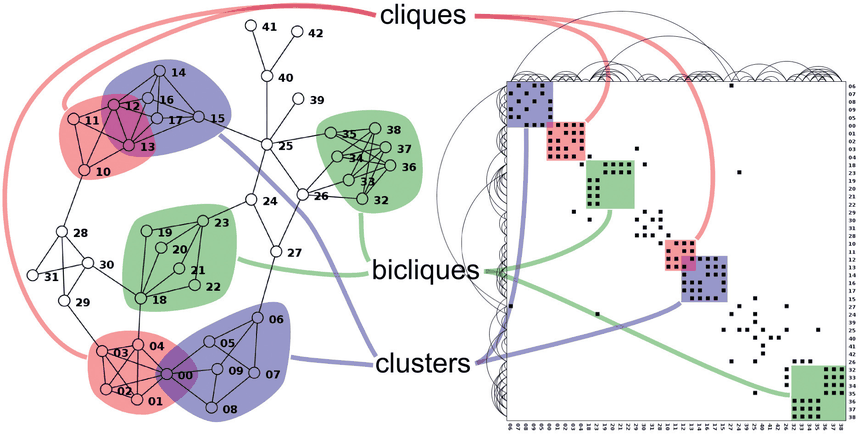

# 9.4 Costs and Benefits: Connection versus Matrix

## Node–link layouts

Encoding networks as node–link diagrams is by far the most popular way to visualise networks and trees [p.234]. The book's other node–link examples include the genealogical graphs of Figure 4.6, the telecommunications network with linewidth encoding bandwidth in Figure 5.9, Cerebral's gene interaction network in Figure 12.5 and the graph interaction examples of Figure 14.10; tree examples include DOITree (Figure 14.2), Cone Trees (Figure 14.4), H3 (Figure 14.6) and TreeJuxtaposer (Figure 14.7) [pp.234-235].

<!-- verbatim p.235 -->
> The great strength of node–link layouts is that for sufficiently small networks they are extremely intuitive for supporting many of the abstract tasks that pertain to network data.
<!-- /verbatim -->

They shine for topological tasks such as path tracing and searching local neighbourhoods a few hops from a target node, and can also be very effective for general overview and finding similar substructures. Effectiveness varies considerably with the specific layout idiom [p.235].

**Weakness: size and link density.** Past a certain network size and link density they become impossible to read, because edges occlude each other and the nodes they pass under [p.235].

<!-- verbatim p.235 -->
> The link density of a network is the number of links compared with the number of nodes. Trees have a link density of one, with one edge for each node. The upper limit for node–link diagram effectiveness is a link density of around three or four [Melanc¸on 06].
<!-- /verbatim -->

Even below a density of four, growing size eventually degrades the layout into an unreadable hairball. The legibility limit depends on the algorithm: simpler ones support hundreds of nodes, while more state-of-the-art ones handle thousands well but degrade in performance for tens of thousands. Interactive navigation and exploration address the problem partially but not fully; filtering, aggregation and navigation ameliorate clutter but add cognitive load, because the user must remember the structure of the parts not visible [p.235].

## Matrix views

- **Perceptual scalability** for large and dense networks. Matrices eliminate node–link occlusion, so they stay effective at very high information densities: node–link views break down beyond about three or four times as many edges as nodes, while matrices handle dense graphs up to the mathematical limit of the node count squared [pp.235-236].
- **Size limits.** Per the scalability analyses of Sections 7.5.2 and 13.4.1, a single-level matrix view handles up to one million edges and an aggregated multilevel matrix view might handle up to ten billion [p.236].
- **Predictability.** A matrix fits a predictable amount of screen space, whereas a node–link view's space need depends on the dataset and is not known in advance [p.236].
- **Stability.** Adding an item makes only a small visual change, where in a force-directed view it might cause a major change. This lets multilevel matrix views easily support geometric or semantic zooming [p.236].
- **Reordering.** Matrices work with the interaction choice of reordering the elements along the axes on demand (Section 7.5) [p.236].
- **Lookup and counting.** Matrices support quickly estimating the number of nodes and finding a node by its label in an ordered list; in a node–link layout a node could be anywhere, though interactive search can highlight matches as labels are typed [p.236].

**Weakness: unfamiliarity.** Most users read small node–link views without training but typically need training for matrix views. With sufficient training many patterns become salient, through different but roughly equally salient visual patterns in each view; Figure 9.7 shows three. A clique, fully interconnected lines in the node–link view, is a filled square block on the diagonal of the matrix, and after training it is "perhaps even easier" to tell a clique from a highly but not completely interconnected cluster in the matrix. Biclique structure is salient, but different, in both views. A node's degree is the count of filled cells in its row or column [pp.236-237].

<!-- verbatim p.237 -->
> The most crucial weakness of matrix views is their lack of support for investigating topological structure because they show links in a more indirect way than the direct connections of node–link diagrams.
<!-- /verbatim -->

This weakness is the direct trade-off for avoiding clutter. The book suggests, hedged with "might be", that node–link views stay popular because most complex network tasks need topological inspection as a subtask. Hybrid multiple-view systems using both representations, such as MatrixExplorer (Figure 4.8), combine their complementary strengths [p.237].

## Empirical evidence

A study comparing the two for many low-level network tasks found node–link views best for small networks and matrix views best for large ones [p.237]. Several tasks grew harder with size for node–link views but not for matrices: estimating the numbers of nodes and edges, finding the most connected node, finding a node by label, finding a direct link between two nodes and finding a common neighbour. Finding a multiple-link path was always harder in matrix views, even for large networks, which agrees with the analysis that path tracing is best supported by node–link views [pp.237-238].

## Figures

-  **Figure 9.7** [p.237]. Characteristic patterns in matrix views and node–link views: both can show cliques and clusters clearly. From [McGuffin 12, Figure 6].

## Related

- [9.2 Connection: Link Marks](s09-02-connection-link-marks.md): the node–link examples this section weighs [p.234]
- [9.3 Matrix Views](s09-03-matrix-views.md): how the adjacency matrix is derived and encoded [p.235]
- [Force-Directed Placement](../idioms/force-directed-placement.md): the layout whose instability the matrix's stability is contrasted with [p.236]
- [Adjacency Matrix View](../idioms/adjacency-matrix-view.md): the matrix idiom's box [p.235]
- [7.5.2 Matrix Alignment: Two Keys](../ch07-arrange-tables/s07-05-separate-order-align-categorical/s07-05-02-matrix-alignment-two-keys.md): the scalability analysis behind the one-million-edge limit [p.236]
- [13.4.1 Item Aggregation](../ch13-reduce-items-attributes/s13-04-aggregate/s13-04-01-item-aggregation.md): the scalability analysis behind aggregated multilevel matrices [p.236]
- [7.5 Separate, Order, and Align: Categorical Regions](../ch07-arrange-tables/s07-05-separate-order-align-categorical/node.md): reordering, which matrix views support [p.236]
- [Cerebral](../idioms/cerebral.md): a node–link gene interaction network example the book points to [p.235]
- [DOITrees Revisited](../idioms/doitrees-revisited.md): a node–link tree view example the book points to [p.235]
- [Hyperbolic Geometry](../idioms/hyperbolic-geometry.md): H3, a node–link file system tree example the book points to [p.235]
