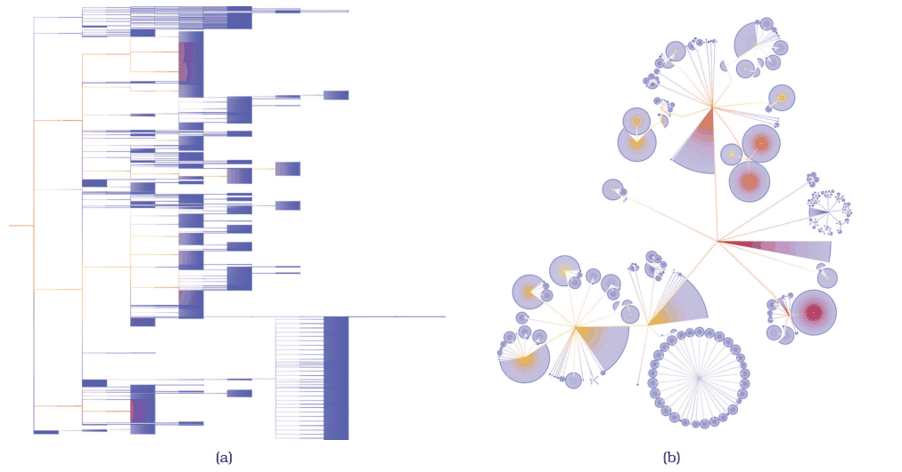
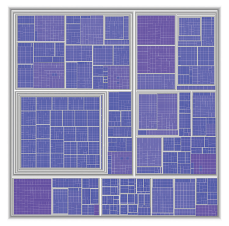
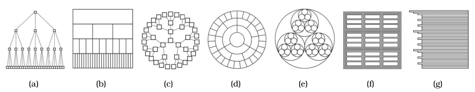
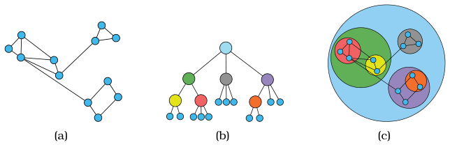

# 9.5 Containment: Hierarchy Marks

## Containment versus connection

<!-- verbatim p.238 -->
> Containment marks are very effective at showing complete information about hierarchical structure, in contrast to connection marks that only show pairwise relationships between two items at once.
<!-- /verbatim -->

## Treemaps

<!-- verbatim p.238 -->
> The idiom of treemaps is an alternative to node–link tree drawings, where the hierarchical relationships are shown with containment rather than connection. All of the children of a tree node are enclosed within the area allocated that node, creating a nested layout.
<!-- /verbatim -->

- **Size.** Node size is mapped to some attribute of the node; in Figure 9.8, the same 5161-node file system as Figure 9.3, node size encodes file size [pp.238-239].
- **Tasks.** Containment is not as effective as connection for topological tasks such as tracing paths through the tree, but it shines for understanding attribute values at the leaves [p.239].
- **Shape of hierarchy.** Treemaps are often used when hierarchies are shallow rather than deep [p.239].
- **Outliers.** They are very effective for spotting outliers of very large attribute values, here large files [p.239].

## Seven encodings of one tree

Figure 9.9 shows the same tree in seven idioms [p.239]:

| Idiom | Link relationships | Tree depth | Sibling order |
| --- | --- | --- | --- |
| (a) Rectilinear vertical node–link | connection | vertical position [p.239] | horizontal position [p.239] |
| (b) Icicle | horizontal position | vertical position and size [p.239] | horizontal position [p.239] |
| (c) Radial node–link | connection | radial depth position [p.239] | radial angular position [p.239] |
| (d) Concentric circles | radial angular position | radial depth position and size [p.239] | radial angular position [p.239] |
| (e) Nested circles | radial containment | nesting level and size [p.239] | not stated [p.239] |
| (f) Treemap | rectilinear containment | nesting level and size [p.239] | not stated [p.239] |
| (g) Indented outline | horizontal position | horizontal position [p.239] | vertical position [p.239] |

Two idioms use containment (e, f) and two use connection (a, c) [p.239]. In most of the trees, spatial position explicitly shows depth, and three show parent–child relationships with no connection marks at all: the icicle and concentric circles show depth along one spatial dimension and parent–child relationships along the other, and the indented outline shows parent–child relationships with relative vertical position as well as depth with horizontal position [pp.239-240]. The text's description of (g) differs slightly from its caption, which assigns link relationships to horizontal position [pp.239-240].

## Compound networks and GrouseFlocks

Containment is usually only used when there is a hierarchical structure: either the network is simply a tree, or it is a compound network [p.240].

<!-- verbatim p.240 -->
> In other words, a compound network is a combination of a network and a tree on top of it, where the nodes in the network are the leaves of the tree.
<!-- /verbatim -->

Interior tree nodes therefore encompass several network nodes, and "multilevel network" is sometimes used as a synonym [p.240]. Containment is often used to explore compound networks. Where sfdp derived one hierarchy only to accelerate layout and never showed it, GrouseFlocks lets users investigate multiple possible hierarchies and shows them explicitly: Figure 9.10 moves from the original graph, to a cluster hierarchy drawn as a node–link layout, to a combined view with containment marks for the hierarchy and connection marks for the network links [pp.240-241]. Cluster hierarchies are discussed further in Section 7.5.2 [p.240].

## Figures

-  **Figure 9.3** [p.228]. Two layouts of a 5161-node tree. (a) Rectangular horizontal node–link layout. (b) BubbleTree node–link layout.
-  **Figure 9.8** [p.238]. Treemap layout showing hierarchical structure with containment rather than connection, in contrast to the node–link diagrams of the same 5161-node tree in Figure 9.3.
-  **Figure 9.9** [p.239]. Seven visual encoding idioms showing the same tree dataset, using different combinations of visual channels. (a) Rectilinear vertical node–link, using connection to show link relationships, with vertical spatial position showing tree depth and horizontal spatial position showing sibling order. (b) Icicle, with vertical spatial position and size showing tree depth, and horizontal spatial position showing link relationships and sibling order. (c) Radial node– link, using connection to show link relationships, with radial depth spatial position showing tree depth and radial angular position showing sibling order. (d) Concentric circles, with radial depth spatial position and size showing tree depth and radial angular spatial position showing link relationships and sibling order. (e) Nested circles, using radial containment, with nesting level and size showing tree depth. (f) Treemap, using rectilinear containment, with nesting level and size showing tree depth. (g) Indented outline, with horizontal spatial position showing tree depth and link relationships and vertical spatial position showing sibling order. From [McGuffin and Robert 10, Figure 1].
-  **Figure 9.10** [p.240]. GrouseFlocks uses containment to show graph hierarchy structure. (a) Original graph. (b) Cluster hierarchy built atop the graph, shown with a node– link layout. (c) Network encoded using connection, with hierarchy encoded using containment. From [Archambault et al. 08, Figure 3].

## Related

- [Treemaps](../idioms/treemaps.md): the idiom box for containment-based tree layout [p.239]
- [GrouseFlocks](../idioms/grouseflocks.md): containment for the cluster hierarchy of a compound network [p.240]
- [9.2 Connection: Link Marks](s09-02-connection-link-marks.md): the node–link tree layouts and the sfdp hierarchy contrasted here [p.240]
- [7.5.2 Matrix Alignment: Two Keys](../ch07-arrange-tables/s07-05-separate-order-align-categorical/s07-05-02-matrix-alignment-two-keys.md): the book's further discussion of cluster hierarchies [p.240]
