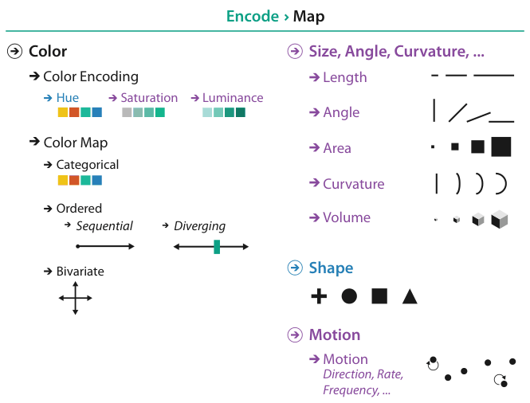

# 10.1 The Big Picture

## Scope of the chapter

The chapter covers how colour and the other nonspatial channels are mapped in visual encoding, summarised as a design-choice tree in Figure 10.1 [pp.243-244].

<!-- verbatim p.244 -->
> The colloquial term color is best understood in terms of three separate channels: luminance, hue, and saturation.
<!-- /verbatim -->

## The colormap choice

<!-- verbatim p.244 -->
> The major design choice for colormap construction is whether the intent is to distinguish between categorical attributes or to encode ordered attributes.
<!-- /verbatim -->

- **Sequential** ordered colormaps show an attribute progressing from a minimum to a maximum value [p.244].
- **Diverging** ordered colormaps mark a zero point in the centre, with values diverging to negative on one side and positive on the other [p.244].
- **Bivariate** colormaps show two attributes at once through carefully designed combinations of luminance, hue and saturation [p.244].

## The other channels

The chapter also covers the magnitude channels of size, angle and curvature, and the identity channels of shape and motion [p.244]. Figure 10.1 groups them under "Encode › Map": colour, split into colour encoding (hue, saturation, luminance) and colour map (categorical; ordered, either sequential or diverging; bivariate); "Size, Angle, Curvature, ..." (length, angle, area, curvature, volume); shape; and motion (direction, rate, frequency) [p.243].

## Figures

-  **Figure 10.1** [p.243]. Design choices for mapping color and other visual encoding channels.

## Related

- [10.2 Color Theory](s10-02-color-theory/node.md): the three colour channels introduced here, in detail [p.244]
- [10.3 Colormaps](s10-03-colormaps/node.md): the categorical, sequential, diverging and bivariate colormap choice [p.244]
- [10.4 Other Channels](s10-04-other-channels.md): size, angle, curvature, shape and motion [p.244]
