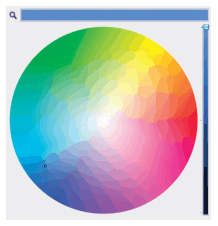
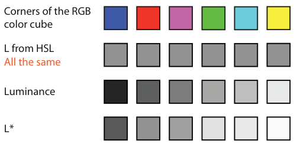
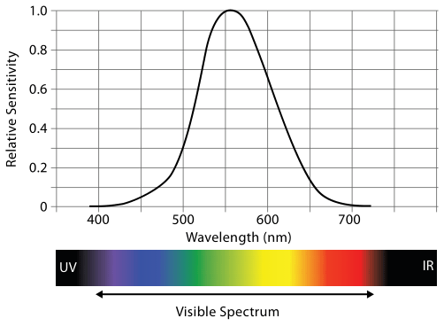

# 10.2.2 Color Spaces

## Colour is three-dimensional

The colours the human visual system can detect form a three-dimensional space. Many mathematical descriptions exist; some are convenient for computers, others match human vision better [p.245].

## RGB

Colours specified as red, green and blue triples form the RGB system, the most common in computer graphics [p.245].

<!-- verbatim p.245 -->
> Although this system is computationally convenient, it is a very poor match for the mechanics of how we see.
<!-- /verbatim -->

The R, G and B axes are not useful as separable channels: they give rise to the integral perception of a colour, so the book does not treat them as channels [p.245].

## HSL and HSV

HSL (hue–saturation–lightness) is more intuitive and widely used by artists and designers [p.245].

- **Hue** captures pure colours not mixed with white or black: red, blue, green, yellow, purple and so on [p.245].
- **Saturation** is the amount of white mixed with the pure colour; pink is a partially desaturated red [p.245].
- **Lightness** is the amount of black mixed with a colour [p.245].
- A common colour picker is a disk with white at the centre, hue around the outside and a separate linear darkness control (Figure 10.2). HSV is very similar, with V (grayscale value) linearly related to L [pp.245-246].

<!-- verbatim p.246 -->
> Despite the popularity of the HSL space, it is only pseudoperceptual: it does not truly reflect how we perceive color.
<!-- /verbatim -->

HSL lightness differs wildly from perceived luminance. Figure 10.3 shows six hues ordered by luminance whose computed L values are all identical; true luminance varies somewhat between them and is a better match [p.246].

## Luminance depends on wavelength

Perceived luminance does not match what an instrument measures: it depends on wavelength. The daylight spectral sensitivity curve is roughly bell shaped (Figure 10.4); we are much more sensitive to middle green and yellow wavelengths than to outer red and blue ones [pp.246-247].

## Perceptually uniform spaces: L\*a\*b\*

- Several colour spaces try to be perceptually uniform, including L\*a\*b\*, with one black-and-white luminance channel L\* and two colour axes a\* and b\*. In Figure 10.3, L\* matches what we see even better than true luminance [p.247].
- L\* is a nonlinear transformation of luminance, because perception of luminance is compressed (the brightness power-law exponent of n = 0.5 in Figure 5.7). It is designed to be perceptually linear, so equal steps look equal, based on measurement over a very large set of observers. The colour axes are also designed to be as perceptually linear as possible [p.247].
- So L\*a\*b\* suits computations such as interpolation and finding differences between colours, which should not be done in the perceptually nonlinear RGB or HSL spaces [p.247].

## The book's terminology

The book uses **luminance** for the black-and-white channel and **saturation** and **hue** for the two chromaticity channels. This hybrid usage matches no standard computer-graphics colour space exactly [p.248].

- The book avoids "perceptually linear luminance" because very few visual encoding idioms compute it [p.248].
- It avoids "brightness", the technical term for perceived luminance, because brightness depends on illumination and surrounding context; encoding idioms manipulate luminance rather than true brightness [p.248].

## Figures

-  **Figure 10.2** [p.246]. A common HSL/HSV colorpicker design, as in this example from Mac OS X, is to show a color wheel with fully saturated color around the outside and white at the center of the circle, and a separate control for the darkness.
-  **Figure 10.3** [p.246]. Comparing HSL lightness, true luminance, and perceptually linear luminance L∗for six colors. The computed HSL lightness L is the same for all of these colors, showing the limitations of that color system. The true luminance values of these same six colors, as could be measured with an instrument. The computed perceptually linear luminance L∗of these colors is the best match with what we see. After [Stone 06].
-  **Figure 10.4** [p.247]. The spectral sensitivity of our eyes to luminance depends on the wavelength of the incoming light. After [Kaiser 96], <http://www.yorku.ca/eye/> photopik.htm.

## Related

- [5.5.1 Accuracy](../../ch05-marks-channels/s05-05-channel-effectiveness/s05-05-01-accuracy.md): the power-law exponents (Figure 5.7) behind compressed luminance perception [p.247]
- [10.2.3 Luminance, Saturation, and Hue](s10-02-03-luminance-saturation-hue.md): how the three channels named here behave in encoding [p.248]
