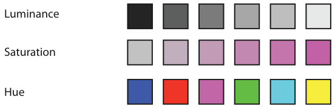

# 10.2.3 Luminance, Saturation, and Hue

## Magnitude versus identity

Colour is confusing in analysis because it is used sometimes as a magnitude channel and sometimes as an identity channel [p.248].

<!-- verbatim p.248 -->
> Luminance and saturation are magnitude channels, while hue is a identity channel. When I use the generic term color, I mean the integral perception across all three of these channels at once, and I am analyzing it as an identity channel.
<!-- /verbatim -->

## The three channels at a glance

| Channel | Type and data | Discriminable steps | Main caveats |
| --- | --- | --- | --- |
| Luminance | Magnitude; ordered data | Small, typically fewer than five on a non-uniform background; Ware: avoid grayscale above two to four bins | Low accuracy across noncontiguous regions (contrast effects); once used for an attribute it is "used up" [p.248] |
| Saturation | Magnitude; ordered data | Low, around three bins | Low accuracy across noncontiguous regions; strong interaction with size [pp.248-249] |
| Hue | Identity; categorical data and groupings | Around six or seven bins in small separated regions | Harder in small regions; no implicit ordering [p.249] |

## Luminance

- Contrast effects make it hard to judge whether noncontiguous regions share a luminance, so few steps are discriminable [p.248].
- Encoding an attribute with luminance uses it up for any other purpose [p.248].

<!-- verbatim p.248 -->
> A crucial consideration when visual encoding with color is that luminance contrast is the only way we can resolve fine detail and see crisp edges; hue contrast or saturation contrast does not provide detectable edges. In particular, text is not readable without luminance contrast.
<!-- /verbatim -->

<!-- verbatim p.248 -->
> The standard guidelines are that 10:1 is a good luminance contrast ratio for text, with 3:1 as a minimum [Ware 13].
<!-- /verbatim -->

Where fine-grained features must be legible, provide enough luminance contrast [p.248].

## Saturation

- Saturation suits ordered data but shares luminance's low accuracy across noncontiguous regions, and has about three discriminable bins [p.248].
- It interacts strongly with size: it is harder to perceive in small regions. Point and line marks occupy small regions, so two saturation levels are safer there [p.248].
- Saturation and hue are not separable within small regions for categorical colour coding [p.249].

<!-- verbatim p.249 -->
> For small regions, designers should use bright, highly saturated colors to ensure that the color coding is distinguishable. When colored regions are large, as in backgrounds, the design guideline is the opposite: use low-saturation colors; that is, pastels.
<!-- /verbatim -->

## Hue

<!-- verbatim p.249 -->
> The identity channel of hue is extremely effective for categorical data and showing groupings. It is the highest ranked channel for categorical data after spatial position.
<!-- /verbatim -->

- Like saturation, hue is harder to distinguish in small regions than large ones [p.249].
- Fine hue distinctions are possible between contiguous regions, but discriminability between separated regions is very limited: around six or seven bins in small separated regions [p.249].
- Hue has no implicit perceptual ordering (Figure 10.5). People reliably put gray between black and white, and pink between saturated red and white, but do not agree on an order for red, blue, green and yellow. Learned conventions, such as green–yellow–red for traffic lights or rainbow order, sit above pure perception [p.249].

## Figures

-  **Figure 10.5** [p.249]. The luminance and saturation channels are automatically interpreted as ordered by our perceptual system, but the hue channel is not.

## Related

- [10.3 Colormaps](../s10-03-colormaps/node.md): how these channel properties decide which colormap fits which attribute type [p.249]
- [10.2.4 Transparency](s10-02-04-transparency.md): the fourth colour channel and which of these three it may combine with [p.249]
- [Categorical Colormaps](../../idioms/categorical-colormaps.md): the saturation-by-region-size rule applied to categorical palettes [p.249]
