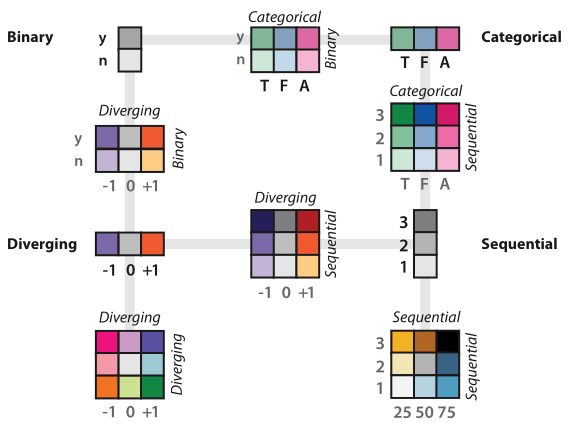
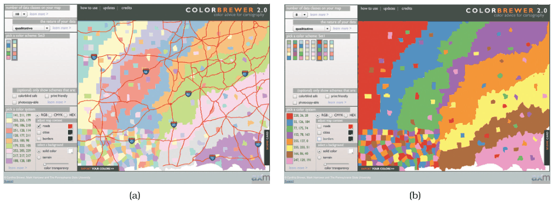
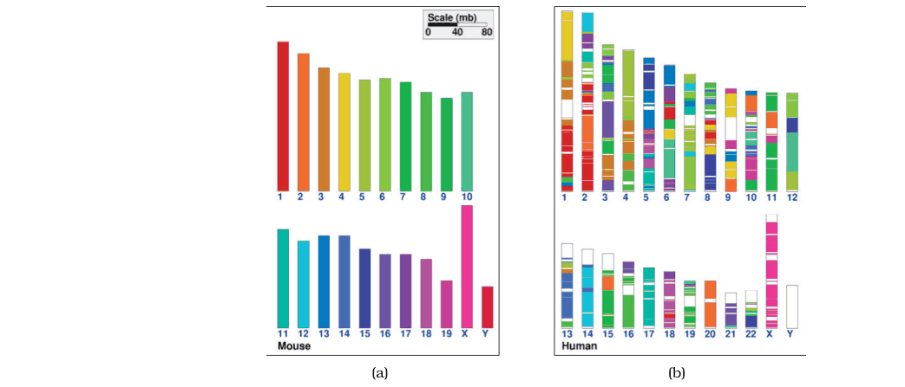
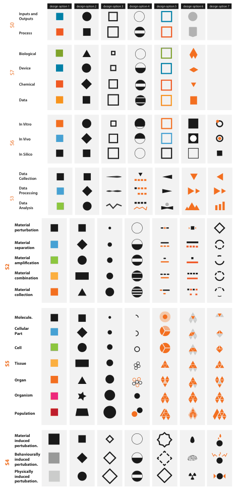
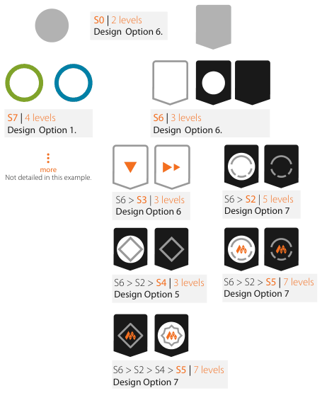

# 10.3.1 Categorical Colormaps

## Colormaps in general (Section 10.3 introduction)

<!-- verbatim p.250 -->
> A colormap specifies a mapping between colors and data values; that is, a visual encoding with color.
<!-- /verbatim -->

- Colormapping is also called pseudocoloring, especially in earlier literature, and a colormap is also called a color ramp [p.250].
- The colormap taxonomy (Figure 10.6) mirrors the data-type taxonomy: categorical or ordered, and ordered splits into sequential or diverging. Match colormap to data type, following the expressiveness principle [p.250].
- Ordered colormaps should use the magnitude channels of luminance and saturation, because hue has no implicit ordering [p.250].
- Colormaps are either continuous or segmented into discrete bins (also called quantized, stepped, binned, discretized or discrete). Continuous colormaps are heavily used for quantitative attributes, especially of inherently spatial fields. Segmented colormaps suit categorical data. For ordinal data, segmented emphasises its discrete nature and continuous its ordered nature [p.250].
- Bivariate colormaps encode two attributes; they are easy to understand when the second is binary and harder when both have multiple levels [p.250].

## Definition

<!-- verbatim p.251 -->
> A categorical colormap uses color to encode categories and groupings. Categorical colormaps are normally segmented.
<!-- /verbatim -->

- They are also called qualitative colormaps [p.251].
- Used appropriately they are very effective: for categorical data they are the next best channel after spatial position [p.251].
- They typically use colour as one integral identity channel for a single attribute, not hue, saturation and luminance for three separate attributes [p.251].

## How many colours

<!-- verbatim p.251 -->
> The number of discriminable colors for coding small separated regions is limited to between six and twelve bins.
<!-- /verbatim -->

- Count the background colour and any default object colours in the total; black, white and gray often go to those uses [p.251].
- Prefer easily nameable colours, for memorability and for discussing them in words [p.251].
- Start with the fully saturated, nameable opponent colours red, blue, green and yellow; when more are needed, add orange, brown, pink, magenta, purple and cyan [pp.251-252].

## Luminance and saturation still matter

- For some uses the colours should be close in luminance, to avoid large salience differences and so all show against one background; fully saturated yellow and green have much less luminance contrast against white than red and blue [p.252].
- For other uses the colours should differ enough in luminance to be distinguishable in black and white [p.252].
- Small regions such as lines need highly saturated colours; large areas need low saturation, so the right colormap may depend on mark type [p.252].
- ColorBrewer (<http://www.colorbrewer2.org>) builds perceptual guidelines into safe suggestions. Its ten-element low-saturation map (Figure 10.7a) suits large regions and leaves saturated colours for small road marks; its eight-element high-saturation map (Figure 10.7b) is too bright for large areas but fits small line or point marks [p.252].

## Discriminability mismatch: the genome example

Figure 10.8 shows categorical colour failing because the attribute has more levels than can be told apart in small noncontiguous regions [p.253].

- In the mouse view (Figure 10.8a), all 21 chromosome colours are distinguishable: regions are large and the subtlest differences are between adjacent regions, so the view works as legend and index [p.253].
- In the human view (Figure 10.8b), the same colours mark small noncontiguous regions. Seven greens collapse to about three bins and five pinks and purples to about three; only around 12 bins are distinguishable in total [pp.253-254].

## Two remedies

1. **Reduce the number of bins deliberately** by a data transformation that respects the data and task, so each bin gets a distinguishable colour. This beats the inadvertent binning of the viewer's perceptual system, which rarely matches meaningful divisions in the data. Options: exploit hierarchical structure to derive aggregate groups with one colour each, or filter to colour only the most important categories and aggregate the rest into "other". Constellation (Section 15.8) narrowed a few dozen link categories to eight bins this way [p.254].
2. **Use other channels instead of, or as well as, colour.** For biological experiment workflows with 27 categorical levels in seven categories of three to seven levels each, seven designs using shape, size and metaphoric glyphs were considered (Figure 10.9). The final design used colour only for the four levels of category S7 (Figure 10.10) [pp.254-256].

## Figures

-  **Figure 10.6** [p.251]. The colormap categorization partially mirrors the data types: categorical versus ordered, and sequential and diverging within ordered. Bivariate encodings of two separate attributes at once is safe if one has only two levels, but they can be difficult to interpret when both attributes have multiple levels. After [Brewer 99].
-  **Figure 10.7** [p.252]. Saturation and area. (a) The ten-element low-saturation map works well with large areas. (b) The eight-element high-saturation map would be better suited for small regions and works poorly for these large areas. Made with ColorBrewer, <http://www.colorbrewer2.org>.
-  **Figure 10.8** [p.253]. Ineffective categorical colormap use. (a) The 21 colors used as an index for each mouse chromosome can indeed be distinguished in large regions next to each other. (b) In noncontiguous small regions only about 12 bins of color can be distinguished from each other, so a lot of information about how regions in the mouse genome map to the human genome is lost. From [Sinha and Meller 07, Figure 2].
-  **Figure 10.9** [p.255]. Effective categorical colormap use: A large space of visual encoding possibilities for 27 categories was considered systematically in addition to the color channel, including size and shape channels and more complex glyphs. From [Maguire et al. 12, Figure 5].
-  **Figure 10.10** [p.256]. Effective categorical colormap use: The final design uses the color channel for only four of the categories. From [Maguire et al. 12, Figure 6].

## Related

- [Categorical Colormaps](../../idioms/categorical-colormaps.md): the card with decision rules and code [p.251]
- [5.4.1 Expressiveness and Effectiveness](../../ch05-marks-channels/s05-04-using-marks-channels.md#s05.04.01): the expressiveness principle that matches colormap to data type [p.250]
- [2.4.3 Fields](../../ch02-what-data-abstraction/s02-04-dataset-types/s02-04-03-fields.md): continuous versus discrete data semantics behind continuous and segmented colormaps [p.250]
- [15.8 Constellation](../../ch15-analysis-case-studies/s15-08-constellation.md): link colour coding reduced from a few dozen categories to eight bins [p.254]
- [13 Reduce Items and Attributes](../../ch13-reduce-items-attributes/node.md): the aggregation and filtering idioms behind the first remedy [p.254]
- [10.4 Other Channels](../s10-04-other-channels.md): shape, size and other channels for the second remedy [p.254]
