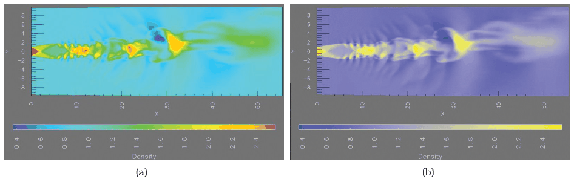
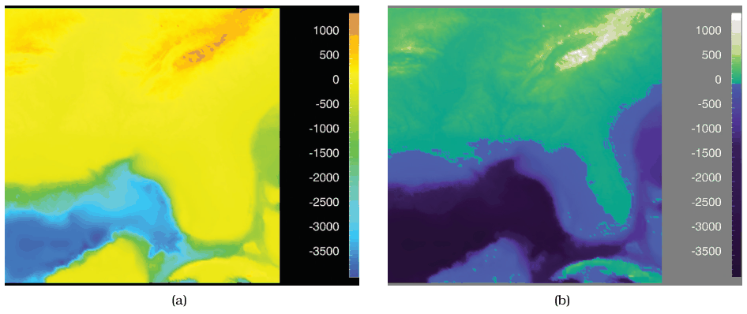
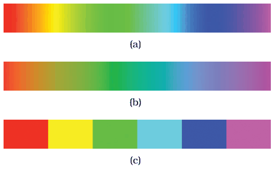

# 10.3.2 Ordered Colormaps

## Definition and the two variants

<!-- verbatim p.254 -->
> An ordered colormap is appropriate for encoding ordinal or quantitative attributes.
<!-- /verbatim -->

The two major variants of continuous colormaps for ordered data have expressiveness characteristics that should match the attribute type [p.254].

<!-- verbatim p.254 -->
> A sequential colormap ranges from a minimum value to a maximum value.
<!-- /verbatim -->

- Luminance alone gives a grayscale ramp [p.254].
- With hue, one end is a specific hue at full saturation and brightness. If saturation varies, the other end is pale or white; if luminance varies, it is dark or black [pp.254-256].

<!-- verbatim p.256 -->
> A diverging colormap has two hues at the endpoints and a neutral color as a midpoint, such as white, gray, or black, or a high-luminance color such as yellow.
<!-- /verbatim -->

## How many hues

The number of hues depends on which level of structure to emphasise: high-level structure, mid-level neighbourhoods, or fine-grained low-level detail [p.256].

- Many hues (the rainbow in Figure 10.11a) emphasise mid-level neighbourhood structure [p.256].
- Two fully saturated hues with saturation varying smoothly to a midpoint (Figure 10.11b, purple to yellow through gray) emphasise large-scale structure. The text calls the ends purple and yellow while the caption calls the map blue–yellow [pp.256-257].
- Many hues make subranges easy to discuss because they are nameable ("the red part versus the blue part"); a saturation or luminance ramp gives only two hue-based categories ("the purple side versus the yellow side"), and smaller neighbourhoods cannot easily be named [pp.256-257].

## The three problems with rainbow colormaps

Rainbow colormaps are a default in many software packages, but have three serious perceptual problems (Figure 10.12a) [p.257]:

1. **Expressiveness mismatch.** Hue is used to show order, though it is an identity channel with no implicit perceptual ordering [p.257].
2. **Perceptual nonlinearity.** Equal steps are not perceived equally across the range. In Figure 10.12(a), –2000 to –1000 shows three distinct colours (cyan, green, yellow), while –1000 to 0 looks yellow throughout [p.257].
3. **Accuracy mismatch.** Fine detail cannot be perceived with hue; luminance would be much better, because edge detection requires luminance contrast [p.257].

## The fix: monotonically increasing luminance

<!-- verbatim p.257 -->
> One way to address all three problems is to design monotonically increasing luminance colormaps: that is, where the multiple hues are ordered according to their luminance
<!-- /verbatim -->

The sentence continues across the page break: the hues run from lowest luminance to highest [pp.257-258].

- The varying hues allow segmentation into categorical regions, for seeing and describing mid-level neighbourhoods [p.258].
- Luminance, a magnitude channel, provides perceptual ordering: high-level distinctions ("the dark parts" versus "the light parts") and low-level structure, because subtle luminance changes are perceived more accurately than subtle hue changes [p.258].
- Figure 10.12(b) uses hue for semantic categories (dark blue sea, cyan continental shelf, green lowlands, white mountains), with a clear segmentation at zero, which is sea level, a semantically meaningful point [p.258].

## Perceptually linear rainbows

A perceptually linear rainbow is possible but loses dynamic range, because fully saturated colours are unavailable (Figure 10.13b, [Kindlmann 02]). It is so much less bright that it seems almost dingy, so it is not commonly used [pp.258-259].

## Segmented rainbows

<!-- verbatim p.259 -->
> Rainbows are not always bad; a segmented rainbow colormap is a fine choice for categorical data with a small number of categories.
<!-- /verbatim -->

- Segmented rainbows could also be used for ordered data: not ideal, but explicit discretisation removes the perceptual nonlinearity problem [p.259].
- A segmented colormap on quantitative data transforms the data type from quantitative to ordered. This is most legitimate when task-driven semantics guide the binning: better to bin deliberately than let the eye create unequal bins that miss meaningful divisions [p.259].

## Figures

-  **Figure 10.11** [p.257]. Rainbow versus two-hue continuous colormap. (a) Using many hues, as in this rainbow colormap, emphasizes mid-scale structure. (b) Using only two hues, the blue–yellow colormap emphasizes large-scale structure. From [Bergman et al. 95, Figures 1 and 2].
-  **Figure 10.12** [p.258]. Rainbow versus multiple-hue continuous colormap with monotonically increasing luminance. (a) Three major problems with the common continuous rainbow colormap are perceptual nonlinearity, the expres-sivity mismatch of using hue for ordering, and the accuracy mismatch of using hue for fine-grained detail. (b) A colormap that combines monotonically increasing luminance with multiple hues for semantic categories, with a clear segmentation at the zero point, succeeds in showing high-level, mid-level, and low-level structure. From [Rogowitz and Treinish 98, Figure 1].
-  **Figure 10.13** [p.259]. Appropriate use of rainbows. (a) The standard rainbow colormap is perceptually nonlinear. (b) Perceptually linear rainbows are possible [Kindlmann 02], but they are less bright with a decreased dynamic range. (c) Segmented rainbows work well for categorical data when the number of categories is small.

## Related

- [Ordered Colormaps](../../idioms/ordered-colormaps.md): the card with decision rules and code [p.254]
- [10.2.3 Luminance, Saturation, and Hue](../s10-02-color-theory/s10-02-03-luminance-saturation-hue.md): why luminance carries order and edges and hue does not [p.257]
- [10.3.1 Categorical Colormaps](s10-03-01-categorical-colormaps.md): where segmented rainbows and nameable hues are the right tool [p.259]
- [10.3.3 Bivariate Colormaps](s10-03-03-bivariate-colormaps.md): sequential and diverging attributes combined in one colormap [p.259]
