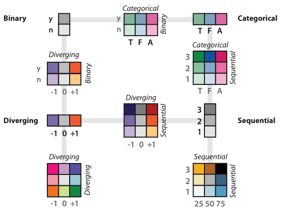

# 10.3.3 Bivariate Colormaps

## Univariate versus bivariate

<!-- verbatim p.259 -->
> The safest use of the color channel is to visually encode a single attribute; these colormaps are known as univariate.
<!-- /verbatim -->

Colormaps that encode two separate attributes are called bivariate; Figure 10.6 includes several [p.259].

## By attribute combination

| Combination | Verdict | How |
| --- | --- | --- |
| Either attribute binary (categorical–binary, diverging–binary) | Straightforward and comprehensible | Two families of colours: fix a base set of hues and vary their saturation [pp.259-260] |
| One categorical attribute with hierarchical structure | Also useful | The same fixed-hues, varied-saturation approach [p.260] |
| Categorical–categorical, both multi-level | Poor results [Wainer and Francolini 80]; absent from Figure 10.6 | None in the figure [p.260] |
| Sequential–sequential, diverging–diverging, diverging–sequential, categorical–sequential | Middle ground; common in vis systems, but some people have difficulty interpreting them | Three levels per attribute in the figure; be aware some people struggle [p.260] |

The book's summary in Figure 10.6: encoding two attributes at once is safe if one has only two levels, but can be hard to interpret when both have multiple levels [p.251].

## Figures

-  **Figure 10.6** [p.251]. The colormap categorization partially mirrors the data types: categorical versus ordered, and sequential and diverging within ordered. Bivariate encodings of two separate attributes at once is safe if one has only two levels, but they can be difficult to interpret when both attributes have multiple levels. After [Brewer 99].

## Related

- [Bivariate Colormaps](../../idioms/bivariate-colormaps.md): the card with decision rules and code [p.259]
- [10.3.2 Ordered Colormaps](s10-03-02-ordered-colormaps.md): the sequential and diverging univariate maps being combined [p.260]
- [10.3.1 Categorical Colormaps](s10-03-01-categorical-colormaps.md): the colormap taxonomy and the univariate categorical case [p.250]
