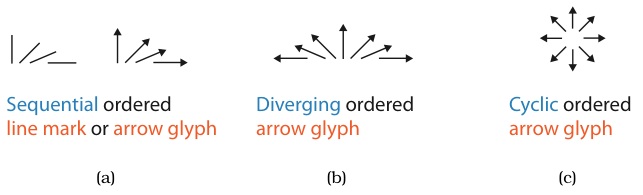

# 10.4 Other Channels

Beyond the highly salient position and colour channels, other magnitude channels are the size channels (length, area, volume), angle (orientation, tilt) and curvature; other identity channels are shape and motion. Texture and stippling combine several channels [p.261].

## Summary table

| Channel | Type | Accuracy or bins | Marks and interactions |
| --- | --- | --- | --- |
| Length | Magnitude | Extremely accurate; only aligned position beats it [p.261] | Integral with other sizes [p.261] |
| Angle | Magnitude | Less accurate than length and position, more than area; best near horizontal, vertical and diagonal [p.262] | Sequential, diverging or cyclic data [p.262] |
| Area | Magnitude | Significantly less accurate; Stevens exponent 0.7; mid-ranking [p.261] | Subsumes length [p.261] |
| Curvature | Magnitude | Not very accurate; probably two or three bins; bottom of ranking with volume [p.263] | Line marks only [p.263] |
| Volume | Magnitude | Quite inaccurate; bottom of ranking; rarely the right choice [p.261] | Subsumes area and length [p.261] |
| Shape | Identity | Dozens to hundreds of bins at large size; about a dozen at 10×10 pixels [p.263] | Point and line marks, not area [p.263] |
| Motion | Identity | Bins and separability between motion types unknown; use binary [p.264] | Separable from static channels; for highlighting [p.264] |
| Texture | Combination | One or two dozen categorical bins; three or four per subchannel for ordered [p.265] | Stippling gives dotted and dashed lines; area stippling now less common [p.265] |

## 10.4.1 Size Channels

- Size is a magnitude channel for ordered data. It interacts with most other channels: when marks are too small, encodings such as shape or orientation cannot be seen. It interacts particularly strongly with hue and saturation [p.261].
- Length is 1D size (height vertical, width horizontal), area 2D, volume 3D, and perceptual accuracy varies considerably across them [p.261].
- **Length** judgements are extremely accurate, very similar to unaligned planar position; only aligned planar position is more accurate [p.261].
- **Area** judgements are significantly less accurate: Stevens assigns an exponent of 0.7 (Figure 5.7). Area sits mid-ranking, below angle and above 3D depth [p.261].
- **Volume** is quite inaccurate, at the bottom of the rankings with curvature. Encoding with volume is rarely the right choice [p.261].

<!-- verbatim p.261 -->
> A larger-dimensional size coding clearly subsumes a smaller-dimensional one: length and area cannot be simultaneously used to encode different dimensions.
<!-- /verbatim -->

Combinations of smaller-dimensional sizes are usually integral: in Figure 5.10, small and large widths and heights gave three groups (small, large and flattened areas), not four. People asked to judge area might simply judge length instead [p.261].

## 10.4.2 Angle Channel

<!-- verbatim p.262 -->
> The angle channel encodes magnitude information based on the orientation of a mark: the direction that it points.
<!-- /verbatim -->

- Angle (orientation judged against another line) and tilt (judged against the display's global frame) are essentially the same channel; angle, tilt and orientation are often used as synonyms [p.262].
- It is somewhat less accurate than length and position but more accurate than area, the next channel down [p.262].
- Within one 90° quadrant angle works as a sequential channel (Figure 10.14a). It is also cyclic: a line mark cycles four times in 360°, an arrow, whose top differs from its bottom, once (Figure 10.14c). An arrow tilted through 180° gives a diverging tiltmap, with vertical as the neutral zero point (Figure 10.14b) [p.262].
- Accuracy is not uniform: very accurate near horizontal, vertical and diagonal, dropping in between. We can tell 89° from 90°, 44° from 45° and 1° from 0°, but not 37° from 38° [p.262].

## 10.4.3 Curvature Channel

The curvature channel is not very accurate and works only with line marks: point marks have no length and area marks have fully constrained shape. It has probably two or three distinguishable bins and sits with volume at the bottom of the magnitude ranking [p.263].

## 10.4.4 Shape Channel

- Shape is a complex perceptual catch-all; vision science identifies lower-level preattentive features such as closure, curvature, termination and intersection. The book simplifies shape to an identity channel for point and line marks [p.263].
- On point marks it is the common, easily understood case; on line marks it gives stipple patterns such as dotted and dashed lines. It cannot apply to area marks, whose shape is constrained by definition [p.263].
- With large enough points, shape has dozens or even hundreds of discriminable bins; in small regions far fewer. In 10×10 pixels, careful design might give roughly a dozen [p.263].
- Shape interferes with other channels as size does, and with size itself. Filled shapes such as disks are a good substrate for hue; sparse line-oriented marks such as crosses have fewer pixels for colour, impairing that channel [p.263].

## 10.4.5 Motion Channels

- Motion channels include direction of motion, velocity and flicker frequency. With a fixed spatial layout, motion is typically a cyclic oscillation around the item's location so it stays in view [pp.263-264].
- Motion is less studied, but is extremely salient and very separable from all static channels, notably colour and spatial position [p.264].

<!-- verbatim p.264 -->
> The strength and weakness of motion is that it strongly draws attention; it is nearly impossible to ignore.
<!-- /verbatim -->

- Attending selectively to the nonmoving channels may be difficult when motion is used. Flicker and blinking are so hard to ignore they can be very annoying and should be used only with great care [p.264].
- It is unclear whether motion channels are separable from each other or how many bins each has. A safe strategy is one combined motion channel for a binary category: moving versus still. The book therefore classifies motion as an identity channel, like shape [p.264].
- Motion suits highlighting, where drawing attention away from the rest of the scene is the goal, especially transitory highlighting with lightweight actions such as mouseover or clicking rather than heavyweight ones such as typed search. Many highlights are binary. Even blinking can fit where very strong emphasis is wanted, such as new items added at several locations in one timestep of a dynamic layout [p.264].

## 10.4.6 Texture and Stippling

- Texture means very small-scale patterns, simplified as three perceptual dimensions: orientation and scale of the elements (mapping to angle and size) and contrast, meaning luminance contrast related to element density (mapping to luminance) [pp.264-265].
- For categorical attributes, combining all three gives at least one or two dozen distinguishable bins with sufficient care [p.265].
- For ordered attributes, mapping separate attributes to each dimension allows no more than three or four bins each; using all three for one attribute gives around a dozen bins with careful design [p.265].

<!-- verbatim p.265 -->
> The term stippling means to fill in regions of drawing with short strokes.
<!-- /verbatim -->

Stippling is a special case of texture, still in regular use for dotted and dashed lines. It was heavily used for area marks in older printing, approximating gray with black ink; with cheap colour and grayscale printing, area stippling is less popular. Hatching and cross-hatching are synonyms for area stippling [p.265].

## Figures

-  **Figure 10.14** [p.262]. Tiltmaps using the angle channel to show three different types of ordered data. (a) A sequential attribute can be shown with either a line mark or an arrow glyph in one quadrant. (b) A diverging attribute can be shown with two quadrants and an arrow glyph. (c) A cyclic attribute can be shown with all four quadrants and arrow glyphs.

## Related

- [5.5.1 Accuracy](../ch05-marks-channels/s05-05-channel-effectiveness/s05-05-01-accuracy.md): the effectiveness ranking and Stevens exponents (Figure 5.7) these channels are placed in [p.261]
- [5.5.3 Separability](../ch05-marks-channels/s05-05-channel-effectiveness/s05-05-03-separability.md): the integral width and height example (Figure 5.10) [p.261]
- [11.4.2 Highlighting](../ch11-manipulate-view/s11-04-select-elements/s11-04-02-highlighting.md): the highlighting that motion channels suit [p.264]
- [Size Channels](../idioms/size-channels.md): length, area and volume: accuracy ranking and integrality [pp.261-262]
- [Angle Channel](../idioms/angle-channel.md): sequential, diverging and cyclic tiltmaps [p.262]
- [Curvature Channel](../idioms/curvature-channel.md): the low-accuracy channel for line marks [p.263]
- [Shape Channel](../idioms/shape-channel.md): categorical encoding on point and line marks [p.263]
- [Motion Channels](../idioms/motion-channels.md): binary highlighting by motion [pp.263-264]
- [Texture and Stippling](../idioms/texture-and-stippling.md): multi-channel patterns for categorical or ordered data [pp.264-265]
