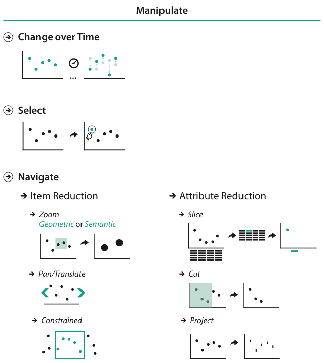

# 11.1 The Big Picture

## Three ways to manipulate a view

<!-- verbatim p.268 -->
> Figure 11.1 shows the design choices for how to manipulate a view: to change anything about it, to select items or attributes within it, and to navigate to a different viewpoint.
<!-- /verbatim -->

Figure 11.1 groups the choices as Change over Time, Select, Navigate (item reduction by zoom, pan/translate and constrained navigation, with zoom geometric or semantic) and attribute reduction (slice, cut, project) [p.267].

## Change

- **Scope.** The ways to change a view cover the full set of all other design choices for idioms: a change can switch from one idiom to another, or alter any parameter of a particular idiom [p.268].
- **What can change.** Any aspect of visual encoding, including the ordering, any other spatial-arrangement choice and other visual channels such as colour; what is filtered; the level of detail of aggregation; and how the data is partitioned into multiple views [p.268].

## Select

- A change often needs a set of items or attributes within the vis as input [p.268].
- Selection choices are what kinds of elements can be targets, how many selection types are supported, how many elements can be in the selected set, and how to highlight them [p.268].

## Navigate

<!-- verbatim p.268 -->
> Navigation is a change of viewpoint; that is, changing what is shown in a view based on the metaphor of a camera looking at the scene from a moveable point of view.
<!-- /verbatim -->

- The framework treats navigation separately, as a special case, because it is a rich enough source of design choices [p.268].
- **Zooming.** Zooming in to see fewer items in more detail can be geometric, matching the semantics of real-world motion. With semantic zooming, the way items are drawn adapts on the fly to the available pixels, so their appearance can change dramatically rather than simply shrinking or enlarging [p.268].
- **Attribute reduction.** The camera metaphor also motivates assigning attributes to spatial dimensions, which leads to the slice idiom (extract a single slice from the view volume), the cut idiom (separate the volume into two parts with a plane and eliminate everything on one side) and the project idiom (reduce the number of dimensions with one of many possible transformations) [pp.268-269].

## Figures

-  **Figure 11.1** [p.267]. Design choices for idioms that change a view.

## Related

- [11.3 Change View over Time](s11-03-change-view-over-time.md): the change choices in detail [p.268]
- [11.4 Select Elements](s11-04-select-elements/node.md): the selection choices in detail [p.268]
- [11.5 Navigate: Changing Viewpoint](s11-05-navigate-changing-viewpoint.md): zooming, panning and constrained navigation [p.268]
- [11.6 Navigate: Reducing Attributes](s11-06-navigate-reducing-attributes.md): slice, cut and project [pp.268-269]
