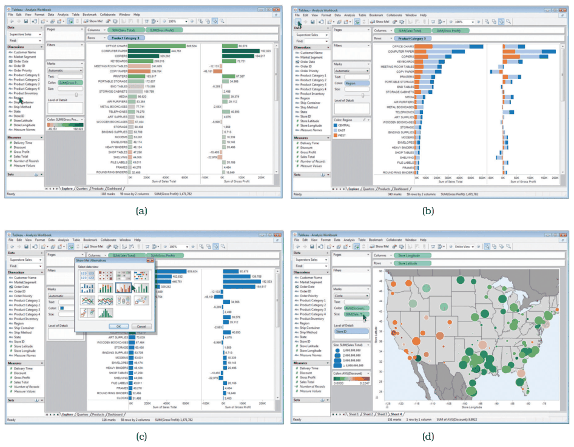
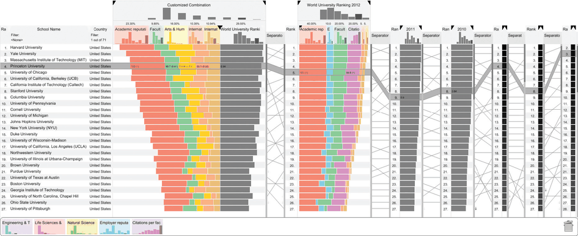
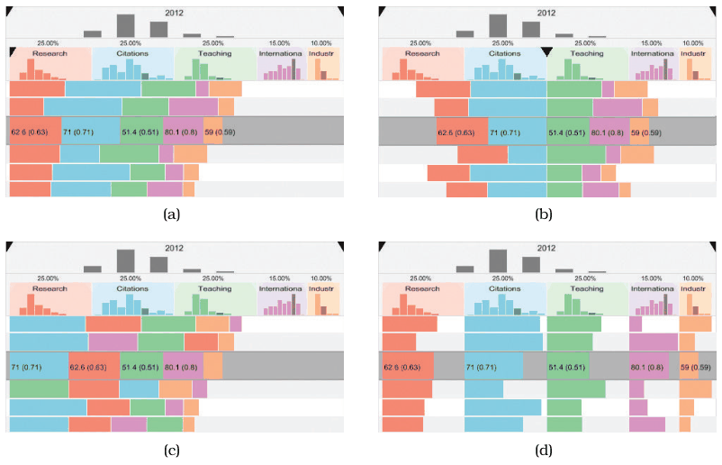
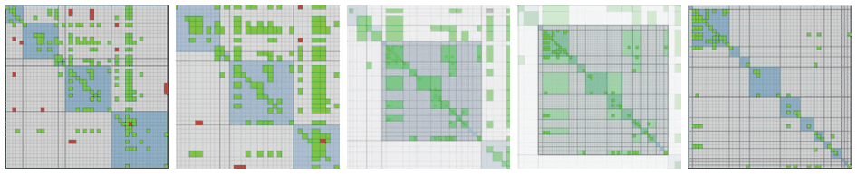

# 11.3 Change View over Time

## What can change

<!-- verbatim p.269 -->
> The possibilities for how the view changes can be based on any of the other design choices of how to construct an idiom: change the encoding, change the arrangement, change the order, change the viewpoint, change which attributes are filtered, change the aggregation level, and so on.
<!-- /verbatim -->

## Change the idiom

- Some vis tools let the user switch manually between different idioms, such as from a node–link layout to a matrix layout of a network [p.269].
- Giving the user control of the encoding is particularly common in general-purpose systems built to accommodate a large range of datasets, rather than special-purpose systems fine-tuned for a very particular task [p.269].
- **Tableau example.** Figure 11.2 shows one product sales dataset encoded several ways in Tableau, which moves fluidly between encodings through drag and drop that assigns attributes to channels: (a) simple bars, (b) stacked bars, (c) a recommendation of alternate encodings that suit the attributes' types and semantics, and (d) given spatial geometry as a substrate, with circular area marks size coded for the sum of sales and colour coded with a diverging red–green colormap for average discount [pp.269-270].

## Change a parameter

Another kind of change alters some parameter of the existing encoding, such as the range of possible mark sizes [p.270].

## Reorder

Reordering, often called sorting, is a powerful choice for finding patterns by interactively changing the attribute used to order the data [pp.270-271].

- A common interaction with tables is sorting rows by the values in a chosen column; the same principle holds for more exotic encodings [p.271].
- **Why it works.** Its power lies in the privileged status of spatial position as the highest-ranked visual channel; reordering spatially invokes the pattern-finding parts of the visual system to check quickly whether the new configuration conveys new information [p.271].
- **When it applies.** Reordering can be used with any categorical attribute; it does not make sense for ordered attributes, which already have a given order [p.271].

## Example: LineUp

- **Purpose.** LineUp supports exploring tables with many attributes through interactive reordering and realigning. Besides sorting by any single attribute, the user can sort by complex weighted combinations of several attributes, and it is explicitly designed to compare multiple rankings [p.271].
- **Figure 11.3.** Rankings of top universities: a customised attribute combination and weights for 2012 on the left, the official 2012 ranking in the middle, both as coloured stacked bars showing component contributions; two columns compressed to a single summary bar (2011, 2010); three collapsed to a grayscale heatmap. Uncollapsed columns are scented widgets with histograms on top, and slope graphs (also called bump charts) link the same items between columns: straight lines for unchanged rank, steep crossing lines for large changes [pp.271-272].
- **Figure 11.4, alignment.** Classical stacked bars (a); any attribute as the baseline from which alignment diverges (b); bars sorted by decreasing size within each row to show which attributes contribute most to an item's score (c); each attribute on its own baseline, giving small multiples with one horizontal bar chart per column (d). Changing alignment triggers an animated transition [pp.272-273].
- **Derived data on the fly.** Unlike earlier derived-data examples where the designer chooses, with LineUp the user decides what data to derive during the analysis session [p.273].

The book gives LineUp a System box (What: Data Table; Derived ordered attribute; How: Encode stacked bar charts, slope graphs; How: Manipulate reorder, realign, animated transitions; Why: Task compare rankings, distributions); the card quotes it [p.273].

## Change the amount of data

Many kinds of change reduce or increase the amount of data shown: changes to aggregation and filtering are at the heart of interactive data reduction idioms, covered in Chapter 13 [p.273].

## Animation

<!-- verbatim p.273 -->
> While animation has intuitive appeal to many beginning designers, it is valuable to think carefully about cognitive load and other trade-offs.
<!-- /verbatim -->

Many changes over time, including changes to spatial layout, fall into the general category of animation [p.273].

## Example: Animated Transitions

<!-- verbatim p.273 -->
> One of the best-justified uses of animation is the idiom of animated transition, where a series of frames is generated to smoothly transition from one state to another.
<!-- /verbatim -->

- **Alternative to a jump cut**, where the display changes abruptly; the term comes from cinematography [p.273].
- **Scope.** Often used for navigation between two camera viewpoints; more generally it can bridge any change, including reordering, filtering by adding or removing items, changing the encoding, or updating values over time [p.273].
- **Benefit.** It helps users keep context by showing explicitly how an item in the first state moves to its position in the second, instead of forcing them to track items with internal cognitive and memory resources [p.273].
- **Limits.** Most useful when the amount of change is limited: people cannot track everything if many items change in different ways all over the frame. It works when few objects change while the rest stay put, or groups move together in similar ways; transitions can also be broken into a few stages [pp.273-274].
- **Evidence.** An empirical study showed that carefully designed animated transitions support better graphical perception of change [Heer and Robertson 07] [p.274].
- **Figure 11.5.** Five frames zoom one level down a cluster hierarchy on a compound network shown as an adjacency matrix: the middle block stretches to fill the space as more structure appears, while other blocks squish to nothing and become more aggregated [p.274].

## Figures

-  **Figure 11.2** [p.270]. Tableau supports fluid changes between visual encoding idioms with drag and drop interaction. (a) Data encoded with bars. (b) Data encoded with stacked bars. (c) The user selects a completely different visual encoding. (d) Data encoded using geographic positions.
-  **Figure 11.3** [p.271]. The LineUp system for comparing multiattribute rankings with reordering and realignment. From [Gratzl et al. 13, Figure 1].
-  **Figure 11.4** [p.272]. Changing the alignment in Lineup. (a) Classical stacked bars. (b) Diverging stacked bars. (c) Ordered stacked bars. (d) Separately aligned bars: small multiple bar charts. From [Gratzl et al. 13, Figure 4].
-  **Figure 11.5** [p.274]. Frames from an animated transition showing zoom between levels in a compound network arranged as an adjacency matrix. From [van Ham 03, Figure 4].

## Related

- [Change over Time](../idioms/change-view-over-time.md): card form of what can change and when to reorder [p.269]
- [LineUp](../idioms/lineup.md): the System box and use conditions [p.273]
- [Animated Transitions](../idioms/animated-transitions.md): the idiom box and limits [p.274]
- [7.5 Separate, Order, and Align: Categorical Regions](../ch07-arrange-tables/s07-05-separate-order-align-categorical/node.md): ordering regions containing categorical data [p.271]
- [5 Marks and Channels](../ch05-marks-channels/node.md): why spatial position is the highest-ranked channel [p.271]
- [13.3.1 Item Filtering](../ch13-reduce-items-attributes/s13-03-filter/s13-03-01-item-filtering.md): scented widgets, used in LineUp's columns [p.272]
- [12.4 Partition into Views](../ch12-facet-into-multiple-views/s12-04-partition-into-views/node.md): small multiples, which LineUp's separate alignment yields [p.272]
- [6.5 Eyes Beat Memory](../ch06-rules-thumb/s06-05-eyes-beat-memory.md): strengths and weaknesses of animation [p.273]
- [11.5 Navigate: Changing Viewpoint](s11-05-navigate-changing-viewpoint.md): navigation, a common use of animated transitions [p.273]
- [9.3 Matrix Views](../ch09-arrange-networks-trees/s09-03-matrix-views.md): adjacency matrix encoding used in Figure 11.5 [p.274]
- [9.5 Containment: Hierarchy Marks](../ch09-arrange-networks-trees/s09-05-containment-hierarchy-marks.md): compound networks, the data type in Figure 11.5 [p.274]
- [13.4.1 Item Aggregation](../ch13-reduce-items-attributes/s13-04-aggregate/s13-04-01-item-aggregation.md): the hierarchical aggregation levels Figure 11.5 moves between [p.274]
- [13 Reduce Items and Attributes](../ch13-reduce-items-attributes/node.md): reducing and increasing the data shown [p.273]
