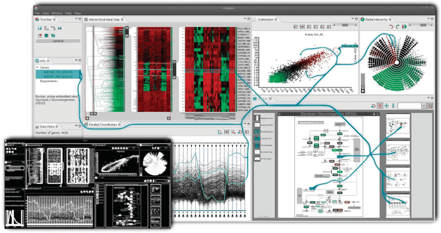

# 11.4.2 Highlighting

## Selection and highlighting are separate choices

<!-- verbatim p.276 -->
> Selection should trigger highlighting in order to provide users with immediate visual feedback, to confirm that the results of their operations match up with their intentions.
<!-- /verbatim -->

The two actions are so closely tied that they are sometimes treated as synonyms [p.276].

<!-- verbatim p.276 -->
> However, you should consider two different design choices that can be independently varied: the interaction idiom of how the user selects elements and the visual encoding idiom of how the selected elements are highlighted.
<!-- /verbatim -->

## Highlighting data items

- **Any encoding change.** Nearly any change of visual encoding can highlight data items [p.276].
- **Colour.** Changing colour is a very common choice. The highlight colour should differ enough from other colours to achieve visual popout through sufficient hue, luminance or saturation contrast [pp.276-277].
- **Colour hides colour.** A fundamental limitation is that the existing colour coding is temporarily hidden, a major problem for some abstract tasks [p.277].
- **Outline.** Highlighting with an outline preserves colour coding: add an outline mark around the selected object, or change an existing outline's colour. It is safest to outline items individually rather than assume the set is spatially contiguous, unless the tool enforces that constraint. An outline may lack salience for small marks but can be very effective for large ones [p.277].
- **Size.** Increase an item's size or a link's linewidth [p.277].
- **Shape, for links.** Change a solid line to a dashed one [p.277].
- **Combinations** increase salience, for example wider lines plus a colour change [p.277].
- **Motion.** Move selected points in small circular orbits around their location, move items slightly back and forth, or crawl a dash pattern along selected links. Still unusual, but Ware and Bobrow found motion coding often outperformed colouring, outlining and size changes [p.277].

## Highlighting attributes and views

- Attributes encoded with marks in a view can be highlighted with the same choices as items, for example a selected parallel coordinates axis given a colour change or outline [p.277].
- When attributes are selected through a control panel, feedback can use standard 2D UI widgets such as radio buttons and lists [p.277].
- A selected view is often highlighted with the operating system's existing window widgets [p.277].

## Highlighting with link marks

Another choice adds connection marks between objects in the selection set, an explicit contrast to the implicit choices above that change existing marks [pp.277-278].

### Example: Context-Preserving Visual Links

Links are drawn as curves carefully routed between existing elements of a vis [Steinberger et al. 11]. The route trades off four criteria: minimise link length, minimise occlusion of salient regions, maximise colour difference from the elements it crosses, and maximise bundling of links together [p.278]. Edge bundling is discussed further in Section 12.5.2 [p.278].

## Figures

-  **Figure 11.6** [p.278]. The context-preserving visual links idiom is an example of the design choice to coordinate betweeen views by explicitly drawing links as connection marks between items and regions of interest. From [Steinberger et al. 11, Figure 1].

## Related

- [Highlighting](../../idioms/highlighting.md): the highlight choices as a card, with code [p.277]
- [Context-Preserving Visual Links](../../idioms/context-preserving-visual-links.md): the idiom box [p.278]
- [6.8 Responsiveness Is Required](../../ch06-rules-thumb/s06-08-responsiveness-required.md): timing requirements for visual feedback [p.276]
- [5.5.4 Popout](../../ch05-marks-channels/s05-05-channel-effectiveness/s05-05-04-popout.md): the popout a highlight colour must achieve [p.277]
- [12.5.2 Static Layers](../../ch12-facet-into-multiple-views/s12-05-superimpose-layers/s12-05-02-static-layers.md): edge bundling, one of the link-routing criteria [p.278]
