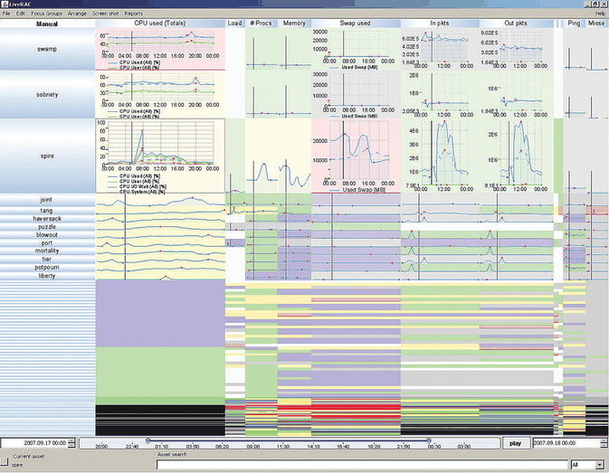

# 11.5 Navigate: Changing Viewpoint

## Navigation as a camera

Large and complex datasets often cannot be understood from a single point of view; many interactive vis systems support a metaphor of navigation, analogous to moving through the physical world, in which the spatial layout is fixed and navigation changes the viewpoint [p.279].

<!-- verbatim p.279 -->
> The term navigation refers to changing the point of view from which things are drawn.
<!-- /verbatim -->

The underlying metaphor is a virtual camera at a particular spot, aimed in a particular direction; changing its viewpoint changes the set of items visible in its frame [p.279].

## Zoom, pan and rotate

- **Zooming** moves the camera closer to or farther from the plane. Zooming in shows fewer items, which appear larger; zooming out shows more, which appear smaller [p.279].
- **Panning** moves the camera parallel to the image plane, up and down or side to side. In 2D navigation, scrolling is a synonym; in 3D, translating is the more common general term for any motion that changes camera position [p.279].
- **Rotating** spins the camera around its own axis. It is rare in 2D navigation but much more important in 3D [p.279].
- **Terminology.** The book uses pan and zoom loosely, as in the infovis literature, for translating the camera parallel and perpendicular to the image plane. In cinematography these motions are trucking and dollying; there, panning means turning the camera in place, and zooming means changing the lens focal length [p.279].

## Navigation as reduction

Because changing the viewpoint changes the visible items, navigation's outcome can combine filtering and aggregation: zooming in, or panning while zoomed in, filters by spatial layout; zooming out can act as aggregation that creates an overview [pp.279-280]. Panning or translating is straightforward; zooming is the more complex case [p.280].

## 11.5.1 Geometric Zooming

Geometric zooming is an intuitive form of navigation because it corresponds almost exactly to real-world experience of walking closer to objects or bringing them closer to our eyes; in 2D, the metaphor is moving a piece of paper closer to or farther from the eyes while keeping it parallel to the face [p.280]. The fundamental appearance of objects is fixed, and moving the viewpoint only changes the size at which they are drawn [p.280].

## 11.5.2 Semantic Zooming

<!-- verbatim p.280 -->
> With semantic zooming, the representation of the object adapts to the number of pixels available in the image-space region occupied by the object.
<!-- /verbatim -->

- It is a nongeometric approach to motion that does not correspond to simply moving a virtual camera; appearance can change subtly or dramatically at different scales [p.280].
- **Text file example.** A file drawn as a rectangular box holds only a short label with its name when small, the full document title at medium size, and a multiline summary when large. Without the change, multiple lines of text would be illegible in a small box [p.280].
- **LiveRAC example (Figure 11.7).** For analysing large collections of time series, here resource usage in large-scale system administration, line charts in a very large grid adapt automatically as rows and columns are stretched and squished. Tiny boxes show only one categorical variable by colour; slightly larger ones add sparklines, very concise line charts with dots at the period's minimum and maximum; past further thresholds, axes are drawn and multiple line charts are superimposed [pp.280-281].
- The stretch-and-squish navigation idiom is an example of a focus+context approach (Chapter 14) [p.281].
- **Semantic zooming or distortion.** The book does not rank the two as rivals. Semantic zooming changes what each item draws for the pixels it gets, so text that would be illegible in a small box gives way to a short label [p.280]; in LiveRAC, stretching and squishing decides how much space each row and column gets, and semantic zooming decides what each cell then shows [pp.280-281]. Focus+context approaches are discussed further in Chapter 14 [p.281].

## 11.5.3 Constrained Navigation

### Problems with unconstrained navigation

- With unconstrained navigation the camera can move anywhere. It is easy to implement for programmers who know standard computer graphics, and appeals conceptually by giving access to a clearly defined mathematical category of transformations [p.281].
- Users often struggle to reach a desired viewpoint with completely free navigation, especially in 3D: navigating six degrees of freedom is a skill few have, pilots being the exception [p.281].
- It is easy to move the viewpoint inside objects meant to be solid; collision detection is computationally intensive, separate from drawing, and not free [pp.281-282].
- The camera can end up pointed at nothing, with an empty frame and no obvious way to find something interesting; this is especially common in 3D but also occurs with unconstrained 2D pan and zoom. A reset-view button is a good idea but far from a complete solution [p.282].

### Constrained idioms

- **Definition.** Constrained navigation idioms put some limit on the possible motion of the camera [p.282].
- **Limit the zoom range** (one of the simplest 2D approaches): no farther out than where the whole scene is visible, no farther in than the size of the smallest object [p.282].
- **Animate to a selected item.** The user selects an item and the system computes a smooth camera trajectory for an animated transition to a viewpoint better suited to it, maintaining context [p.282].
- **Figure 15.20 example.** The final viewpoint is zoomed in enough for clearly visible labels, out far enough that the object's full extent fits, and panned so the object is in frame; a click anywhere in the green box around a set of words frames the whole complex object, not that exact point [p.282].
- **3D orientation.** A useful extra constraint is a final orientation looking straight down at the object along a perpendicular vector, with the camera's up vector matching the object's vertical axis [p.282].
- **Linked navigation between views.** Constrained navigation is particularly powerful combined with linked navigation: clicking an item in a sortable list or table view, which supports search for known names, can frame it in another, more elaborate view designed for browsing local neighbourhoods with a very different spatial encoding [p.282].
- **Both together.** Many tools support both types, with constrained navigation as shortcuts for common use and unconstrained navigation as a backup for uncommon cases needing fully general controls [p.283].

## Figures

-  **Figure 11.7** [p.281]. LiveRAC uses semantic zooming within a stretchable grid of time-series line charts. From [McLachlan et al. 08, Figure 2b].

## Related

- [Geometric Zooming](../idioms/geometric-zooming.md): card form with code [p.280]
- [Semantic Zooming](../idioms/semantic-zooming.md): card form with code [p.280]
- [Constrained Navigation](../idioms/constrained-navigation.md): card form with code [p.282]
- [Animated Transitions](../idioms/animated-transitions.md): the transitions constrained navigation uses to keep context [p.282]
- [13 Reduce Items and Attributes](../ch13-reduce-items-attributes/node.md): filtering and aggregation, which navigation amounts to [p.280]
- [14 Embed: Focus+Context](../ch14-embed-focus-context/node.md): focus+context approaches, including stretch-and-squish [p.281]
- [Stretch and Squish Navigation](../idioms/stretch-and-squish-navigation.md): the navigation idiom LiveRAC's grid uses [p.281]
- [14.6 Costs and Benefits: Distortion](../ch14-embed-focus-context/s14-06-costs-benefits-distortion.md): the costs to weigh before adding focus+context distortion to, or instead of, semantic zooming [p.281]
- [15.8 Constellation](../ch15-analysis-case-studies/s15-08-constellation.md): the Figure 15.20 example of framing a selected object [p.282]
- [11.6 Navigate: Reducing Attributes](s11-06-navigate-reducing-attributes.md): camera-inspired idioms that remove dimensions [p.283]
