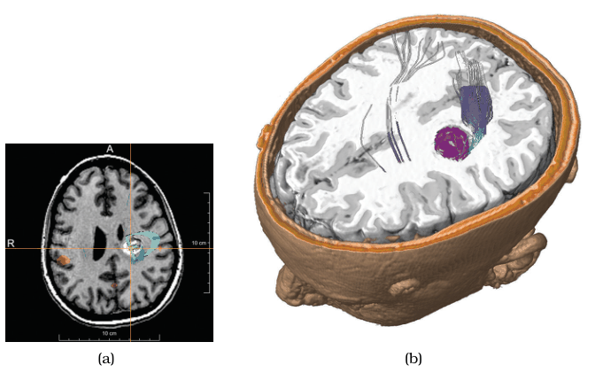
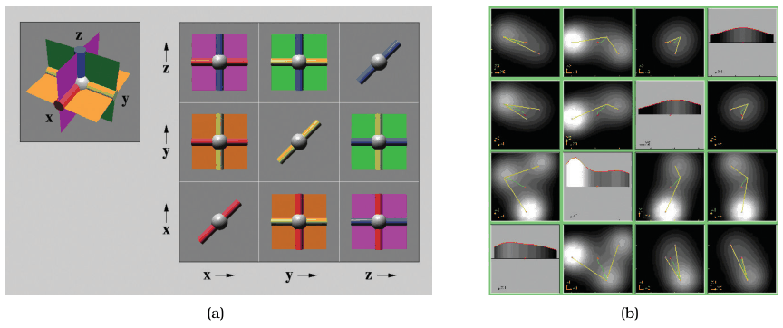

# 11.6 Navigate: Reducing Attributes

## Camera intuitions for reducing dimensions

The geometric intuitions behind navigation with a virtual camera also give design choices for reducing the number of attributes: slice, cut and project [p.283]. The section uses "dimensions" as a synonym for attributes to stress moving a camera through space [p.283]. Though inspired by manipulating a camera in a 3D scene, the idioms generalise to higher-dimensional spaces; they are very commonly used for spatial field datasets and can sometimes usefully apply to abstract data [p.283].

## 11.6.1 Slice

<!-- verbatim p.283 -->
> With the slice design choice, a single value is chosen from the dimension to eliminate, and only the items matching that value for the dimension are extracted to include in the lower-dimensional slice.
<!-- /verbatim -->

- Slicing is a particularly intuitive metaphor when reducing spatial data from 3D to 2D [p.283].
- **Figure 11.8(a).** A 3D scan of a human head inspected by interactively moving the slice to different heights along the skull: the chosen value is a height in the third dimension, and each extracted point keeps its 2D position and colour [p.283].
- **Axis-aligned slices** follow the original dimensions used to gather the data, here the body's major axes; they may match familiar views, as medical students learn anatomy in cross sections along the coronal, sagittal and horizontal planes [p.283].
- **Arbitrary orientation.** A slice can lie at any orientation; the operation is mathematically more complex because finding the values may need significant computation rather than a look-up, and sampling and interpolation artefacts must be minimised (also discussed in Section 8.4) [p.283].
- **Beyond 3D to 2D.** The slicing plane can be a hyperplane; reducing to one dimension makes it a line; several dimensions can be eliminated at once, for example from six to one [p.284].

### Example: HyperSlice

HyperSlice uses slicing for attribute reduction on abstract data with many attributes: scalar functions of many variables [van Wijk and van Liere 93] [p.284]. Its encoding is a matrix of views showing all possible orthogonal 2D slices; Figure 11.9(a) shows the intuition with three mutually perpendicular planes in 3D [p.284]. Views are coordinated by linked navigation of the high-dimensional space: each view is both a display and a control, and dragging in a view changes the slice value for its pair of dimensions [pp.284-285]. Figure 11.9(b) shows a four-dimensional dataset with function value coded by luminance [p.285].

## 11.6.2 Cut

<!-- verbatim p.285 -->
> The interaction idiom of cut allows the user to position a plane that divides the viewing volume in two, and everything on the side of the plane nearest to the camera viewpoint is not shown.
<!-- /verbatim -->

- The cutting plane can be axis aligned or arbitrarily oriented, as with slices; in computer graphics it is often called a clipping plane [p.285].
- Cutting is often used to see features inside a 3D volume. Figure 11.8(b) sets the cut at the same level as the slice in Figure 11.8(a) on medical brain data [p.285].
- **Cut versus slice.** The cut shows more than the 2D slice alone, because the 3D context behind the plane stays visible [p.285].
- Figure 8.6(c) also shows a cutting plane in use on a human head dataset, but with the direct volume rendering idiom [p.285].

## 11.6.3 Project

<!-- verbatim p.286 -->
> With the project design choice, all items are shown, but without the information for specific dimensions chosen to exclude.
<!-- /verbatim -->

- An object's shadow on a wall or floor is a projection from 3D to 2D. Some projections keep partial information about removed dimensions; others eliminate it completely [p.286].
- **Orthographic projection.** Excluded dimensions' values are simply dropped and nothing about them is retained; from 3D to 2D all depth information is lost [p.286]. Dimensional filtering, common with abstract data, is essentially a synonym; orthographic projection is the term more used with spatial data [p.286].
- **Projections in multiple views.** There can be a view per combination of dimensions; architectural blueprints show the three axis-aligned 2D views of an XYZ scene: floor plan (XY), side view (YZ) and front view (XZ) [p.286].
- **Perspective projection** also goes from 3D to 2D, as in our eyes and the graphics virtual camera; much depth information is lost, but some survives through foreshortening, where distant objects are closer together on the image plane [p.286].
- **Map projections**, such as Mercator, transform the Earth's curved surface to flat maps; most design choices concern whether distorting angles or areas matters less for the intended abstract task [p.286]. A footnote says cartographic projections go from a 2D curved space embedded in 3D to a 2D flat space, so they do not cleanly fit the intuition of projection as dimensionality reduction [p.286].

## Figures

-  **Figure 11.8** [p.284]. The slice choice eliminates a dimension/attribute by extracting only the items with a chosen value in that dimension. The cut choice eliminates all data on one side of a spatial cutting plane. (a) Axis-aligned slice. (b) Axis-aligned cut. From [Rieder et al. 08, Figures 7c and 0].
-  **Figure 11.9** [p.285]. The HyperSlice system uses extracting only the items with a chosen value in that dimension. (a) Three 3D planes that intersect at right angles. (b) Four-dimensional dataset where function value is encoded with luminance. From [van Wijk and van Liere 93, Figures 1 and 4].

## Related

- [Slice](../idioms/slice.md): card form with code [p.283]
- [HyperSlice](../idioms/hyperslice.md): card form of the many-variable slicing system [p.284]
- [Cut](../idioms/cut.md): card form with code [p.285]
- [Project](../idioms/project.md): card form with code [p.286]
- [8.4 Scalar Fields: One Value](../ch08-arrange-spatial-data/s08-04-scalar-fields-one-value/node.md): sampling and interpolation for arbitrary slices [p.283]
- [8.4.2 Direct Volume Rendering](../ch08-arrange-spatial-data/s08-04-scalar-fields-one-value/s08-04-02-direct-volume-rendering.md): the encoding paired with a cutting plane in Figure 8.6(c) [p.285]
- [Multidimensional Transfer Functions](../idioms/multidimensional-transfer-functions.md): the second figure printed as 8.6, whose panel (c) is the cut head dataset [p.285]
- [13.4.3 Attribute Aggregation: Dimensionality Reduction](../ch13-reduce-items-attributes/s13-04-aggregate/s13-04-03-attribute-aggregation-dimensionality-reduction.md): reducing attributes by aggregation rather than navigation [p.283]
- [11.5 Navigate: Changing Viewpoint](s11-05-navigate-changing-viewpoint.md): the camera metaphor these idioms extend [p.283]
