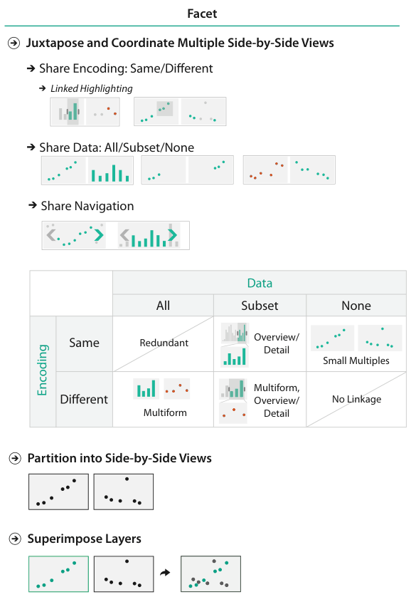

# 12.1 The Big Picture

## Three families of faceting choices

The chapter covers how to facet data across multiple views (Figure 12.1) [p.290].

<!-- verbatim p.290 -->
> One option for showing views is juxtapose them side by side, leading to many choices of how to coordinate these views with each other. The other option is to superimpose the views as layers on top of each other. When the views show different data, a set of choices covers how to partition data across multiple views.
<!-- /verbatim -->

Figure 12.1 organises the choices under three headings: juxtapose and coordinate multiple side-by-side views, partition into side-by-side views, and superimpose layers. Under juxtaposition sit share encoding (same or different, with linked highlighting beneath it), share data (all, subset or none) and share navigation [p.289]. A table crosses encoding with data: same encoding with all, a subset or none of the data gives redundant, overview/detail and small multiples; different encoding gives multiform, multiform overview/detail and no linkage [p.289].

## The choices in each family

- **Juxtaposed views.** The main choices are how to coordinate them: which visual encoding channels they share, how much of the data they share, and whether navigation is synchronised. Other choices are when to show each view and how to arrange them [p.290].
- **Partitioning.** How many regions to use, how to divide the data into regions, the order in which attributes are used to split, and when to stop [p.290].
- **Superimposing.** How elements are partitioned between layers, how many layers to use, how to distinguish them from each other, and whether the layers are static or dynamically constructed [p.290].

## Figures

-  **Figure 12.1** [p.289]. Design choices of how to facet information between multiple views.

## Related

- [12.2 Why Facet?](s12-02-why-facet.md): the rationale and costs behind these three families [p.290]
- [12.3 Juxtapose and Coordinate Views](s12-03-juxtapose-coordinate-views/node.md): the coordination choices for juxtaposed views [p.290]
- [12.4 Partition into Views](s12-04-partition-into-views/node.md): the partitioning choices [p.290]
- [12.5 Superimpose Layers](s12-05-superimpose-layers/node.md): the layering choices [p.290]
