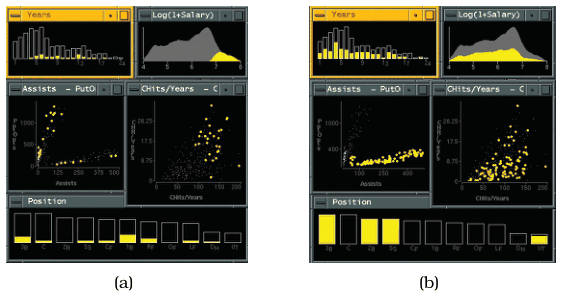

# 12.3.1 Share Encoding: Same/Different

## Shared encoding and multiform views

The most common way to link views is some form of shared visual encoding, where a channel is used the same way across views [p.292].

<!-- verbatim p.292 -->
> The design choice of shared encoding views means that all channels are handled the same way for an identical visual encoding. The design choice of multiform views means that some, but not necessarily all, aspects of the visual encoding differ between the two views.
<!-- /verbatim -->

For example, two multiform views might have different spatial layouts but the same colour coding, giving a shared encoding through the colour channel; or two views could be aligned in one spatial direction but not the other. These forms of linking do not necessarily require interactivity and can be done with completely static views [p.292]. The generic term multiple views is often used as a synonym for multiform views [p.292].

## Linked highlighting

Interactivity unleashes the full power of linked views [p.292].

<!-- verbatim p.292 -->
> One of the most common forms of linking is linked highlighting, where items that are interactively selected in one view are immediately highlighted in all other views using in the same highlight color.
<!-- /verbatim -->

Linked highlighting, also called brushing or cross-filtering, is a special case of shared encoding in the colour channel. Its central benefit is seeing how a region that is contiguous in one view is distributed within another [p.292].

## Why multiform views

A single monolithic view has strong limits on how many attributes it can show at once without too much clutter. Simple abstract tasks can often be fully supported by one view of a specific dataset, but more complex ones often cannot [pp.292-293]. With multiple views, each can show only a subset of the attributes, avoiding the clutter of superimposing too many in one view. Even views showing the same attributes can encode them with different channels [p.293].

<!-- verbatim p.293 -->
> The most important channel change is what spatial position encodes; this most salient channel dominates our use of the view and strongly affects what tasks it best supports.
<!-- /verbatim -->

Multiform views can thus exploit the strengths of multiple visual encodings [p.293].

## Example: Exploratory Data Visualizer (EDV)

EDV links highlighting between bar charts, scatterplots and a histogram of baseball statistics (Figure 12.2) [p.293]. Selecting high salaries in the smoothed histogram shows a very different distribution elsewhere: no rookies in the Years played bar chart, little correlation with Assists-PutOuts, and hits per year more correlated with salary than home runs; the Position window shows a loose relationship with salary [pp.293-294]. Selecting the bottom of the two clumps in the Assists-PutOuts scatterplot shows it corresponds to specific positions, while those players are fairly evenly distributed in the other windows [p.294]. EDV is described in a System box; see its card [p.294].

## Figures

-  **Figure 12.2** [p.293]. Linked highlighting between views shows how regions that are contiguous in one view are distributed within another. (a) Selecting the high salaries in the upper right window shows different distributions in the other views. (b) Selecting the bottom group in the Assists-PutOuts window shows that the clump corresponds to specific positions played. From [Wills 95, Figures 4 and 5].

## Related

- [Exploratory Data Visualizer (EDV)](../../idioms/exploratory-data-visualizer-edv.md): the System box and use conditions for this example [p.294]
- [12.3.2 Share Data: All, Subset, None](s12-03-02-share-data-all-subset.md): the second coordination axis, often combined with multiform views [p.294]
- [12.3.4 Combinations](s12-03-04-combinations.md): how shared or different encoding combines with data sharing [p.301]
- [11.4.2 Highlighting](../../ch11-manipulate-view/s11-04-select-elements/s11-04-02-highlighting.md): the selection highlighting that linked highlighting propagates [p.292]
- [12.5 Superimpose Layers](../s12-05-superimpose-layers/node.md): the alternative of putting more attributes into one view, which multiform views avoid [p.293]
