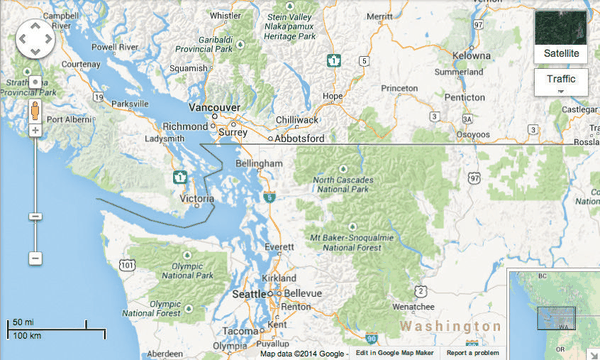
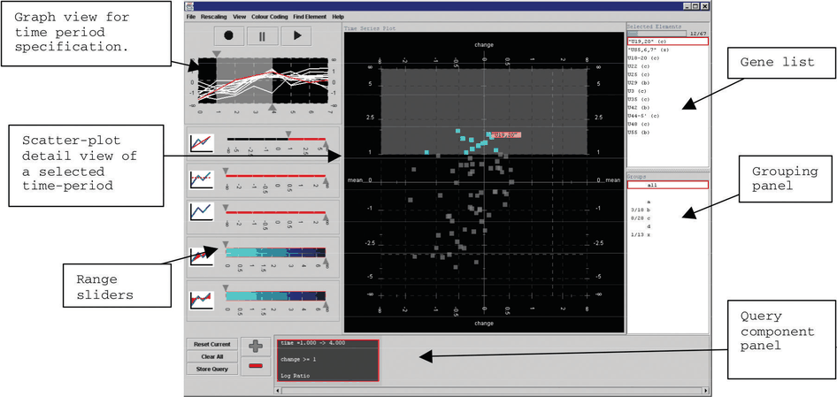
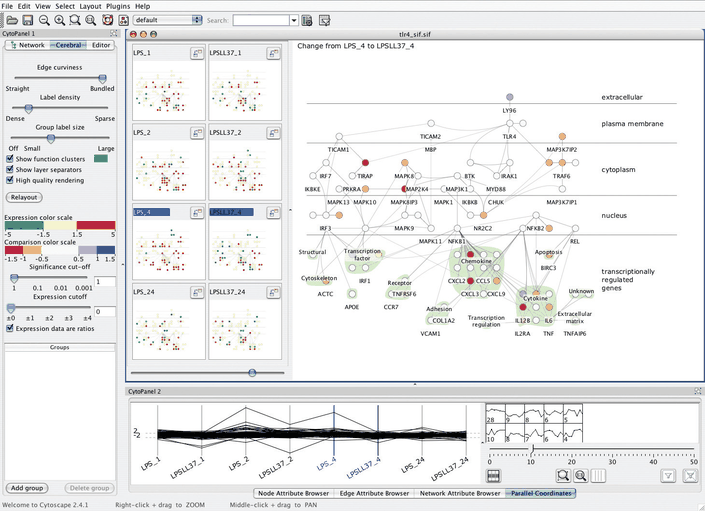

# 12.3.2 Share Data: All, Subset, None

## Three alternatives

A second choice is how much data two views share. With shared data, each view shows all of the data; with overview–detail, one view shows a subset of what is in the other; with small multiples, the views show disjoint partitions of the dataset [p.294].

## Shared data

Showing all the data in each view is common with multiform systems, where the encoding differs. Combining shared data with shared encoding is unusual, because the two views would be identical and redundant [p.294].

## Overview–detail

One view shows information about the entire dataset as an overview; one or more additional views show more detail about a subset the viewer selects from the broader view [p.294].

A popular overview–detail idiom combines shared encoding and shared data with navigation, so each view shows a different viewpoint of the same dataset. The two views often differ in size, one large with many pixels and one small. For some tasks the large window should be the main view for exploring details, with the small one the zoomed-out overview; for others the large view shows the overview and a smaller window the details [p.294]. Both views could in theory be set to the same zoom level, but normally one shows only a subset of the other; and zooming is only one form of navigation, since views at the same zoom can show different subsets through rotation or translation [pp.294-295].

**How many views.** A common choice is two views, one overview and one detail. When the dataset has multilevel structure at discrete scales, multiple detail views may be appropriate to show structure at those levels: the user zooms into successively smaller subsets with a series of selections, and the other views act as a concise visual history of what they selected, accessible at a glance. With the change choice instead, users are more likely to lose track of their location, having no scaffolding to augment internal memory [p.295].

**Bird's-eye maps.** Interactive online maps combine shared encoding and overview–detail: a large exploration view plus a small "bird's-eye" overview whose rectangle shows the region visible in the detail view (Figure 12.3). Minimal linkage is unidirectional, with the rectangle updating as the user pans and zooms the large view; bidirectional linkage also lets the user move the rectangle to update the large view [pp.295-296].

**Multiform overview–detail and detail on demand.** Overview–detail can also be combined with multiform views, where the detail view uses a different encoding from the overview. A detail view showing additional information about items selected in a central main view is sometimes called a detail-on-demand view; it might be a popup near the cursor or a fixed window elsewhere [p.296].

**Microarray example.** A multiform overview–detail tool for microarray time-series data coordinates a scatterplot with a graph view (Figure 12.4); its designers concluded that no single view would suffice [p.296]. The graph view is an overview of superimposed line charts, one line per gene, where the user selects a time period with a slider. That view does not support visual queries about value change or fold change, derived within the chosen window; the scatterplot detail view's horizontal axis can be set to either, with functional groups colour coded and the label under the cursor shown dynamically [pp.297-298]. A list view of gene names in the active window, ordered alphabetically, gives a textual overview and supports browsing and lookup [p.298].

<!-- verbatim p.298 -->
> Although a text list might appear to be a trivial vis when considered as a stand-alone view, these kinds of simpler views often play useful roles in a multiple-view system.
<!-- /verbatim -->

Hovering is useful for identifying the mark in one place, but would be a very frustrating way to get an overview of all labels; glancing at the list gives an overview of names and lets the user quickly select an item with a known name [p.298].

## Small multiples

The third alternative shows a different partition of the dataset in each view [p.298].

<!-- verbatim p.298 -->
> Multiple views with the same encoding and different partitions of the data between them are often called small multiples.
<!-- /verbatim -->

The shared encoding gives the views a common reference frame, so comparing spatial position between them is directly meaningful. Small multiples are often aligned into a list or matrix to support comparison with the highest precision. They are in some sense the inverse of multiform views: identical encoding, different data [p.298].

**Weakness.** As with all juxtaposed views, small multiples need screen real estate to show all views at once. With current displays of around one million pixels, the operational limit is a few dozen views with several hundred elements in each [p.299].

**Strength.** They make different partitions simultaneously visible side by side, so the user can glance between them with minimal interaction cost and memory load. They are often used as an alternative to animation, with every frame visible at once [p.299].

<!-- verbatim p.299 -->
> Animation imposes a massive memory load when the amount of change between each frame is complex and distributed spatially between many points in the scene.
<!-- /verbatim -->

**Cerebral example.** Cerebral shows small-multiple network views of gene interactions, one per experimental condition, aligned in a reorderable matrix beside a large node–link view (Figure 12.5) [p.299]. Each small multiple colours nodes with a diverging red–green colormap for gene activity in its condition, following bioinformatics domain conventions, with other colormaps that better serve colourblind users also available; the large view colours nodes with a diverging orange–blue colormap of the derived difference between two selected small multiples [p.299]. Cerebral is also multiform, with a parallel coordinates view and a clustering control panel below, and its navigation is linked between views [p.299].

## Figures

-  **Figure 12.3** [p.295]. Overview–detail example with geographic maps, where the views have the same encoding and dataset; they differ in viewpoint and size. Made with Google Maps, <http://maps.google.com>.
-  **Figure 12.4** [p.297]. Multiform overview–detail vis tool for microarray exploration features a central scatterplot linked with the graph view in the upper left. From [Craig and Kennedy 03, Figure 3].
-  **Figure 12.5** [p.300]. Cerebral uses small-multiple views to show the same base graph of gene interactions colored according to microarray measurements made at different times. The coloring in the main view uses the derived attribute of the difference in values between the two chosen views. From [Barsky et al. 08, Figure 2].

## Related

- [Bird's-Eye Maps](../../idioms/birds-eye-maps.md): the idiom box for the map overview–detail example [p.296]
- [Multiform Overview–Detail Microarrays](../../idioms/multiform-overview-detail-microarrays.md): the System box and task analysis for the microarray tool [p.298]
- [Cerebral](../../idioms/cerebral.md): the System box for the small-multiple network example [p.300]
- [11.5 Navigate: Changing Viewpoint](../../ch11-manipulate-view/s11-05-navigate-changing-viewpoint.md): changing the viewpoint with navigation [p.294]
- [12.5.2 Static Layers](../s12-05-superimpose-layers/s12-05-02-static-layers.md): superimposed line charts, used in the microarray overview [p.297]
- [12.4 Partition into Views](../s12-04-partition-into-views/node.md): how to partition data between small-multiple views [p.298]
- [7.5 Separate, Order, and Align: Categorical Regions](../../ch07-arrange-tables/s07-05-separate-order-align-categorical/node.md): aligning small multiples into lists and matrices [p.298]
- [6.5 Eyes Beat Memory](../../ch06-rules-thumb/s06-05-eyes-beat-memory.md): the relationship between animation and memory [p.299]
- [7.5.2 Matrix Alignment: Two Keys](../../ch07-arrange-tables/s07-05-separate-order-align-categorical/s07-05-02-matrix-alignment-two-keys.md): the red–green colormap convention in bioinformatics [p.299]
- [12.3.3 Share Navigation: Synchronize](s12-03-03-share-navigation-synchronize.md): the linked navigation used by bird's-eye maps and Cerebral [p.299]
