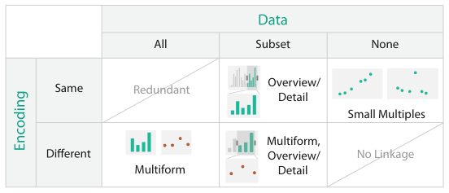
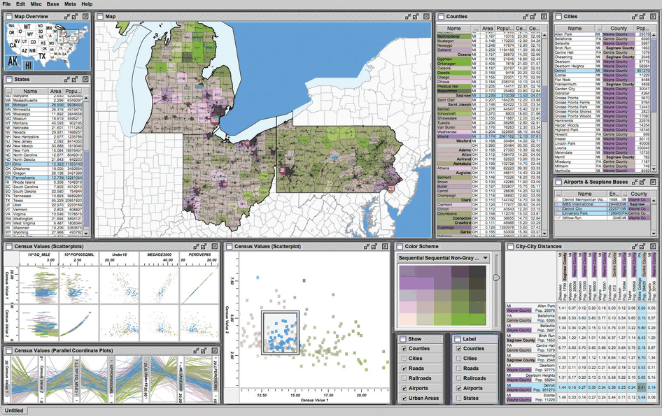

# 12.3.4 Combinations

## Crossing encoding with data

Figure 12.6 summarises the coordination choices by whether encoding and data are shared and how the choices interact. The encoding can be the same or different; the data can be the same, a subset or a partition [p.301].

| Encoding | All data | Subset | None (partition) |
| --- | --- | --- | --- |
| Same | Redundant [p.301] | Overview/detail [p.301] | Small multiples [p.301] |
| Different | Multiform [p.301] | Multiform, overview/detail [p.301] | No linkage [p.301] |

Two of the six possibilities are not useful. When everything is shared, the views are redundant; when nothing is shared, with different data and no shared channels, there is no linkage between the views. Otherwise the two choices are independent: for example, overview–detail subsets can be used with either multiform or shared encoding [p.301].

## How the terms apply to complex systems

Complex systems use these methods in combination [p.301].

<!-- verbatim p.301 -->
> so in this book these terms are used to mean that at least one pair of views differs along that particular axis. For example, multiform means that at least one pair of views differs, not necessarily that every single view has a different encoding from every other one.
<!-- /verbatim -->

## Example: Improvise

A census vis built with the Improvise toolkit uses many views (Figure 12.7). Each county carries geographic information plus population, density, genders, median age, percentage change since 1990 and proportions of major ethnic groups [p.302]. The system is multiform, with geographic, scatterplot, parallel coordinate, tabular and matrix views that all share one bivariate sequential–sequential colour encoding, documented by a legend [p.302]. A scatterplot matrix in the lower left forms a set of small multiples, each showing a different pair of attributes. All views are linked by highlighting: the blue selected items are close together in some views and spread out in others [p.302]. Small-multiple reorderable list views, from partitioning the data by attribute, allow direct sorting by and selection within an attribute. A small overview map in the upper left has linked navigation to the large geographic detail view [pp.302-303].

## Figures

-  **Figure 12.6** [p.301]. Design choices for how to coordinate between views relating to sharing encoding and data.
-  **Figure 12.7** [p.302]. The Improvise toolkit [Weaver 04] was used to create this census vis that has many forms of coordination between views. It has many multiform views, some of which use small multiples, and some of which provide additional detail information. From <http://www.cs.ou.edu/∼weaver/improvise/examples/census>.

## Related

- [Improvise](../../idioms/improvise.md): the System box for this example [p.303]
- [Cerebral](../../idioms/cerebral.md): another system combining small multiples, multiform views and linked navigation [p.299]
- [10.3.3 Bivariate Colormaps](../../ch10-map-color-other-channels/s10-03-colormaps/s10-03-03-bivariate-colormaps.md): the shared colormap Improvise uses [p.302]
- [12.3.1 Share Encoding: Same/Different](s12-03-01-share-encoding-same-different.md): the encoding axis of the table [p.301]
- [12.3.2 Share Data: All, Subset, None](s12-03-02-share-data-all-subset.md): the data axis of the table [p.301]
- [11.5 Navigate: Changing Viewpoint](../../ch11-manipulate-view/s11-05-navigate-changing-viewpoint.md): navigation covered further [p.301]
- [Scatterplot Matrix (SPLOM)](../../idioms/scatterplot-matrix-splom.md): the small-multiple scatterplot matrix in Improvise [p.302]
