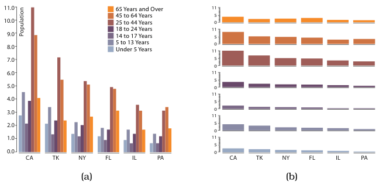

# 12.4.2 List Alignments

## Grouped bars versus small-multiple bars

Comparing grouped bar charts with small-multiple aligned bar charts (Figure 12.8) is a concrete, simple example of how partitioning decisions enable different tasks [p.306].

- **Grouped bar chart.** A multibar glyph is drawn in each region where a standard bar chart would draw one mark. In Figure 12.8(a) the regions are states and the bars in each glyph show demographic categories [p.306].
- **Small-multiple bar charts.** Several standard bar charts, one per view. In Figure 12.8(b) each view shows a demographic category, with the states spread along each chart's axis [pp.306-307].

<!-- verbatim p.307 -->
> The grouped bar chart facilitates comparison between the attributes, whereas the small multiple bar charts facilitate comparison within a single attribute.
<!-- /verbatim -->

## One reading, two views

The two encodings can be read in a unified way, either both as glyphs or both as partitions [p.307]. As glyphs, grouped bars use a smaller multibar glyph and small-multiple bars a larger bar-chart glyph. As partitions, both split twice, first by one key and then by a second, with a single mark in each subregion [p.307].

<!-- verbatim p.307 -->
> The difference is that with grouped bars the second-level regions are interleaved within the first-level regions, whereas with small multiple bars the second-level regions are contiguous within a single first-level region.
<!-- /verbatim -->

## Figures

-  **Figure 12.8** [p.306]. Partitioning and bar charts. (a) Single bar chart with grouped bars: separated by state key into regions, using seven-mark glyphs within each region. (b) Four aligned small-multiple bar chart views: separated by group key into vertically aligned list of regions, with a full bar chart in each region. From <http://bl.ocks.org/mbostock/3887051>, after <http://bl.ocks.org/mbostock/4679202>.

## Related

- [12.4.1 Regions, Glyphs, and Views](s12-04-01-regions-glyphs-views.md): the glyph and view continuum this example applies [p.307]
- [Bar Charts](../../idioms/bar-charts.md): the standard bar chart each small multiple uses [p.306]
- [7.5.1 List Alignment: One Key](../../ch07-arrange-tables/s07-05-separate-order-align-categorical/s07-05-01-list-alignment-one-key.md): bar charts as list alignment on one key [p.306]
