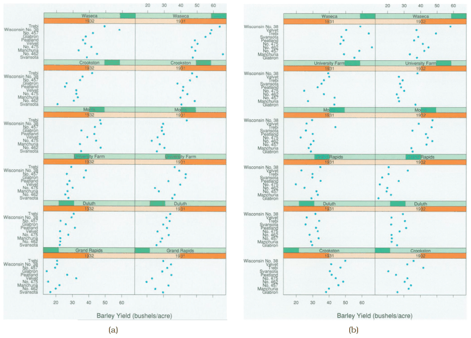
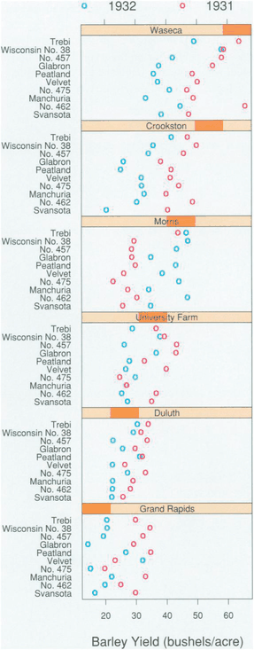

# 12.4.3 Matrix Alignments

## Example: Trellis

Trellis is a more complex example: partitioning a multiattribute dataset into multiple views and ordering them in a 2D matrix alignment is its main avenue for exploration [p.307].

**Data.** Figure 12.9 shows barley yields as dot charts. The dataset is a multidimensional table with three categorical keys: site (six levels, where the barley was grown), variety (ten levels) and year (two levels, a number treated as categorical rather than ordered), plus a quantitative yield attribute [p.307].

**Encoding.** Matrix columns are partitioned by year and rows by site. Within each dot chart the vertical axis is separated by variety, and yield is expressed with horizontal position [p.307].

## Main-effects ordering

<!-- verbatim p.307 -->
> The ordering idiom used is main-effects ordering, where the derived attribute of the median value is computed for each group created by the partitioning and used to order them.
<!-- /verbatim -->

Trellis can apply main-effects ordering at every partitioning scale. In Figure 12.9(a) the rows are ordered by the sites' medians and the rows within each dot chart by the varieties' medians [p.307]. Its value is that outliers countervailing the general trends become visible: the Morris plots in the third row do not match the others, suggesting the years may have been switched [p.307]. With alphabetical ordering between and within plots (Figure 12.9(b)), no general trend is visible, so the display gives no hint of outliers [pp.307-308].

<!-- verbatim p.308 -->
> Main-effects ordering is useful because it is a data-driven way to spatially order information so that both general trends and outliers can be spotted.
<!-- /verbatim -->

## Changing the partition to test a hypothesis

Figure 12.10 restructures the plot to investigate the anomaly: it still partitions vertically by site but no further, so both years share one view and are distinguished by colour. The switched colour pattern in the third row is convincing evidence that the Morris data is incorrect [p.308].

## Figures

-  **Figure 12.9** [p.308]. Trellis facets the data into a matrix of dot chart views, allowing the user control of partitioning and orderering. (a) With main-effects ordering, the plots are ordered by median values within the plots for the sites, and the shared vertical axis within each plot is ordered by median values within the varieties. The Morris site in the third row is a visible outlier that does not fit the general trends. (b) With a simple alphabetical ordering of plots and axes, no trends are visible, so no outliers can be detected. From [Becker et al. 96, Figures 1 and 3].
-  **Figure 12.10** [p.309]. A second Trellis plot combines the years into a single plot with year encoded by color, showing strong evidence of an anomaly in the data. From [Becker et al. 96, Figure 2].

## Related

- [Trellis](../../idioms/trellis.md): the System box, use conditions and code [p.309]
- [7.5.1 List Alignment: One Key](../../ch07-arrange-tables/s07-05-separate-order-align-categorical/s07-05-01-list-alignment-one-key.md): where dot charts, the view in each Trellis panel, are discussed [p.307]
- [Dot Charts](../../idioms/dot-charts.md): the view type in each panel [p.307]
- [7.5.2 Matrix Alignment: Two Keys](../../ch07-arrange-tables/s07-05-separate-order-align-categorical/s07-05-02-matrix-alignment-two-keys.md): 2D matrix alignment of regions [p.307]
- [12.4.4 Recursive Subdivision](s12-04-04-recursive-subdivision.md): user control of partitioning, taken further by reconfiguring the order of splits [p.308]
