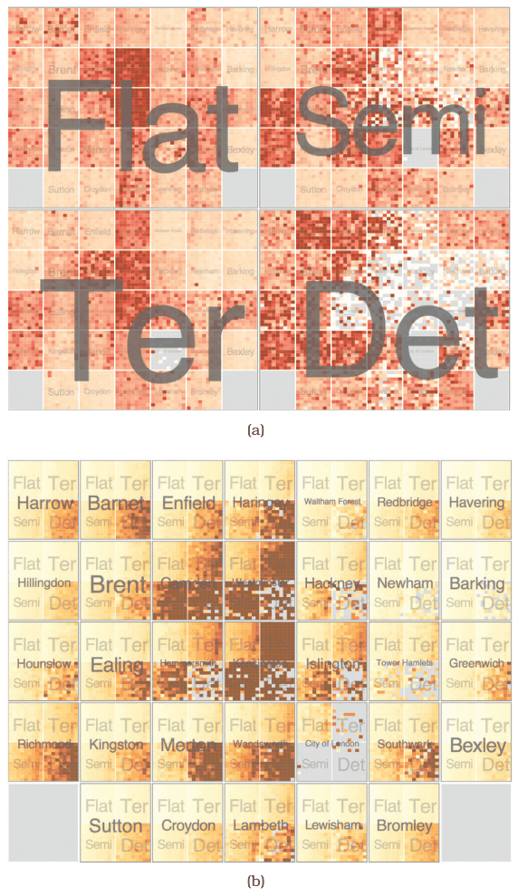
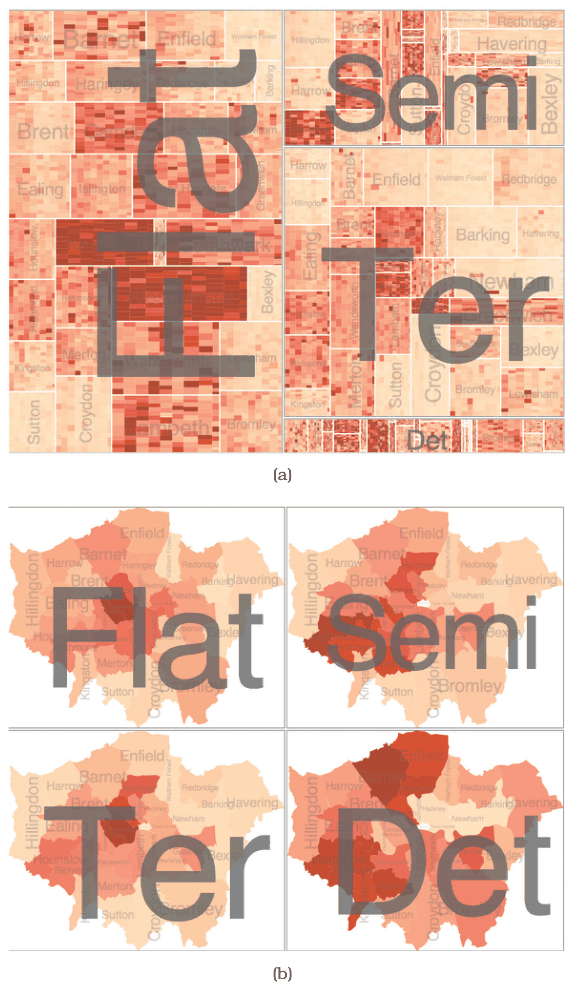

# 12.4.4 Recursive Subdivision

## Exploratory partitioning with HiVE

Partitioning can be exploratory, with the user reconfiguring the display to try different partitioning and encoding variables. The Hierarchical Visual Expression (HiVE) system supports this, shown on over one million London property transactions [p.310]. Attributes: residence type, categorical with four levels (flats Flat, attached terrace houses Ter, semidetached Semi, detached Det); price, quantitative; time of sale as year and month, an ordered attribute with hierarchical internal structure; and neighbourhood, 33 levels, which can be considered either categorical or spatial [p.310].

## Four configurations

**Type, then neighbourhood, then time (Figure 12.11(a)).** The top split into four regions by type is arranged in a matrix; the next split by neighbourhood uses the same matrix alignment; the final split is by time, in a matrix with years left to right and months top to bottom. Each base-level square is coloured by the derived price variation within the group [p.310]. The four house types show very different patterns, while colouring within each neighbourhood square is more consistent, so houses in the same neighbourhood tend to have similar prices [p.310].

This arrangement has three readings: recursive subdivision using matrix alignment; containment indicating the order of partitioning, each higher region containing the next level; or four sets of 33 small multiples, each a neighbourhood heatmap. Consistent ordering and alignment make it easy to compare the same time cell across neighbourhood heatmaps [p.310].

**Neighbourhood, then type (Figure 12.11(b)).** The same spatial arrangement with the first two splits swapped, coloured by a slightly different derived attribute, average price. Expensive neighbourhoods near the centre are easy to spot, as is that detached houses, in the lower right of each view, cost more than other types [p.310]. The caption notes that switching the order of splits shows radically different patterns [p.311].

**Sized by sales (Figure 12.12(a)).** The partition order of Figure 12.11(a), but regions are sized by number of sales, giving variably sized rectangles instead of equal squares [p.313].

<!-- verbatim p.313 -->
> This encoding can be interpreted as a treemap, where the tree structure being shown is implicitly derived by the order of partitioning decisions rather than being explicitly provided.
<!-- /verbatim -->

**Geographic second level (Figure 12.12(b)).** The top level keeps rectangular regions, but the next shows the information geographically with choropleth maps [p.313]. The progression makes the structural similarity of heatmaps, treemaps and choropleth maps obvious: all use colour-coded area marks, with shape set by encoding choices in the first two and by given spatial geometry in the last [p.313]. The rough correspondence between the rectangular ordering and the geography is no coincidence: it comes from a spatially aware treemap variant, a hybrid of using given spatial data and arranging table data [p.313].

## Figures

-  **Figure 12.11** [p.311]. The HiVE system supports exploration through different partitioning choices. (a) Recursive matrix alignment where the first split is by the house type attribute, and the second by neighborhood. The lowest levels show time with years as rows and months as columns. (b) Switching the order of the first and second splits shows radically different patterns. From [Slingsby et al. 09, Figures 7b and 2c].
-  **Figure 12.12** [p.312]. HiVE with different arrangements. (a) Sizing regions according to sale counts yields a treemap. (b) Arranging the second-level regions as choropleth maps. From [Slingsby et al. 09, Figures 7a and 7c].

## Related

- [9.5 Containment: Hierarchy Marks](../../ch09-arrange-networks-trees/s09-05-containment-hierarchy-marks.md): treemaps in detail [p.313]
- [Treemaps](../../idioms/treemaps.md): the idiom the sales-sized configuration yields [p.313]
- [8.3 Geometry](../../ch08-arrange-spatial-data/s08-03-geometry.md#s08.03.01): choropleth maps, the second-level arrangement in Figure 12.12(b) [p.313]
- [Choropleth Map](../../idioms/choropleth-map.md): the second-level arrangement in Figure 12.12(b) [p.313]
- [Heatmaps](../../idioms/heatmaps.md): the neighbourhood views as small-multiple heatmaps [p.310]
- [7.5.4 Recursive Subdivision: Multiple Keys](../../ch07-arrange-tables/s07-05-separate-order-align-categorical/s07-05-04-recursive-subdivision-multiple-keys.md): recursive subdivision of tables in Chapter 7 [p.310]
