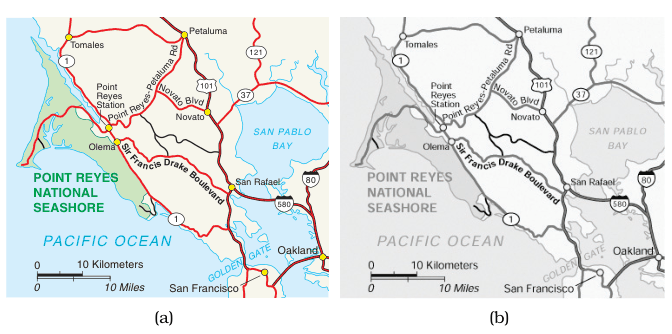
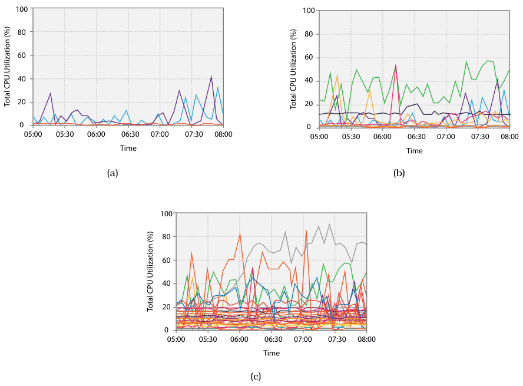
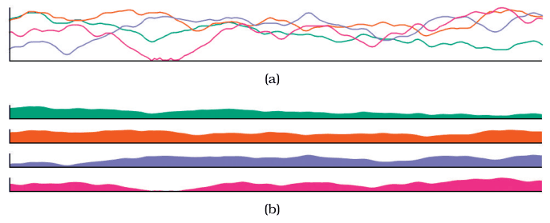
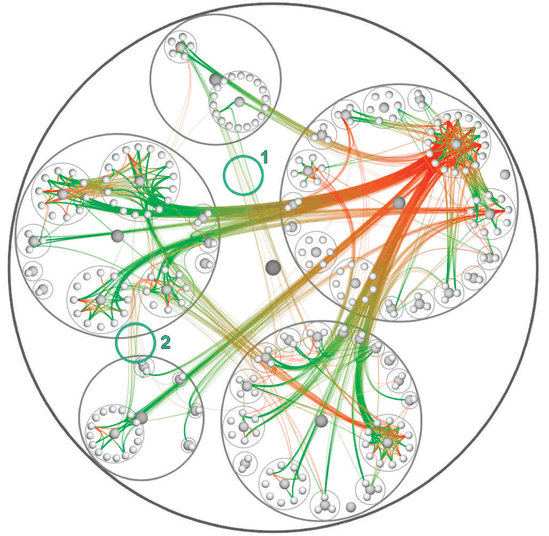

# 12.5.2 Static Layers

## The choice

<!-- verbatim p.314 -->
> The design choice of static layers is that all of the layers are displayed simultaneously; the user can choose which to focus on with the selective direction of visual attention.
<!-- /verbatim -->

Mapmakers usually design maps exactly this way [p.314].

## Example: Cartographic Layering

In Figure 12.13(a), area marks form a background layer, with three unsaturated colours distinguishing water, parks and other land; line marks form a foreground road layer, main roads as wide fully saturated red lines and small roads as thinner black lines [p.314]. The layering works because of the luminance contrast between elements on different layers, visible in the grayscale version, Figure 12.13(b) [p.314]. Checking luminance contrast explicitly is an example of the slogan Get It Right in Black and White [p.314].

## Example: Superimposed Line Charts

Several lines representing different items are superimposed in one shared frame (Figure 12.14) [p.315]. This works because the only mark is a thin line mostly disjoint from the others. Occlusion is very small with three lines, the idiom remains usable with nearly a dozen, but it does not scale to many dozens or hundreds [p.315]. The book is inconsistent about the limit: the text says nearly one dozen and the idiom box's Scale says one dozen, while the caption of Figure 12.14(b) says up to a few dozen lines can still be understood [pp.315-316].

## Empirical evidence: superimpose or juxtapose

A study compared superimposed line charts with juxtaposed small multiples of filled-area charts (Figure 12.15), with screen area held commensurate so the small multiples fit in the same area as the single superimposed view, trading less vertical space against less clutter [p.317]. Tasks were local maximum (which series is highest at one time), global slope (which series rises most over the whole period) and global discrimination (whether values were higher at different time points across series), with 2, 4 or 8 series [p.317].

<!-- verbatim p.317 -->
> They proposed the guideline that superimposing layers, as in Figure 12.15(a), is the best choice for comparison within a local visual span, while juxtaposing multiple views, as in Figure 12.15(b), is a better choice for dispersed tasks that require large visual spans, especially as the number of series increases.
<!-- /verbatim -->

## Example: Hierarchical Edge Bundles

A more complex static superimposition operates on a compound network: a base network plus a cluster hierarchy grouping its nodes [p.317]. Figure 12.16 shows a software call graph, which functions call which, together with the hierarchical structure of the source code that defines them [p.318].

Colour creates two easily distinguished layers: the gray source-code hierarchy, drawn with circular containment marks, and a semitransparent red–green layer of call-graph edges drawn as connection marks [p.318]. The edges are bundled, like cables tied together, to reduce occlusion of the tree beneath; without bundling, most of the background structure would be very hard to see. Layering matters too: gray, opaque edges would make the image much harder to interpret [pp.318-319]. The idiom works with many different tree layouts [p.319].

## Layering in graphics hardware

Layering is often done with modern graphics hardware, blending planes oriented in the screen plane from back to front as if at slightly different 3D depths, one way to make complex drawings with the spirit of 2D drawings rather than true 3D scenes with full perspective [p.319].

## Figures

-  **Figure 12.13** [p.315]. Static visual layering in maps. (a) The map layers are created by differences in the hue, saturation, luminance, and size channels on both area and line marks. (b) The grayscale view shows that each layer uses a different range in the luminance channel, providing luminance contrast. From [Stone 10].
-  **Figure 12.14** [p.316]. Multiple line charts can be superimposed within the same global frame. (a) A small number of items is easily readable. (b) Up to a few dozen lines can still be understood. (c) This technique does not scale to hundreds of items.
-  **Figure 12.15** [p.317]. Empirical study comparing superimposed line charts to juxtaposed filled-area line charts. (a) Superimposed line charts performed best for tasks carried out within a local visual span. (b) Juxtaposed filled area charts were best for global tasks, especially as the number of time series increased. From [Javed et al. 10, Figures 1 and 2].
-  **Figure 12.16** [p.318]. The hierarchical edge bundles idiom shows a compound network in three layers: the tree structure in back with containment circle marks, the red– green graph edges with connection marks in a middle layer, and the graph nodes in a front layer. From [Holten 06, Figure 13].

## Related

- [Cartographic Layering](../../idioms/cartographic-layering.md): the map example's idiom box [p.315]
- [Superimposed Line Charts](../../idioms/superimposed-line-charts.md): the line chart example's idiom box and scale [p.316]
- [Hierarchical Edge Bundles](../../idioms/hierarchical-edge-bundles.md): the compound-network example's idiom box [p.319]
- [6.9 Get It Right in Black and White](../../ch06-rules-thumb/s06-09-get-right-black-white.md): checking luminance contrast explicitly [p.314]
- [9.5 Containment: Hierarchy Marks](../../ch09-arrange-networks-trees/s09-05-containment-hierarchy-marks.md): compound networks defined and discussed [p.317]
- [12.3.2 Share Data: All, Subset, None](../s12-03-juxtapose-coordinate-views/s12-03-02-share-data-all-subset.md): juxtaposed small multiples, the alternative tested in the study [p.317]
- [12.5.1 Visually Distinguishable Layers](s12-05-01-visually-distinguishable-layers.md): why few layers with area marks, but many thin lines, stay distinguishable [p.315]
