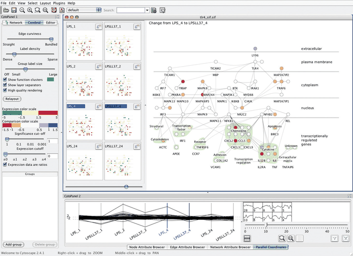
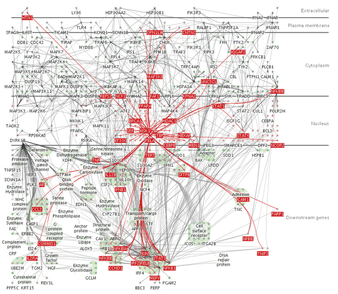

# 12.5.3 Dynamic Layers

## The choice

<!-- verbatim p.319 -->
> With dynamic layers, a layer with different salience than the rest of the view is constructed interactively, typically in response to user selection.
<!-- /verbatim -->

The number of possible layers can be huge, because they are constructed on the fly rather than chosen from a very small set that must be simultaneously distinguishable [p.319].

## Example: Cerebral

Cerebral, also shown in Figure 12.5, uses dynamic layering (Figure 12.17). A foreground layer updates constantly as the user moves the cursor: over a node, it shows the one-hop neighbourhood, every node a single topological hop away plus the links to them from the target node [p.319]. The neighbourhood is emphasised in a distinctive fully saturated red, against a background layer of only low-saturation colours, and foreground marks also have larger linewidth [p.319].

## Figures

-  **Figure 12.5** [p.300]. Cerebral uses small-multiple views to show the same base graph of gene interactions colored according to microarray measurements made at different times. The coloring in the main view uses the derived attribute of the difference in values between the two chosen views. From [Barsky et al. 08, Figure 2].
-  **Figure 12.17** [p.320]. Cerebral dynamically creates a foreground visual layer of all nodes one topological hop away in the network from the node underneath the cursor. From [Barsky et al. 07, Figure 1].

## Related

- [Cerebral](../../idioms/cerebral.md): the system's System box and its small-multiple views [p.319]
- [12.5.1 Visually Distinguishable Layers](s12-05-01-visually-distinguishable-layers.md): the few-layer limit that dynamic layers sidestep [p.319]
- [12.5.2 Static Layers](s12-05-02-static-layers.md): the alternative of a fixed set of layers shown at once [p.319]
- [11.4.2 Highlighting](../../ch11-manipulate-view/s11-04-select-elements/s11-04-02-highlighting.md): selection-driven highlighting, which dynamic layers build on [p.319]
