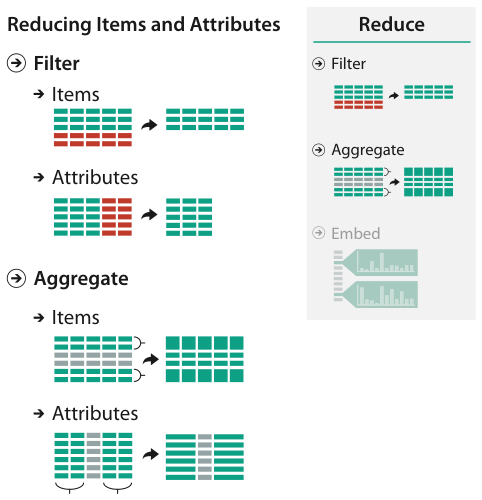

# 13.1 The Big Picture

## Scope

<!-- verbatim p.324 -->
> Figure 13.1 shows the set of design choices for reducing—or increasing—what is shown at once within a view. Filtering simply eliminates elements, whereas aggregation combines many together. Either choice can be applied to both items or attributes.
<!-- /verbatim -->

## The design choices in Figure 13.1

Figure 13.1 groups three choices under Reduce: Filter, Aggregate and Embed [p.323]. Embed is covered in Chapter 14, not here [p.324].

Its lower panel, "Reducing Items and Attributes", crosses the two choices this chapter covers with the two kinds of element they act on [p.323]:

- **Filter items** and **filter attributes**: Section 13.3 [pp.323-324].
- **Aggregate items** and **aggregate attributes**: Section 13.4 [pp.323-324].

## Figures

-  **Figure 13.1** [p.323]. Design choices for reducing (or increasing) the amount of data items and attributes to show.

## Related

- [13.2 Why Reduce?](s13-02-why-reduce.md): the trade-off between filtering and aggregation that these choices pose [p.324]
- [14 Embed: Focus+Context](../ch14-embed-focus-context/node.md): the third Reduce choice in Figure 13.1, covered in its own chapter [p.324]
