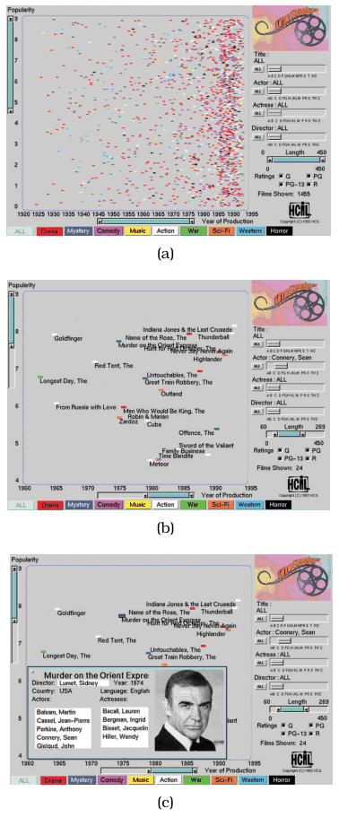
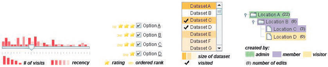

# 13.3.1 Item Filtering

## Filtering in general (Section 13.3 opening)

Filtering is a straightforward way to reduce the number of elements shown: some elements are simply eliminated [p.325]. It applies to both items and attributes [p.325]. A straightforward approach lets the user select one or more ranges of interest in one or more elements; the range might mean what to show or what to leave out [p.325].

<!-- verbatim p.325 -->
> The idea of filtering is very obvious; the challenge comes in designing a vis system where filtering can be used to effectively explore a dataset.
<!-- /verbatim -->

- **The naive design.** To filter items on a single quantitative attribute, a programmer could simply have the user type a minimum and a maximum [p.325]. From the user's point of view this is very difficult: they cannot know what numbers to type, or whether the choice was correct [p.325].
- **The principle.** When the goal is to support exploration of potentially unknown datasets, you cannot assume that users already know these answers [p.325].

### Dynamic queries

<!-- verbatim p.325 -->
> In an interactive vis context, filtering is often accomplished through dynamic queries, where there is a tightly coupled loop between visual encoding and interaction, so that the user can immediately see the results of the intervention.
<!-- /verbatim -->

A display showing a visual encoding of the dataset is used with controls that support direct interaction, so the display updates immediately when the user changes a setting [p.325]. The controls are often standard widgets such as sliders, buttons, comboboxes and text fields, and many extensions of off-the-shelf widgets have been proposed for vis [pp.325-326].

## Item filtering

<!-- verbatim p.326 -->
> In item filtering, the goal is to eliminate items based on their values with respect to specific attributes. Fewer items are shown, but the number of attributes shown does not change.
<!-- /verbatim -->

## Example: FilmFinder

- **Data and encoding.** A movie database table with nine value attributes (genre, year made, title, actors, actresses, directors, rating, popularity, length), shown as an interactive scatterplot of year made versus popularity with movies colour coded by genre [p.326].
- **Interaction.** Moving sliders and pressing buttons immediately filters out or adds back items [p.326]. When enough items have been filtered away, the marks are automatically enlarged and labelled [p.326].
- **Views.** Multiform overview–detail views: clicking a mark brings up a popup detail view about that movie [p.326].
- **Widgets.** A dual slider selects a minimum and maximum movie length; several alpha sliders are tuned for selecting text strings rather than numbers [p.326].

FilmFinder is a specific example of the general dynamic queries approach, where browsing with tightly coupled encoding and interaction is an alternative to searching by running queries, as with a database [p.326]. All items are shown at the start as an overview, and direct manipulation of widgets replaces reformulating queries [p.326]. The approach suits browsing, as opposed to a search where the user must formulate an explicit query that might return far too many items, or none [p.326].

## Scented widgets

Standard filtering widgets can be augmented by concisely encoding information about the dataset in the control panel itself, using no or minimal extra screen space, to create displays with high information density [p.328]. These are **scented widgets**, alluding to information scent: cues that help a searcher decide whether to drill down further into an information source or look elsewhere [p.328]. Figure 13.3 shows three ways to add information [p.328]:

- insert a concise statistical graphic, such as a bar or line chart [p.328];
- insert icons or text labels [p.328];
- treat part of the existing widget as a mark and encode more information into it with channels such as hue, saturation and opacity [p.328].

## Other filtering examples in the book

- **Improvise (Figure 12.7).** Its checkbox list view is a simple filter controlling which geographic features are shown [p.328].
- **Multiform microarray explorer (Figure 12.4).** Simple range sliders, plus range selection on top of line charts of time-series data; the selected range in the line chart acts as a filter for the scatterplot view [p.328].

## Figures

-  **Figure 13.2** [p.327]. FilmFinder features tightly coupled interactive filtering, where the result of moving sliders and pressing buttons is immediately reflected in the visual encoding. (a) Exploration begins with an overview of all movies in the dataset. (b) Moving the actor slider to select Sean Connery filters out most of the other movies, leaving enough room to draw labels. (c) Clicking on the mark representing a movie brings up a detail view. From [Ahlberg and Shneiderman 94, Color Plates 1, 2, and 3].
-  **Figure 13.3** [p.328]. The scented widget idiom adds visual encoding information directly to standard graphical widgets to make filtering possible with high information density displays. From [Willett et al. 07, Figure 2].

## Related

- [FilmFinder](../../idioms/filmfinder.md): the System box and card for the dynamic queries example [p.326]
- [13.3.2 Attribute Filtering](s13-03-02-attribute-filtering.md): filtering attributes instead of items, and combining the two [p.328]
- [13.2 Why Reduce?](../s13-02-why-reduce.md): the "out of sight, out of mind" cost of filtering [p.325]
- [Improvise](../../idioms/improvise.md): the census vis whose checkbox list acts as a filter [p.328]
- [Multiform Overview–Detail Microarrays](../../idioms/multiform-overview-detail-microarrays.md): range sliders and line-chart range selection as filters [p.328]
