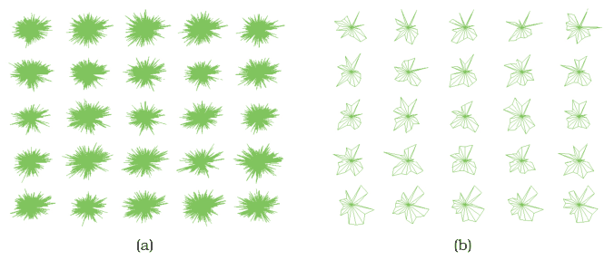

# 13.3.2 Attribute Filtering

## Definition

<!-- verbatim p.328 -->
> With attribute filtering, the goal is to eliminate attributes rather than items; that is, to show the same number of items, but fewer attributes for each item.
<!-- /verbatim -->

Item filtering and attribute filtering can be combined, showing both fewer items and fewer attributes [p.329]. Many idioms for attribute filtering and aggregation use the term **dimension** rather than attribute in their names [p.329].

## Example: DOSFA

- **Idiom.** The Dimensional Ordering, Spacing, and Filtering Approach (DOSFA) features attribute filtering, as its name suggests [p.329].
- **Dataset.** 215 attributes representing word counts and 298 points representing documents in a collection of medical abstracts [p.329].
- **Encoding.** DOSFA can be used with many visual encodings; Figure 13.4 shows it with star plots [p.329].
- **Result.** In Figure 13.4(a) the plot axes are so densely packed that little structure can be seen; in Figure 13.4(b), after ordering dimensions by similarity and filtering by both similarity and importance thresholds, the display shows clear visual patterns [p.329].

The book prints DOSFA's facets in a System box: data a table of many value attributes; encode star plots; facet small multiples with matrix alignment; reduce attribute filtering [p.329].

## Attribute filtering with attribute ordering

Attribute filtering is often used with attribute ordering, also called dimensional ordering [p.330]. If attributes can be ordered by a derived attribute that measures the similarity between them, all the high-scoring or low-scoring ones can easily be filtered out interactively [p.330].

<!-- verbatim p.330 -->
> A similarity measure for an attribute creates a quantitative or ordered value for each attribute based on all of the data item values for that attribute.
<!-- /verbatim -->

- **Variance.** One approach is to calculate the variance of an attribute: how similar to or different from each other its values are [p.330].
- **Many measures.** Some focus on global similarity, others search for partial matches [p.330].
- **Terminology.** A synonym for similarity measure is similarity metric; the book combines measure and metric for this discussion, though specialised contexts such as mathematics and business analysis distinguish them carefully [p.330].

## Figures

-  **Figure 13.4** [p.329]. The DOSFA idiom shown on star glyphs with a medical records dataset of 215 dimensions and 298 points. (a) The full dataset is so dense that patterns cannot be seen. (b) After ordering on similarity and filtering on both similarity and importance, the star glyphs show structure. From [Yang et al. 03a, Figures 3a and 3d].

## Related

- [DOSFA](../../idioms/dosfa.md): the System box and card for the attribute-filtering example [p.329]
- [7.6.3 Radial Layouts](../../ch07-arrange-tables/s07-06-spatial-axis-orientation/s07-06-03-radial-layouts.md): star plots, the encoding DOSFA is shown with [p.329]
- [13.3.1 Item Filtering](s13-03-01-item-filtering.md): filtering items rather than attributes; the two combine [p.329]
- [13.4.3 Attribute Aggregation: Dimensionality Reduction](../s13-04-aggregate/s13-04-03-attribute-aggregation-dimensionality-reduction.md): merging attributes rather than eliminating them, since aggregation also applies to attributes [p.330]
- [12.4.3 Matrix Alignments](../../ch12-facet-into-multiple-views/s12-04-partition-into-views/s12-04-03-matrix-alignments.md): the small multiples with matrix alignment that DOSFA's System box names [p.329]
