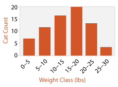
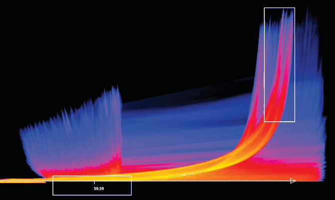
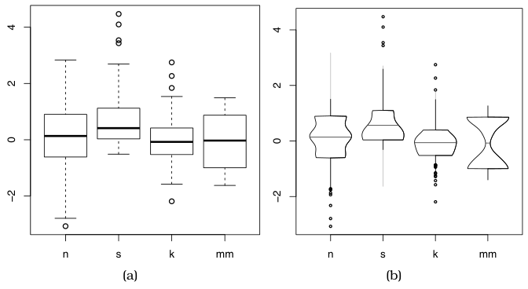
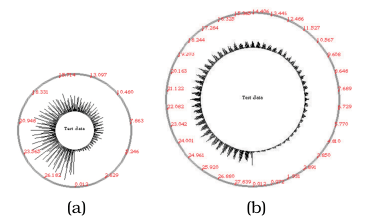
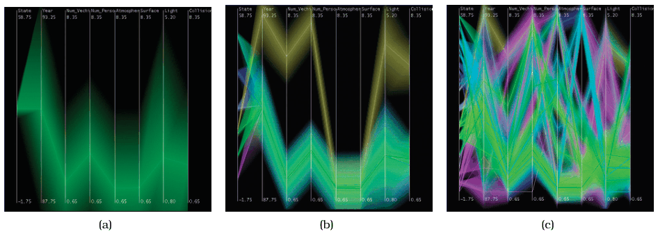

# 13.4.1 Item Aggregation

## Aggregation in general (Section 13.4 opening)

<!-- verbatim p.330 -->
> The other major reduction design choice is aggregation, so that a group of elements is represented by a new derived element that stands in for the entire group.
<!-- /verbatim -->

Aggregation merges elements, whereas filtering eliminates them completely; the two can be used together, and aggregation, like filtering, applies to both items and attributes [p.330]. Cartographic generalisation is an example of a complex combination of both [p.330].

- **Operators.** Aggregation typically involves a derived attribute. The simplest is the average; the four other basic operators are minimum, maximum, count and sum [p.330]. These simple operators alone are rarely an adequate solution [p.330].
- **The challenge.** The challenge is to avoid eliminating the interesting signals in the dataset while summarising it [p.330]. Anscombe's Quartet (Figure 1.3) illustrates exactly the difficulty of adequately summarising data, and so the limits of static encodings that use aggregation [p.330].
- **The strength.** Aggregation is nevertheless powerful, particularly in interactive idioms where the user can change the level of aggregation on the fly to inspect the dataset at different levels of detail [p.330].

The most straightforward use of item aggregation is within static idioms; its full power and flexibility come from interactive idioms where the view changes dynamically [p.330].

## Example: Histograms

- **What it shows.** The distribution of items within an original attribute; Figure 13.5 bins the weights of all the cats in a neighbourhood into 5-pound blocks [p.331].
- **Derived data.** The attribute's range is partitioned into bins, and the count of items in each bin is saved as a derived ordered attribute [p.331].
- **Encoding.** Very similar to bar charts: a line mark using spatial position in one direction, with bins along an axis in the other [p.331]. Histograms are sometimes drawn without space between bars to imply continuity; bar charts have spaces to imply discretisation [p.331].
- **Not a bar chart.** Despite the visual similarity, histograms are very different: they do not show the original table but a derived table more concise than the original dataset, making them an aggregation idiom [p.331].
- **Bin count.** The number of bins can be chosen independently of the number of items [p.331].

<!-- verbatim p.331 -->
> The choice of bin size is crucial and tricky: a histogram can look quite different depending on the discretization chosen.
<!-- /verbatim -->

One possible solution is to compute the number of bins from dataset characteristics; another is to let the user change the number of bins interactively and watch the histogram change [p.331].

## Example: Continuous Scatterplots

- **The problem.** Occlusion can be a major readability problem with scatterplots, because many dots can be overplotted on one location; size coding and text labels make it worse [p.332].
- **The solution.** Plot an aggregate value at each pixel instead of drawing every item as a point, using colour at each pixel to show the density of overplotting, often with transparency [p.332].
- **Derived data.** Conceptually this uses a derived attribute, overplot density, calculated after the layout; in practice many hardware acceleration techniques avoid computing it explicitly [p.332].
- **Figure 13.6.** A tornado air-flow dataset, with velocity magnitude horizontally and z-direction velocity vertically; density uses a log-scale sequential colormap with monotonically increasing luminance, from dark blues through reds to yellows and whites [p.332].
- **Origin.** Scatterplots began as an idiom for discrete, categorical data and were generalised to a framework of density functions for continuous data, giving continuous scatterplots in 2D and continuous histograms in 1D [pp.332-333].
- **Layout.** A dense, space-filling 2D matrix alignment where each pixel gets a different colour [p.333].

<!-- verbatim p.333 -->
> Although the idiom of continuous scatterplots has a similar name to the idiom of scatterplots, analysis via the framework of design choices shows that the approach is in fact very different.
<!-- /verbatim -->

## Example: Boxplot Charts

<!-- verbatim p.333 -->
> The visually concise idiom of boxplots shows an aggregate statistical summary of all the values that occur within the distribution of a single quantitative attribute.
<!-- /verbatim -->

- **Five derived variables.** The median (50% point), the lower and upper quartiles (25% and 75% points), and the upper and lower fences, chosen values near the extremes beyond which points count as outliers [p.333].
- **Glyph.** The box stretches between the quartiles with a horizontal line at the median; whiskers are vertical lines from the box to the fences, marked with horizontal lines; outliers beyond the fences are drawn as discrete dots, as in scatterplots or dot charts [p.333]. Boxplots are also known as box-and-whisker diagrams [p.333].
- **Versus bar charts.** Like a single bar, a boxplot uses only one spatial axis, but shows five numbers with a glyph rather than one number with a line mark [p.333]. A boxplot chart puts multiple boxplots in one frame to contrast attribute distributions, as bar charts show bars along the second axis; in Figure 13.7 the quantitative value is vertical and the categorical key horizontal [p.333].
- **Item reduction.** The boxplot can be considered an item reduction idiom giving an aggregate view of a distribution through derived data [p.333].
- **Scalability.** It aggregates an arbitrarily large set of values (thousands to millions) down to five numbers [p.334]. Those five need only moderate space along the central axis, because spatial position gives high acuity, and each boxplot needs very little space along the secondary axis, so a chart can hold roughly hundreds of categorical values [p.334].
- **What it reveals.** Spread (degree of dispersion) from the extent of the box, and skew relative to a normal distribution from the asymmetry between the top and bottom of the box [p.334].
- **Limit and variants.** Standard boxplots are designed for unimodal data [p.334]. Many variants add information; the vase plot (Figure 13.7(b)) varies the central box's width by density, allowing a visual check for multimodal distributions [p.334]. Variable-width variants need more space along the secondary axis, a classic cost–benefit trade-off where conveying more information requires more room [p.334].

## Dynamic aggregation

Many interesting uses of aggregation involve dynamically changing sets, where the mapping between items and the aggregated mark changes on the fly [p.335]. The simple case lets the user explicitly request aggregation and deaggregation of item sets; more sophisticated approaches do so automatically through higher-level interaction and navigation, usually based on spatial proximity [p.335].

## Example: SolarPlot

- **Idiom.** A radial histogram with an interactively controllable aggregation level [p.335].
- **Control.** The user directly manipulates the size of the base circle, the chart's radial axis; this indirectly changes the number of available bins, and so the aggregation level [p.335].
- **Operator.** Like all histograms, its aggregation operator is count: bar height is the number of items in the set [p.335].
- **Figure 13.8.** Ticket sales over 30 years, starting at the base of the circle and running counterclockwise [p.335]. The small, heavily aggregated circle (a) shows an increase in sales over the years; the larger, less aggregated circle (b) also shows seasonal patterns within each year [p.335].

## Hierarchical aggregation

<!-- verbatim p.336 -->
> The general design choice of hierarchical aggregation is to construct the derived data of a hierarchical clustering of items in the original dataset and allow the user to interactively control the level of detail to show based on this hierarchy.
<!-- /verbatim -->

Many idioms use variants of it; the cluster–calendar system in Figure 6.7 is one, and hierarchical parallel coordinates is another [p.336].

## Example: Hierarchical Parallel Coordinates

- **Goal.** Interactively controlled aggregation raises the scalability of basic parallel coordinates to hundreds of thousands of items [p.336].
- **Derived data.** A hierarchical clustering of the items, with per-cluster statistics: number of points, mean, minimum, maximum, and depth in the hierarchy [p.336].
- **Encoding.** Each cluster is a band of varying width and opacity, with the mean in the middle and width at each axis set by the cluster's minimum and maximum for that attribute; in the limit, a one-item cluster is a single line, as in the original idiom [pp.336-337]. Bands are coloured by proximity in the cluster hierarchy, so distant clusters get very different colours [p.337].
- **Control.** One slider sets the global level of detail; its parameter is a derived variable that varies the aggregate level of detail smoothly and continuously [p.337].
- **Figure 13.9.** Eight attributes and 230,000 items: (a) the single top-level cluster as very broad green bands; (b) several clusters, with the tan cluster distinguishable from the now-smaller green one; (c) dozens of clusters with tighter bands, where proximity-based colouring mitigates occlusion [p.337].

The book's box gives this idiom's scale as 10,000 to 100,000 items, while the text says hundreds of thousands and Figure 13.9 shows 230,000 items; the book does not reconcile these [pp.336-337].

## Figures

-  **Figure 13.5** [p.331]. The histogram idiom aggregates an arbitrary number of items into a concise representation of their distribution.
-  **Figure 13.6** [p.332]. The continuous scatterplot idiom uses color to show the density at each location, solving the problem of occlusion from overplotting and allowing scalability to large datasets. From [Bachthaler and Weiskopf 08, Figure 9].
-  **Figure 13.7** [p.334]. The boxplot is an idiom presenting summary statistics for the distribution of a quantitative attribute, using five derived values. These plots illustrate four kinds of distributions: normal (n), skewed (s), peaked (k), and multimodal (mm). (a) Standard box plots. (b) Vase plots, which use horizontal spatial position to show density directly. From [Wickham and Stryjewski 12, Figure 5].
-  **Figure 13.8** [p.336]. The SolarPlot circular histogram idiom provides indirect control of aggregation level by changing the circle size. (a) The small circle shows the increase in ticket sales over time. (b) Enlarging the circle shows seasonal patterns in addition to the gradual increase. From [Chuah 98, Figures 1 and 2].
-  **Figure 13.9** [p.337]. Hierarchical parallel coordinates provide multiple levels of detail. (a) The single top cluster has large extent. (b) When several clusters are shown, each has a smaller extent. (c) When many clusters are shown, the proximity-based coloring helps them remain distinguishable from each other. From [Fua et al. 99, Figure 4].

## Related

- [Histograms](../../idioms/histograms.md): the idiom box and card [p.331]
- [Continuous Scatterplots](../../idioms/continuous-scatterplots.md): the idiom box and card [p.333]
- [Boxplot Charts](../../idioms/boxplot-charts.md): the idiom box and card [p.335]
- [SolarPlot](../../idioms/solarplot.md): the idiom box and card [p.335]
- [Hierarchical Parallel Coordinates](../../idioms/hierarchical-parallel-coordinates.md): the idiom box and card [p.337]
- [8.3 Geometry](../../ch08-arrange-spatial-data/s08-03-geometry.md#s08.03.01): cartographic generalisation, a complex combination of aggregation and filtering [p.330]
- [1.6 Why Show the Data in Detail?](../../ch01-whats-vis-why/s01-06-why-show-data-detail.md): Anscombe's Quartet, the limits of summarising [p.330]
- [Cluster–Calendar Time-Series Vis](../../idioms/cluster-calendar-time-series-vis.md): another hierarchical aggregation example (Figure 6.7) [p.336]
- [Scatterplots](../../idioms/scatterplots.md): the discrete idiom continuous scatterplots aggregate to escape overplotting [p.332]
- [Bar Charts](../../idioms/bar-charts.md): visually similar to histograms and boxplot charts but showing the original table [pp.331-333]
- [Parallel Coordinates](../../idioms/parallel-coordinates.md): the base encoding hierarchical parallel coordinates scales up [p.336]
- [13.4.2 Spatial Aggregation](s13-04-02-spatial-aggregation.md): aggregation that must take the spatial nature of the data into account [p.338]
