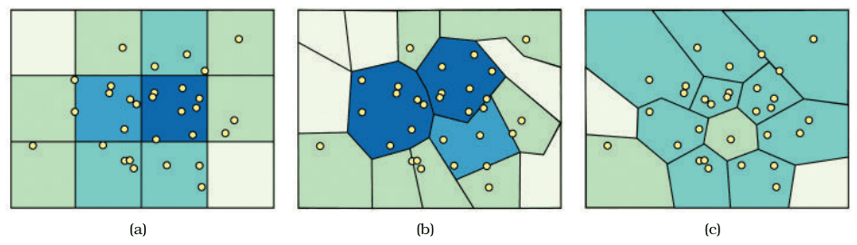
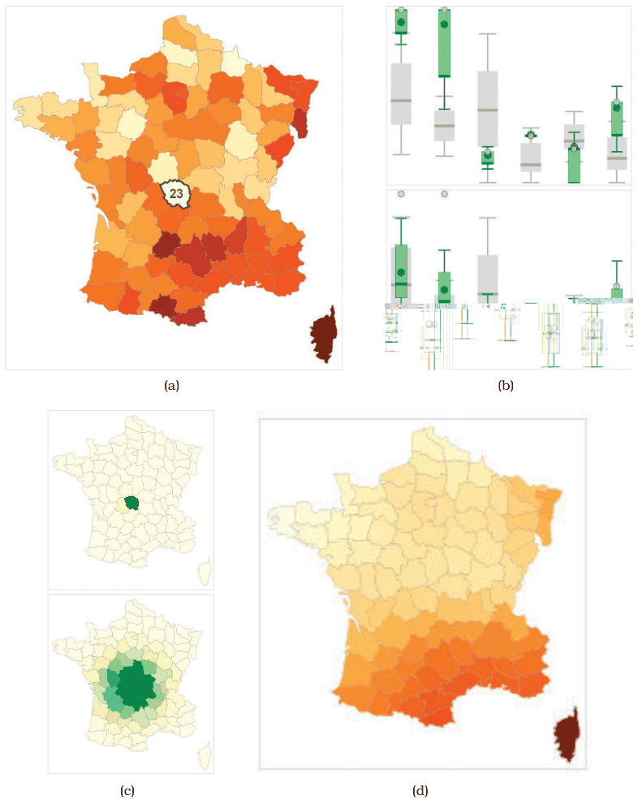

# 13.4.2 Spatial Aggregation

## The challenge and the MAUP

<!-- verbatim p.338 -->
> The challenge of spatial aggregation is to take the spatial nature of data into account correctly when aggregating it.
<!-- /verbatim -->

<!-- verbatim p.338 -->
> In the cartography literature, the modifiable areal unit problem (MAUP) is a major concern: changing the boundaries of the regions used to analyze data can yield dramatically different results.
<!-- /verbatim -->

- **Boundaries.** Even if the number and size of units stay the same, any change of spatial grouping can significantly change the analysis results [p.338]. In Figure 13.10 the same location near the middle of the map is high density in (a), medium in (b) and low in (c), depending on the region boundaries [p.338].
- **Scale.** Changing the scale of the units also changes the results [p.338].
- **Gerrymandering.** Manipulating voting-district boundaries for political gain is the instance of the MAUP best known to the general public [p.338].

## Example: Geographically Weighted Boxplots

The geowigs family (geographically weighted interactive graphics) supports spatial aggregation with geographically weighted regression and geographically weighted summary statistics [p.338].

- **Dataset (Figure 13.11).** A multivariate geographic dataset for exploring social issues in 19th-century France, with six quantitative attributes: population per crime against persons (x1), population per crime against property (x2), percentage who can read and write (x3), donations to the poor (x4), population per illegitimate birth (x5) and population per suicide (x6) [pp.338-340].
- **(a)** A standard choropleth map coloured by x1, with the interactively selected region Creuse (23) highlighted [p.340].
- **(b)** gw-boxplots for all six attributes at two scales. The gw-boxplot compares the global distribution with the currently chosen spatial scale through superimposed layers: the global distribution is a grey background boxplot, and the local statistics for the chosen scale are a green foreground boxplot [p.340].
- **(c)** Weighting maps for each gw-boxplot set's scale: very local on top, larger on the bottom [p.340].
- **(d)** A gw-mean map, a geographically weighted mean geowig, weighted by the same larger scale [p.340].

At the local level, x1 is clearly an outlier in the gw-boxplot, matching the region's pale colour on the choropleth map [p.340]. Weighted at a larger scale, its distribution is close to the global one in the boxplot, matching the mid-range colour in the gw-mean map [p.340].

## Figures

-  **Figure 13.10** [p.338]. Modifiable Areal Unit Problem (MAUP) example, showing how different boundaries for aggregation regions lead to very different visual patterns on choropleth maps. (a) Central region is high density. (b) Central region is medium density. (c) Central region is low density. From <http://www.e-education.psu.edu/geog486/l4> p7.html, Figure 4.cg.6.
-  **Figure 13.11** [p.339]. Geowigs are geographically weighted interactive graphics. (a) A choropleth map showing attribute x1. (b) The set of gw-boxplots for all six attributes at two scales. (c) Weighting maps showing the scales: local and larger. (d) A gw-mean map at the larger scale. From [Dykes and Brunsdon 07, Figures 7a and 2].

## Related

- [Geographically Weighted Boxplots](../../idioms/geographically-weighted-boxplots.md): the idiom box and card [p.340]
- [8.3 Geometry](../../ch08-arrange-spatial-data/s08-03-geometry.md#s08.03.01): choropleth maps, the encoding the MAUP distorts [p.340]
- [Choropleth Map](../../idioms/choropleth-map.md): the map type shown in Figures 13.10 and 13.11(a) [p.340]
- [13.4.1 Item Aggregation](s13-04-01-item-aggregation.md): boxplots, the encoding gw-boxplots extend [p.340]
- [Boxplot Charts](../../idioms/boxplot-charts.md): the non-spatial boxplot idiom [p.340]
- [12.5 Superimpose Layers](../../ch12-facet-into-multiple-views/s12-05-superimpose-layers/node.md): the facet choice gw-boxplots use for global versus local [p.340]
