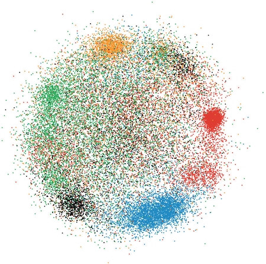
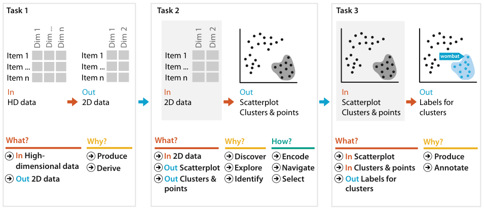

# 13.4.3 Attribute Aggregation: Dimensionality Reduction

## Attribute aggregation

Just as attributes can be filtered, they can be aggregated: a new attribute is synthesised to take the place of multiple original attributes [p.340]. A very simple approach groups attributes by a similarity measure and synthesises the new attribute as an average across the similar set [pp.340-341].

<!-- verbatim p.341 -->
> A more complex approach to aggregation is dimensionality reduction (DR), where the goal is to preserve the meaningful structure of a dataset while using fewer attributes to represent the items.
<!-- /verbatim -->

**Terminology.** Attribute aggregation, attribute synthesis and dimensionality reduction (DR) are synonyms [p.341]. DR is the common term in the literature; the book uses attribute aggregation to place the choice in its taxonomy, which is not typical usage [p.341]. Although DR might logically seem to include attribute filtering, it usually means attribute synthesis through aggregation [p.341].

## 13.4.3.1 Why and When to Use DR?

The rationale that a few new synthetic attributes can faithfully represent most of the structure or variance in a dataset hinges on an assumption: that there is hidden structure and significant redundancy in the original dataset, because the underlying latent variables could not be measured directly [p.341].

- **Nonlinear methods** are used when the new dimensions cannot be expressed as a straightforward combination of the original ones [p.341].
- **Multidimensional scaling (MDS)** has linear and nonlinear variants; its goal is to minimise the differences between distances in the high-dimensional space and in the new lower-dimensional space [p.341].

### Example: dimensionality reduction for document collections

- **When.** DR is frequently used to analyse large collections of text documents, from thousands to millions or more, where reading each is impractical [p.341]. Document collections are not directly visualisable but can be transformed into a derived high-dimensional table [p.341].
- **Bag of words.** The linear order of words is ignored and the uses of each word are counted, giving a feature vector over all words in the collection [p.341]. Very common words are typically removed, but vectors can still hold tens of thousands of words, and they are very sparse: most values are zero [p.341].
- **First derived table.** Documents are items and each word is a quantitative attribute holding its count in the document; looking directly at this table is not very interesting [p.342].
- **Second derived table.** DR derives a much smaller set of new attributes that still represents much of the structure: same items, just a few attributes [p.342]. So there are two stages of deriving data [p.342].
- **Suitable tasks.** Bag-of-words DR suits analysing the differential distribution of words between documents, or finding clusters of related documents by common word use [p.342]. The reduced data is typically shown as a scatterplot for cluster discovery: verifying a conjectured cluster structure or finding unknown structure [p.342].
- **Other media.** Images, videos and other multimedia are transformed into derived attributes in a similar spirit; a major question is how to derive features that represent an image compactly [p.342]. Text features are relatively easy because they are words, though natural language processing often merges synonyms and same-stem words; image features need more complex computation such as edge detection or colour sets; video processing can use temporal characteristics such as interframe coherence [p.342].

**A chained analysis (Figure 13.13).** The scenario is complex enough to break into a chained sequence of what–why–how instances [p.342]:

1. Derive a low-dimensional table from the high-dimensional one with MDS [p.342].
2. Encode the low-dimensional data as a scatterplot colour coded by a conjectured clustering; the user's discovery task is to verify whether there are visible clusters and identify those with semantic meaning given their documents [p.342]. Figure 13.12 uses the Glimmer MDS algorithm on a real document collection; the user navigates the scatterplot, and selecting a point shows document keywords in a popup and full text in another view [p.342].
3. Produce annotations by adding text labels to the verified clusters [p.342].

## 13.4.3.2 How to Show DR Data?

With standard DR techniques, the user chooses the number of synthetic attributes [p.344]. With two, the reduced data is most often shown as a scatterplot; with more than two, a scatterplot matrix (SPLOM) may be a good choice [p.344].

- **Not correlation.** Scatterplots are often used to check correlation between two attributes, but that is not the goal here: DR collapses correlated dimensions into new synthetic ones designed not to be correlated [p.344].
- **The tasks.** To verify or find whether items form meaningful clusters, and to verify or check whether the new synthetic attributes are meaningful [p.344].
- **Inspecting points.** For both, it is important to select a low-dimensional point and inspect the high-dimensional data it represents, checking whether the spatial layout properly reflects the high-dimensional space [p.344].
- **Colour.** Sometimes the scatterplot just encodes 2D position; often points are coloured by a conjectured categorisation, and the task is to check whether colour patterns match the spatial clusters, as in Figure 13.12 [p.344].

<!-- verbatim p.345 -->
> When you are interpreting dimensionally reduced scatterplots it is important to remember that only relative distances matter.
<!-- /verbatim -->

- **Absolute position is meaningless.** Most techniques create layouts whose meaning is unchanged by arbitrary rotation, mirror reflection across any line or rescaling; mathematically, the layouts are affine invariant [p.345].
- **Only large-scale structure.** Use the inspection only to find or verify large-scale cluster structure; fine-grained structure is not strongly reliable because some information is lost in the reduction [p.345]. Major differences in distances are meaningful; minor ones may not be a reliable signal [p.345].
- **Safest idioms.** Empirical studies show 2D scatterplots or SPLOMs are the safest choices for inspecting DR data [p.345].
- **Avoid 3D.** 3D scatterplots, though proposed many times, suffer all the problems of 3D representations and are the worst possible case for accurate depth perception, an abstract cloud of points floating in 3D space (Section 6.3) [p.345]. 3D landscapes for DR data are similarly problematic [p.345].

## Figures

-  **Figure 13.12** [p.343]. Dimensionality reduction of a large document collection using Glimmer for multidimensional scaling. The results are laid out in a single 2D scatterplot, allowing the user to verify that the conjectured clustering shown with color coding is partially supported by the spatial layout. From [Ingram et al. 09, Figure 8].
-  **Figure 13.13** [p.343]. A chained sequence of what–why–how analysis instances for the scenario of dimensionality reduction of document collection data.

## Related

- [Dimensionality Reduction for Document Collections](../../idioms/dimensionality-reduction-for-document-collections.md): the idiom box and card [p.344]
- [3.4.2 Produce](../../ch03-why-task-abstraction/s03-04-actions/s03-04-02-produce.md#s03.04.02.03): deriving new data, which both DR stages do [p.341]
- [6.3 No Unjustified 3D](../../ch06-rules-thumb/s06-03-no-unjustified-3d/node.md): why 3D scatterplots and landscapes of DR data are problematic [p.345]
- [Scatterplot Matrix (SPLOM)](../../idioms/scatterplot-matrix-splom.md): the choice for more than two synthetic attributes [p.344]
- [Scatterplots](../../idioms/scatterplots.md): the usual encoding for two synthetic attributes [p.344]
- [13.3.2 Attribute Filtering](../s13-03-filter/s13-03-02-attribute-filtering.md): eliminating attributes rather than synthesising them [p.340]
- [11.6 Navigate: Reducing Attributes](../../ch11-manipulate-view/s11-06-navigate-reducing-attributes.md): slicing, cutting and projecting, the navigation-based way to reduce attributes [p.340]
