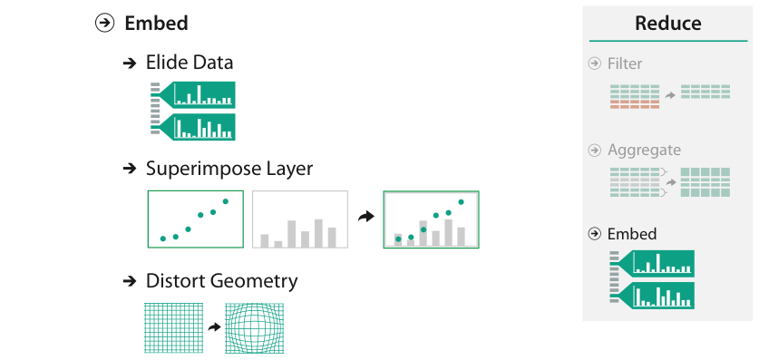

# 14.1 The Big Picture

## Scope

<!-- verbatim p.348 -->
> The family of idioms known as focus+context are based on the design choice to embed detailed information about a selected set—the focus—within a single view that also contains overview information about more of the data—the context.
<!-- /verbatim -->

These idioms reduce the amount of data to show through sophisticated combinations of filtering and aggregation [p.348]. The design considerations are complex enough that the framework treats embedding separately as a special case, and a very large family of specific focus+context idioms has been proposed [p.348].

## The three design choices

Figure 14.1 places Embed beside Filter and Aggregate under Reduce, with three choices beneath it: Elide Data, Superimpose Layer and Distort Geometry [p.347].

- **Elide.** Some items are filtered out completely, others are summarised by dynamic aggregation for context, and only the focus items are shown in detail [p.348].
- **Superimpose layers.** A local region of focus information can be moved against a background layer of context [p.348].
- **Distort geometry.** Context regions are compressed to make room for magnified focus regions [p.348].

All three involve a choice of single or multiple focus regions; geometric distortion adds choices of region shape, region extent and interaction metaphor [p.348].

## Names for focus+context

A margin note lists terms that are essentially synonyms for, or special cases of, focus+context [p.348]:

<!-- verbatim p.348 -->
> bifocal displays, degree-of-interest models, detail in context, distortion-oriented presentations, distortion viewing, elastic presentation spaces, fisheye lens, generalized fisheye views, hyperbolic geometry, multifocal displays, nonlinear magnification fields, pliable surfaces, polyfocal projections, rubber sheet navigation, and stretch and squish navigation.
<!-- /verbatim -->

## Figures

-  **Figure 14.1** [p.347]. Design choices for embedding focus information within context.

## Related

- [14.3 Elide](s14-03-elide.md): the first design choice in detail [p.348]
- [14.4 Superimpose](s14-04-superimpose.md): the second design choice [p.348]
- [14.5 Distort](s14-05-distort.md): the third design choice and its shape, extent and metaphor sub-choices [p.348]
- [13 Reduce Items and Attributes](../ch13-reduce-items-attributes/node.md): filter and aggregate, which embedding combines and which sit beside it under Reduce [pp.347-348]
